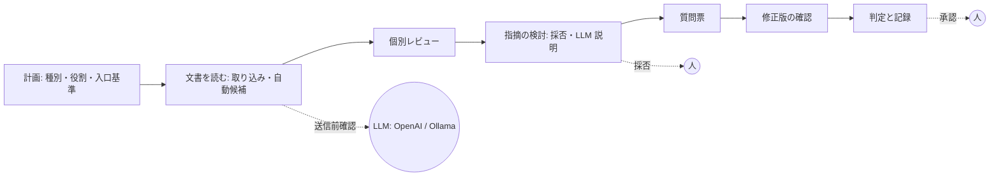

# WS2D-RA-006 要求分析書 System 06「ドキュメント検証（ドキュメントインスペクション）」

- 文書ID: WS2D-RA-006
- 版数: 0.2（合意前の草案） / 作成日: 2026-10-15 / 最終更新: 2026-10-15 / 承認者: 未承認（保守者が要件合意時に記入する）
- 準拠: REBOK（JISA, 2011）の工程区分を参考にした（要求獲得・要求分析。工程名・知識領域の正式名称は一次資料未確認のため準拠とは言わない）／ISO/IEC/IEEE 29148:2018（ステークホルダ要求の整理。条番号は原典未確認）
- 本書の位置づけ: なぜ商用化するか・誰のためか・何を対象にするかを合意するための文書。要件の仕様化は WS2D-RD-006 で行う

## 1. 文書概要

### 1.1 目的
既存の System 06「ドキュメント検証」（画面上の呼称は「レビュー」。内部名 docverify）を、第三者検証会社の QA が顧客に有償で提供できる商用水準に引き上げる。本書はそのための要求を獲得・分析した結果をまとめ、保守者（プロダクトオーナー）と合意する。

### 1.2 読者
- 保守者（プロダクトオーナー。要件合意と受け入れ判定を行う）
- 開発チーム（WS2D-RD-006 以降の設計・実装の入力にする）
- レビュアー（要求の網羅性・妥当性を確認する）

### 1.3 関連文書

| 文書番号 | 文書名 | 関係 |
|---|---|---|
| WS2D-RD-006 | 要件定義書 System 06 | 本書の下位。要件の仕様化 |
| WS2D-RD-001 | 要件定義書（全体） | 既存機能の要件。System 06 は本書群で詳細化 |
| WS2D-NF-001 | 非機能要件定義書 | 全体の非機能要件。System 06 固有分は RD-006 8 章 |
| WS2D-GL-001 | 用語集 | 共通用語 |
| 実装契約 | docs/process/docverify-contract.md（v1・v2 追補） | 現行機能の仕様。以下「契約」「契約 v2」 |
| 調査 00・A〜E5・D〜D3 | docs/research/docverify/（2026-10-15 実施） | 本書の根拠。以下「00 §4」「C §2」のように略す |
| 画面見本 | docs/design/docverify/home-v1.html | ホーム画面の案（承認待ち） |

### 1.4 既に決めたこと（決定。本書では蒸し返さない）

| No | 決定 | 出典 |
|---|---|---|
| D-1 | System 06 は既存の docverify を拡張する。新システムは起こさない。データ（1 レビュー＝1 JSON）と API は互換を保って拡張する | 契約、契約 v2 |
| D-2 | 検出は決定的な規則（辞書・パターン）で行い、LLM は説明と書き換え案の作成に使う二段構成にする | 00 §3・§6-2、B §4-3、E2 §5 |
| D-3 | 指摘の採否・レビューの承認は人が行う。AI・自動処理は承認欄を埋めない | 契約 v2（approval）、A §3 |
| D-4 | 製品が使う LLM は OpenAI とローカルの Ollama | 保守者方針（想定環境） |
| D-5 | 対象は PC ブラウザのみ（モバイル・タブレット非対応） | 保守者方針 |
| D-6 | 想定ユーザーはコードを書かない QA（文系・経験 4 年目・ISTQB FL）。選ぶだけで入力し、日本語 3 文で判断できること | 保守者方針 |
| D-7 | 網羅性（書かれていない要求）は検出できたと言わず、常に「未検証」と表示する。矛盾・重複は「確認候補」として出し、確定扱いにしない | 00 §3、B §5 |
| D-8 | 進める順は P1b（取り込み）→ P1c（スコア表示）→ P2（LLM）→ P3（矛盾・追跡）→ P4（工程管理）→ P5（精度公開） | 00 §6-3・改訂ロードマップ |
| D-9 | IPA ソフトウェア開発データ白書の値は「参考範囲」として出典付きで示し、合否基準にしない | C §7、E5 §4 |
| D-10 | 既にマージ済み: P1（29148 規則 4 種・品質スコアの算出。PR #242）、P1b（docx/xlsx 取り込みの改修。PR #247） | 00 改訂ロードマップ、git 履歴 |

## 2. ステークホルダー分析

| ステークホルダー | 関心 | 影響 | 獲得手段 |
|---|---|---|---|
| 第三者検証会社の QA（初級。主利用者） | 選ぶだけで指摘の仕分け・質問票・判定まで進められること。指摘の理由が日本語で読めること | 高 | 現行画面の操作、home-v1 見本のレビュー |
| QA リーダー（議長・承認者） | 工程・役割・入口出口基準が規格に沿って記録されること。指標で進み具合とレビューの十分さが分かること | 高 | C §9 のチェックリストとの突合 |
| 文書の作成者（顧客の設計者） | 指摘の根拠（原文・規則）が明確で、書き換え案があること。質問票で答えやすいこと | 中 | 質問票・報告 xlsx の見本 |
| 顧客 PM・情報システム部門 | 文書が外部に出る範囲・送信先・保持期間・学習利用の有無が説明できること | 高（購買判断） | E4 §3 のチェックリスト |
| テナント管理者 | LLM の送信先・観点プリセット・利用者の管理。テナント間の分離 | 中 | 既存のテナント管理機能 |
| 製品運用者（WebSpec2Doc 運用） | LLM 費用・障害時の縮退・ログ保存 | 中 | 既存の非機能要件定義書 |
| 競合比較を行う購買担当 | 精度・機能の比較材料（適合率・再現率の公開） | 中 | A §2・§4 |

## 3. ビジネス要求（BR-06-xx）

### 3.1 なぜ商用化するか
競合（QuintSpect・QVscribe・IBM RQA 等）が共通して持つ機能（品質の見える化・カスタム観点・矛盾検知・追跡と完全率）のうち、現行は品質スコアの算出（画面未表示）しか持たない（00 §1）。一方、競合で確認できなかった空白（精度の公開・実画面との突合・指摘ごとの根拠と記録・日本語の規格準拠・規格に沿った工程管理）のうち、実画面との突合と根拠付き指摘は既に持つ（00 §2）。追いつく部分を揃え、空白を差別化として固める。

| ID | ビジネス要求 | 区分 | 根拠 |
|---|---|---|---|
| BR-06-01 | 指摘ごとに規則 ID・ISO/IEC/IEEE 29148 の品質特性・原文引用を示し、判定を再現できる記録として残す | 差別化 | 00 §2-4・§2-5、A §4 |
| BR-06-02 | 文書の品質を特性別のスコアで見える化する | 追いつく | 00 §1、A §3 |
| BR-06-03 | 日本の設計書（docx・xlsx）を取りこぼさず読み、読めなかった範囲を利用者に示す | 前提 | E3 §2・§3 |
| BR-06-04 | 指摘の理由と書き換え案を LLM で示し、初級 QA でも直し方が分かるようにする。送信先は OpenAI とローカル LLM から選べる | 追いつく＋差別化 | 00 §4 P2、E4 §4 |
| BR-06-05 | 要求集合の矛盾・重複候補と、要件→設計→テストの追跡・完全率を示す | 追いつく | 00 §1、C §1、B §4-5・§4-6 |
| BR-06-06 | IEEE 1028／ISO/IEC 20246／ISTQB に沿ったレビュー工程（種別・役割・入口出口基準・指標）を管理し、記録を残す | 差別化 | 00 §2-6、C §9 |
| BR-06-07 | 検出の適合率・再現率を測定し、規則別に公開する | 差別化 | 00 §2-1、E1、E2 §5 |
| BR-06-08 | 顧客の文書を安全に扱い、送信先・学習利用・保持・削除・監査を説明できる | 前提（購買条件） | E4 §3 |
| BR-06-09 | コードを書かない QA が選ぶだけで最後まで進められる | 前提 | D-6 |
| BR-06-10 | 仕様書の文言と実画面（System 01 の巡回結果）の食い違いを示す | 差別化（現行） | 00 §2-2、契約 match.py |
| BR-06-11 | 組織・文書種別ごとの観点チェックリストを使い回せる | 追いつく | 00 §1、D3 §9 |

### 3.2 商用化の前提（差別化）
調査の範囲で確認できなかった（存在しないことの証明ではない）点を差別化の根拠にする（A §4、00 §2）。
- 空白 1: 検出精度（適合率・再現率・誤検知率）の公開
- 空白 2: 実画面・実挙動と仕様の突合（現行で保有）
- 空白 4: 指摘ごとの根拠（原文引用・規則 ID）と再現可能な判定記録（現行で一部保有）
- 空白 6: 規格に沿ったレビュー工程・役割・指標の管理
- ローカル LLM（Ollama）を選べること。ただし需要の大きさは未確認で、単独の主軸にはしない（E4 §4）

競合の効果数値・料金は使わない（A §5「引用してはいけない数値」）。

## 4. 業務フロー

### 4.1 現状（As-Is。現行の System 06）
1. レビューを作り、計画（期限・参加者・役割・観点チェックリスト・終了条件）を保存する
2. 文書（txt・md・docx・xlsx・pdf）を取り込むと、規則による自動候補が出る
3. 候補を採用・却下し、人の指摘を追加する
4. 要確認の指摘から質問票（CSV・xlsx）を出し、回答 CSV を取り込む
5. 修正版を取り込み、差分と指摘の引き継ぎを確認する。必要なら実画面と照合する
6. 終了条件（未対応の重大・主要の件数）を満たしたら閉じ、報告 xlsx を出す

問題点:
- 品質スコアは算出しているが画面に出ていない（00 改訂ロードマップ P1c）
- 指摘の理由・直し方は規則の定型文だけで、初級 QA が作成者に説明しにくい（00 §4 P2）
- 要求集合（矛盾・重複・追跡）を検査しない（C §1）
- 工程・役割・指標の管理が規格の要求（入口出口基準・兼務制約・検査速度・変更できない記録）に届かない（C §9）
- 精度を測っていない。顧客に検出の限界を説明できない（E1、E4 §3 精度開示）
- 送信先開示・送信前確認・監査ログ・精度と限界の明記が未実装（00 §6-4）

### 4.2 あるべき姿（To-Be）
- 計画: レビュー種別（IEEE 1028 の 5 種等）を選ぶと、必要な役割・入口出口基準・チェックリストの既定が決まる
- 取り込み: 文書順・表・図形・ヘッダー/フッターまで読み、読めなかった要素の件数を表示する
- 検出: 規則が候補を出し、各候補に規則 ID・特性・原文を付ける。LLM は送信前確認の後、理由と書き換え案を付ける
- 仕分け: 個別レビューは他者の指摘を見ずに行い、分析で採否を決める
- 集合の検査: 矛盾・重複は確認候補として出し、追跡表と完全率を出す。網羅性は「未検証」
- 判定: 出口基準と指標（指摘密度・検査速度。IPA 白書の参考範囲を併記）を示し、承認は人が記入する
- 記録: 参加者・日時・対象版のハッシュ・判定・指摘一覧を変更できない記録として残す
- 信頼: 規則別の適合率・再現率を製品内で公開する

## 5. ゴール分解（KAOS 風。ゴール木を箇条書きで表す。KAOS の記法は簡略化している）

- G0: 第三者検証の文書レビューを、顧客に説明できる根拠と記録付きで提供できる商用製品にする
  - G1: 指摘の質と説明力を上げる（BR-06-01・03・04・11）
    - SG1.1: 取りこぼさず読む → 取り込み改修、読めなかった要素の申告
    - SG1.2: 根拠付きで検出する → 規則 ID・特性・原文、規則の有効/無効
    - SG1.3: 直し方を示す → LLM の説明・書き換え案、揺れの検出
  - G2: 文書全体の品質を示す（BR-06-02・05）
    - SG2.1: スコアの表示 → 特性別・総合・推移
    - SG2.2: 集合の検査 → 矛盾・重複候補、追跡と完全率
  - G3: レビューを規格どおりに運営する（BR-06-06）
    - SG3.1: 工程・役割・基準 → 種別テンプレート、兼務制約、入口出口基準
    - SG3.2: 指標と記録 → 指摘密度・検査速度、変更できない記録
  - G4: 購買条件を満たす（BR-06-07・08）
    - SG4.1: 安全 → 送信先開示・送信前確認・伏せ字・監査ログ・保持と削除
    - SG4.2: 信頼 → 精度の測定と公開、限界の明記
  - G5: 初級 QA が使える（BR-06-09）
    - SG5.1: 選ぶだけの入力、日本語 3 文の説明、全状態の画面

## 6. ユースケース一覧（UC-06-xx）

| ID | 名称 | 主アクター | 事前条件 | 主系列 | 代替系列 |
|---|---|---|---|---|---|
| UC-06-01 | レビューを計画する | QA リーダー | ログイン済み | 新しいレビュー → 種別・参加者と役割・期限・チェックリスト・終了条件を選ぶ → 保存 | 兼務制約に反する割当は理由を示して保存しない |
| UC-06-02 | 文書を取り込む | QA | UC-06-01 完了 | 文書を選ぶ → 取り込み → 断片数・読めなかった要素の件数・自動候補を確認 | 上限超過・破損・暗号化は理由と次の行動を表示し、レビューは変えない |
| UC-06-03 | 個別レビューを行う | レビュアー | 文書取り込み済み・入口基準達成 | 原文を読み、候補を採用・却下し、人の指摘を加える → 個別レビューを終える | 他者の指摘は個別レビューを終えるまで見えない（設定で切替） |
| UC-06-04 | AI の説明と書き換え案を見る | QA | 指摘がある・LLM 設定済み | 指摘を選ぶ → 送信前確認（送信先・範囲）→ 承諾 → 説明と書き換え案を見る → 採用／不採用 | LLM が使えないときは規則の説明だけ表示し、作業は続けられる |
| UC-06-05 | 質問票を出し回答を取り込む | QA | 要確認の指摘がある | 質問票を CSV／xlsx で出す → 作成者が回答 → 回答を取り込む | 回答の無い行・不明な No. は反映せず件数で示す |
| UC-06-06 | 修正版を確認する | 議長 | 指摘が修正済み | 新しい版を取り込む → 差分・引き継がれた指摘を確認 → 修正を確認済みにする | 消えた断片の指摘は「修正済み」になり、議長が確認する |
| UC-06-07 | 実画面と照合する | QA | System 01 で巡回済み | 巡回済みサイトを選ぶ → 照合 → 食い違い候補を仕分ける | 未巡回なら System 01 での巡回を案内する |
| UC-06-08 | 矛盾・重複候補を確認する | QA | 文書取り込み済み | 集合の検査を実行 → 候補の組を見る → 矛盾／重複／問題なしを記録 | 候補 0 件でも網羅性は「未検証」と表示する |
| UC-06-09 | 追跡と完全率を確認する | QA リーダー | 要件・設計・テストの文書を登録済み | 追跡表を作る → 完全率と孤立項目を見る → xlsx に出す | ID を読み取れない文書は理由を示す |
| UC-06-10 | 判定し記録する | 承認者 | 出口基準の判定可能 | 判定結果・指標を確認 → 承認者名を記入 → 報告 xlsx を出す | 基準未達なら理由を示して閉じない |
| UC-06-11 | 指標を見る | QA リーダー | レビューがある | メトリクスで指摘密度・検査速度・修正完了率を IPA 参考範囲と並べて見る | ページ数が無い文書は密度を「算出できません」と表示 |
| UC-06-12 | 観点プリセットを管理する | QA リーダー | 管理画面に入れる | プリセットを選ぶ・複製・編集 → 保存 | 使用中のプリセットの削除は止める |
| UC-06-13 | LLM の送信先を設定する | テナント管理者 | 管理者権限 | 送信先（初期値は使わない／OpenAI／Ollama）を選ぶ → 送信先の所在・学習利用・保持の説明を確認 → 保存 | Ollama に接続できなければ保存前に理由を示す |
| UC-06-14 | 精度を確かめる | 購買担当・QA | 精度測定済み | 精度ページで規則別の適合率・再現率・n・測定日・限界を見る | 未測定の規則は「未測定」と表示 |

## 7. 対象範囲と対象外

| 区分 | 対象 | 対象外（本版） |
|---|---|---|
| 文書形式 | txt・md・docx・xlsx・pdf | doc・xls（旧形式）、ppt/pptx、画像のみの文書の文字認識（OCR）、Google ドキュメント等の直接連携 |
| 文書種別 | 要件定義書・基本設計書・画面設計書・テスト仕様書 | ソースコードのレビュー |
| 言語 | 日本語（主）、英語（精度測定の比較用） | その他の言語 |
| 検出 | 規則による検出、LLM による説明・書き換え案、矛盾・重複候補、追跡 | 網羅性の判定（常に「未検証」）、LLM 単独による指摘の確定 |
| レビュー工程 | 種別・役割・入口出口基準・指標・記録 | 機能安全規格（ISO 26262・IEC 61508・DO-178C）の独立性レベルの判定（C §6。原典確認が要るため） |
| 承認 | 人が承認者名を記入する欄と記録 | 電子署名・AI による承認 |
| 規格 | 規格に沿った機能と、適用範囲の宣言 | 規格の認証取得・「認証済み」と誤認させる表示（C §9-G） |
| 利用環境 | PC ブラウザ | モバイル・タブレット |
| 連携 | System 01 の巡回結果（実画面照合） | 外部の要求管理ツール（ALM）との連携 |
| 文書の修正 | 書き換え案の提示 | 元文書の自動書き換え・保存 |
| 共同作業 | 版番号による同時編集の競合防止 | 同時編集の画面への即時反映、多言語 UI、外部の版管理（Git 等）との連携 |

## 8. 前提・制約・リスク

### 8.1 前提
- 既存のマルチテナント・認証・LLM 層（OpenAI／Ollama）・System 01 の巡回結果を流用する
- 顧客から文書の提供を受けられる。顧客の同意の範囲で LLM に送る
- 日本語の注釈付き公開データセットは確認できなかった（E1）。日本語の精度測定は自社で注釈セットを作る

### 8.2 制約
- 技術: Docker を使わない（保守者方針）
- 法務: 個人情報を含む文書を外部 LLM に送る場合は利用目的と学習利用の有無の確認が求められる（E4 §2.3。個人情報保護委員会 2023/6 注意喚起。二次資料経由）
- 法務: 書籍（形式手法の本）の文章は CC BY-NC-SA 4.0。観点の構造だけを参照し、文面は自作する（D3 §9）
- 法務: ARTA データセットはライセンス未記載。商用の公開評価に使う前に著者確認が要る（E1）
- 規格: 29148・20246・1028 の正文は未入手で、条項名は二次資料に基づく（00 §5）

### 8.3 リスク

| リスク | 影響 | 対応 |
|---|---|---|
| 誤検出が多く利用者の信頼を失う | 解約 | 適合率と再現率を分けて測り公開。規則の有効/無効を選べる（E2 §5） |
| LLM の説明が誤る・揺れる | 誤った修正 | LLM は提案のみ、採否は人。揺れた箇所は質問票へ回す（B §5） |
| 顧客文書の外部送信による漏えい | 契約違反 | 送信先の選択・送信前確認・伏せ字・監査ログ・Ollama の選択肢（E4 §3） |
| 取り込み漏れが無言で起きる | 指摘の見落とし | 読めなかった要素の件数を表示（E3 §3） |
| IPA 白書の値を合否と誤解される | 誤った判断 | 参考範囲として出典・適用限界を併記し、合否に使わない（E5 §4） |
| 規格の条項を誤って引用する | 説明力の低下 | 「規格に沿った」と書き「準拠・認証」と書かない。条項は原典確認まで未確認と明記 |

## 9. 競合・類似ツールとの位置づけ

| 区分 | 代表 | 本システムが取り込む要素 | 出典 |
|---|---|---|---|
| 国内 | バルテス QuintSpect | 観点別スコア、複数文書の矛盾検知、改善提案 | A §1-1、E4 §2.7 |
| 海外 | QVscribe、IBM RQA、Visure、Jama Connect Advisor | 要件文ごとの弱語指摘、スコア、カスタム観点、採否は人 | A §1・§3 |
| 研究 | Smella、Paska、VERIMED 等 | 規則検出＋LLM 説明の二段構成、書式パターン、言い換えの揺れ | B §1・§4 |

位置づけ: 競合は品質の見える化と矛盾検知を持つが、精度の公開・実画面との突合・規格に沿った工程管理は確認できなかった（A §4）。System 06 は根拠と記録・実画面照合・工程管理・精度公開で差をつける。

## 10. 未決事項（保守者に決めてもらうこと）

| No | 問い | 推奨 | 決定 | 影響範囲 |
|---|---|---|---|---|
| Q-1（RD 要確認-1） | 外部 LLM（OpenAI）へ文書の本文を送ってよいか（指摘の断片のみか、前後の文脈も含むか） | 指摘のある断片と前後 1 断片まで。伏せ字の後に送る | 推奨で進行（2026-10-15 保守者の /goal 指示） | FR-06-112・113 |
| Q-2（RD 要確認-2） | LLM の既定の送信先（使わない／OpenAI／Ollama） | 「使わない」を既定にし、管理者が選ぶ | 推奨で進行（2026-10-15 保守者の /goal 指示） | FR-06-111 |
| Q-3（RD 要確認-3） | ホームの画面見本 home-v1 を承認するか | 承認を受けてから P1c に着手 | 推奨で進行（2026-10-15 保守者の /goal 指示） | RD-006 9 章 |
| Q-4（RD 要確認-4） | 優先度（MoSCoW）とリリース区分の割当 | RD-006 11 章の案 | 推奨で進行（2026-10-15 保守者の /goal 指示） | RD-006 全体 |
| Q-5（RD 要確認-5） | レビューデータ・監査ログの保持期間の既定 | 既定値は保守者が決め、契約値で上書き可 | 推奨で進行（2026-10-15 保守者の /goal 指示） | NFR-06-03 |
| Q-6（RD 要確認-6） | 保存時の暗号化を R1 で入れるか | 設置形態（Q-7）で決める | 推奨で進行（2026-10-15 保守者の /goal 指示） | NFR-06-06 |
| Q-7（RD 要確認-12） | 提供形態（SaaS／顧客環境への設置） | System 08 と同じく顧客環境／ローカル設置で開始 | 推奨で進行（2026-10-15 保守者の /goal 指示） | 8 章 非機能 |
| Q-8（RD 要確認-14） | 日本語の精度測定用の注釈セットを誰が作るか（2 名独立＋裁定） | 社内 QA 2 名で 300〜500 文から | 推奨で進行（2026-10-15 保守者の /goal 指示） | FR-06-171 |
| Q-9（RD 要確認-15） | 精度を製品外（Web サイト等）にも公開するか | 製品内の精度ページから始める | 推奨で進行（2026-10-15 保守者の /goal 指示） | FR-06-172 |

### 改訂履歴

| 版 | 日付 | 変更 | 出所 |
|---|---|---|---|
| 0.1 | 2026-10-15 | 初版 | — |
| 0.2 | 2026-10-15 | 終了条件の用語を「重大・主要」に統一、Q 番号に RD 要確認番号を併記し決定列を「推奨で進行」に更新、送信先の初期値「使わない」を UC-06-13 に明記、共同作業の範囲と対象外を 7 章に追加 | 点検結果 rd006_review.md No.6・24・27・28 |
