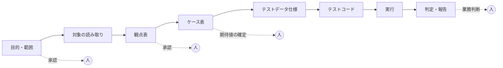

# WS2D-RA-008 要求分析書 System 08「バッチ・バックエンドのテスト」

- 文書ID: WS2D-RA-008
- 版数: 0.2（合意前の草案） / 作成日: 2026-10-15 / 最終更新: 2026-10-15 / 承認者: 未承認（保守者が要件合意時に記入する）
- 準拠: REBOK（JISA, 2011）の工程区分を参考にした（要求獲得・要求分析。工程名・知識領域の正式名称は一次資料未確認のため準拠とは言わない）／ISO/IEC/IEEE 29148:2018（ステークホルダ要求の整理。条番号は原典未確認）
- 本書の位置づけ: なぜ作るか・誰のためか・何を対象にするかを合意するための文書。要件の仕様化は WS2D-RD-008 で行う

## 1. 文書概要

- 改訂（0.2・2026-10-15）: 検証指摘（High 4・Medium・Low）反映、保守者決定の書き戻し

### 1.1 目的
第三者検証会社の QA が、バッチ処理・API・DB を含む結合（外部結合を含む）・システム・受け入れテストを AI エージェントに委任できる商用水準のシステムを、WebSpec2Doc の System 08 として追加する。本書はその要求を獲得・分析した結果をまとめ、保守者（プロダクトオーナー）と合意する。

### 1.2 読者
- 保守者（プロダクトオーナー。要件合意と受け入れ判定を行う）
- 開発チーム（WS2D-RD-008 以降の設計・実装の入力にする）
- レビュアー（要求の網羅性・妥当性を確認する）

### 1.3 関連文書

| 文書番号 | 文書名 | 関係 |
|---|---|---|
| WS2D-RD-008 | 要件定義書 System 08 | 本書の下位。要件の仕様化 |
| WS2D-RD-001 | 要件定義書（全体） | 既存機能の要件。System 08 は追加分 |
| WS2D-NF-001 | 非機能要件定義書 | 全体の非機能要件。System 08 固有分は RD-008 8 章 |
| WS2D-GL-001 | 用語集 | 共通用語 |
| 調査 1〜4 | 商用ツール／OSS／論文・標準／ベテラン QA の観点（2026-10-15 実施） | 本書の根拠。以下「調査1（商用）」「調査2（OSS）」「調査3（論文・標準）」「調査4（QA 実務）」と略す |

### 1.4 既に決めたこと（決定。本書では蒸し返さない）

| No | 決定 |
|---|---|
| D-1 | System 08 を新規追加し、System 07（バッチ・スクリプトのテスト）は残す。08 の対象種別は「バッチジョブ（DB・ファイル IF）／API（REST。gRPC は将来）／スクリプト（07 を取り込む）／ジョブネット（先行後続）」 |
| D-2 | テストレベルは ISTQB の結合（コンポーネント統合・システム統合＝外部結合）・システム・受け入れを明示的に扱う。選んだレベルで観点セットと期待値の決め方が変わる |
| D-3 | 期待値の決め方は 3 方式を一級市民にする: DB 前後比較（差分）／別経路計算（独立実装・SQL 再計算）／ゴールデンデータ（承認済み期待値）。未検証は未検証と表示する（不在は証明しない） |
| D-4 | 段階承認: 目的・範囲 → 対象の読み取り → 観点表 → ケース表 → テストデータ仕様 → テストコード → 実行 → 判定・報告。承認済みの段階は再生成で壊さない |
| D-5 | 生成コードの第一ターゲットは pytest。DB は PostgreSQL が最初、MySQL／Oracle／SQL Server／SQLite を順次 |
| D-6 | 実行は製品内のサンドボックスで行い、証跡（ログ・前後スナップショット・差分のテーブル）を案件に保存する |
| D-7 | 製品実行時の LLM は既存層（OpenAI／Ollama）。開発工程のモデルは要件にしない |
| D-8 | 想定ユーザーはコードを書かない QA（文系・経験 4 年目・ISTQB FL）とシニア QA の 2 層 |
| D-9 | 対象は PC ブラウザのみ |

## 2. ステークホルダー分析

| ステークホルダー | 関心 | 影響 | 獲得手段 |
|---|---|---|---|
| 第三者検証会社の QA（初級） | 選ぶだけで観点・ケース・データ・実行まで進められること。判断の根拠が日本語で読めること | 高（主利用者） | 既存 System 03 AutoRun の利用状況、本書の UC を使った操作検証 |
| 第三者検証会社の QA（シニア） | SQL・テストコードを直接直せること。観点の抜けが無いこと。期待値の根拠が追えること | 高（品質の最終責任） | 調査4 の観点表をレビューしてもらう。生成コードの読み合わせ |
| テストリード | 進捗・承認状況・未検証の件数が一目で分かること。工数の見通し | 高（導入判断） | 段階承認の履歴とレポートの見本で合意 |
| 顧客 PM | 納品物（テスト仕様書・エビデンス）が自社基準で受け取れること。顧客データが外に出ないこと | 高（契約・受け入れ） | 納品物の見本、データ取扱いの説明資料 |
| 顧客の開発者 | 不具合報告が再現可能であること（入力・手順・差分） | 中 | 報告書の見本 |
| テナント管理者 | 接続先・秘密情報・利用者権限の管理。テナント間の分離 | 中 | 既存のテナント管理機能の運用ヒアリング |
| 製品運用者（WebSpec2Doc 運用） | サンドボックスの資源・ログ保存・LLM 費用の管理 | 中 | 既存運用（非機能要件定義書）からの延長 |

## 3. ビジネス要求（BR-08-xx）

### 3.1 なぜ作るか
第三者検証のバッチ・バックエンド試験の工数は「設計（観点・ケース）」「データ準備」「実行と証跡取得」「判定と報告」に分かれる。System 07 は設計の一部（スクリプトからのケース表・テストコード生成）だけを扱い、DB・API・環境・実行・期待値の決め方を持たない。System 08 はこの 4 区分をすべて AI エージェントに委任し、人は合意（承認）と業務判断だけを行う構成にする。工数の削減率は**要計測**（出典なし。MVP の実データ試行で測る）。

| ID | ビジネス要求 | 削る工数区分 | 根拠 |
|---|---|---|---|
| BR-08-01 | 設計書・DDL・ジョブ定義・API 仕様からテスト観点とケースを導出し、観点の抜けを減らす | 設計 | 調査1 要約 4（観点・ケース導出は空白）、調査4 4 章（観点表のバッチ観点が粗い） |
| BR-08-02 | 境界・0 件・大量・文字コード・日付境界を含むテストデータを、マスキングを前提に生成する | データ準備 | 調査1 要約 5（データ生成と検証が別製品）、調査4 1.5 |
| BR-08-03 | テストを実行し、前後スナップショット・差分・ログを証跡として自動で残す | 実行・証跡 | 調査4 1.7（目視比較は証跡が残りにくい [S10]） |
| BR-08-04 | 機械判定できる期待値は自動確定し、業務判断を含む期待値は人が確定する。未検証を PASS に数えない | 判定 | 調査3 要約 3・A-4（オラクル問題） |
| BR-08-05 | 日本の検証現場の納品物（観点表・テスト仕様書・エビデンス・不具合一覧）の形で出力する | 報告 | 調査1 要約 6（日本の納品物形式への対応は確認できず） |
| BR-08-06 | コードを書かない QA は選ぶだけで最後まで進め、シニア QA は SQL・コードを直接直せる | 全区分 | 決定 D-8 |
| BR-08-07 | 顧客データ・接続先の秘密情報を安全に扱い、テナント間で分離する | 全区分（前提） | 調査4 3 章（本番由来データの取扱い [S16]）、既存のテナント分離 |
| BR-08-08 | バッチ固有の試験（再実行・中断復旧・業務日付・ジョブネット）を設計対象にする | 設計 | 調査1 要約 4・未確認事項（バッチ固有の試験設計は空白）、調査4 要約 1・3・5 |
| BR-08-09 | テストレベル（結合・外部結合・システム・受け入れ）ごとに観点と期待値方式を切り替える | 設計・判定 | 決定 D-2、調査3 C-4（ISTQB のテストレベル。原典未確認） |

### 3.2 商用化の前提（差別化）
調査1 の範囲で、次の 3 点を満たす商用品は確認できなかった（「存在しない」の証明ではない）。これを差別化の根拠にする。
- 空白 A: 設計書 → 観点 → ケース → データ → 実行 → 証跡の一気通貫（調査1 要約 5）
- 空白 B: ジョブネット起動・業務日付操作・再実行／中断復旧などバッチ固有の試験設計（調査1 要約 4）
- 空白 C: 日本の商用ツール・日本の納品物形式への出力（調査1 要約 6）

| 機能 | QuerySurge | iCEDQ | Tosca DI | DVO | SOAtest | ReadyAPI | mabl | System 08（計画） |
|---|---|---|---|---|---|---|---|---|
| DB 前後／表間比較 | ○ | ○ | ○ | ○ | △ | △ | － | ○（Must） |
| スキーマ／契約検証 | － | － | ○ | － | ○ | ○ | ○ | ○（Must: DDL、Should: OpenAPI） |
| テストデータ生成／マスク | － | － | － | － | ○ | ○（生成） | － | ○（Must） |
| ケース／観点の AI 生成 | ○（マッピング） | － | － | △（列一致） | ○ | ○（報道） | △ | ○（観点まで。Must） |
| 要件との追跡 | － | － | ○ | － | － | － | － | ○（Must） |
| 環境切替 | － | － | － | － | － | － | － | ○（Must） |
| バッチ固有の試験設計 | － | － | － | － | － | － | － | ○（Must: 再実行・日付） |

出典: 調査1 4 章（○＝公式／主張で記載あり、△＝限定的、－＝確認できず。「－」は機能が無いことの証明ではない）。QuerySurge は調査1 1-1（出典 URL は調査1 本文）、Tosca DI https://docs.tricentis.com/tosca-2026.1/en-us/content/data_integrity/di_intro.htm 、DVO https://docs.informatica.com/data-integration/powercenter/10-5/data-validation-option-user-guide/tests-for-table-pairs/tests-for-table-pairs-overview.html 、SOAtest https://www.parasoft.com/products/parasoft-soatest/ 、ReadyAPI https://support.smartbear.com/readyapi/docs/testing/data-driven/index.html 、mabl https://www.mabl.com/api-testing 、iCEDQ https://icedq.com/ 。ベンダーの効果数値（工数削減率・速度倍率）は調査1「引用してはいけない数値」に従い使わない。

## 4. 業務フロー

### 4.1 現状（As-Is）
第三者検証のバッチ・バックエンド試験は、おおむね次の順で人手で進むと想定する（手順 2〜5 は想定で未検証。目視比較だけは調査4 [S10] に記述がある。個別案件の実測も未確認）。
1. 顧客から設計書・IF 仕様・DDL を受け取り、シニア QA が観点表を書く
2. 観点からテスト仕様書（条件・手順・期待値）を書く。期待値は電卓・Excel で手計算する
3. テストデータを手で作るか本番データのコピーを加工する
4. 顧客の検証環境でバッチを起動し、前後の DB を SQL で抜いて Excel に貼る
5. 目視で比較して合否を付け、エビデンス（画面・SQL 結果）を納品物にまとめる

問題点:
- 観点の抜けがシニア QA の暗黙知に依存する。観点表のバッチ観点は「定時処理」程度に粗い例がある（調査4 [S19]）
- 期待値を実装と同じ式で複写する、または現行のバグを期待値にしてしまう（調査4 4 章 [S10][S19b]）
- 目視比較は合否基準が曖昧になり証跡が残りにくい（調査4 [S10]）
- 本番由来データの取扱いが契約・セキュリティ要件になる（調査4 [S16]）
- 再実行・中断復旧・業務日付など、バッチ固有の観点が後回しになりやすい（調査4 要約 1・3。頻度は未計測）

### 4.2 あるべき姿（To-Be）
AI エージェントが各段階の成果物を下書きし、人が段階ごとに承認する。承認済みの段階は後段の再生成で壊さない。
- 目的・範囲: 対象種別・テストレベル・環境を選ぶだけで、観点セットと期待値方式の既定が決まる
- 読み取り: 資料から事実（テーブル・列・ジョブの先行後続・API 操作）を抽出し、根拠行を示す
- 観点・ケース: 調査4 の観点カテゴリを網羅し、ISO/IEC/IEEE 29119-4 の技法名を付ける
- データ: 境界・0 件・大量・文字コード・NULL・日付境界のデータをマスキング前提で生成する
- 実行: サンドボックスから検証環境へ接続して実行し、前後スナップショットと差分を自動保存する
- 判定: 機械判定できる期待値は自動確定し、業務判断を含む期待値は人が確定する。未確定は「未判定」と表示する
- 報告: 観点表・テスト仕様書・エビデンス・不具合一覧を日本語の納品形式で出力する

## 5. ゴール分解（KAOS 風。ゴール木を箇条書きで表す。KAOS の記法は簡略化している）

- G0（ビジネスゴール）: 第三者検証のバッチ・バックエンド試験を AI エージェントに委任できる商用製品にする
  - G1: 設計工数を減らし観点の抜けを減らす（BR-08-01・08）
    - SG1.1: 資料から事実を根拠付きで抽出する → 機能候補: 資料取り込み、DDL・ジョブ定義・OpenAPI 解析
    - SG1.2: 観点カテゴリを網羅した観点表を作る → 機能候補: 観点生成（29119-4 技法付き）、観点カタログ
    - SG1.3: テストレベル別にケースを作る → 機能候補: レベル別ケース生成
  - G2: データ準備工数を減らす（BR-08-02・07）
    - SG2.1: 境界データを機械生成する → 機能候補: データ仕様・生成
    - SG2.2: 顧客データを安全に扱う → 機能候補: マスキング、接続先の秘匿
  - G3: 実行と証跡取得を自動化する（BR-08-03）
    - SG3.1: 検証環境で安全に実行する → 機能候補: サンドボックス実行、タイムアウト、キャンセル
    - SG3.2: 前後の DB を残す → 機能候補: スナップショット・差分
  - G4: 判定を客観化する（BR-08-04・09）
    - SG4.1: 機械判定できる期待値を自動確定する → 機能候補: 冪等性・件数・スキーマ・不変条件の自動判定
    - SG4.2: 業務の期待値を人が確定する → 機能候補: 別経路 SQL の承認、ゴールデン承認
  - G5: 納品できる形で出す（BR-08-05）
    - SG5.1: 日本の納品物形式 → 機能候補: Excel／Markdown 出力（Excel は想定・未検証。顧客様式へ差替え可）、不具合一覧
    - SG5.2: 誰が何を承認したか説明できる → 機能候補: 承認履歴・監査
  - G6: 2 層の利用者が使える（BR-08-06）
    - SG6.1: 初級は選ぶだけ → 機能候補: 採用／修正／破棄の選択 UI
    - SG6.2: シニアは直接編集 → 機能候補: SQL・コード編集

## 6. ユースケース一覧（UC-08-xx）

| ID | 名称 | 主アクター | 事前条件 | 主系列 | 代替系列 |
|---|---|---|---|---|---|
| UC-08-01 | 案件を作り対象・環境を登録する | QA | テナントにログイン済み | 案件作成 → 対象種別・テストレベルを選ぶ → 環境と接続先を登録 → 接続確認 | 接続確認に失敗したら原因と次の行動を表示し、登録は下書きで残す |
| UC-08-02 | 資料を取り込み事実を読み取る | QA | UC-08-01 完了 | 仕様書・DDL・ジョブ定義・OpenAPI・ソースを取り込む → 事実一覧と根拠行を確認 → 承認 | 解析できない資料は「読み取れなかった」と表示し、質問として残す |
| UC-08-03 | 観点表を作り承認する | QA | 読み取り承認済み | 観点表を生成 → 各観点を採用／修正／破棄 → 承認 | シニア QA が観点を追加する |
| UC-08-04 | ケース表を作り期待値方式を決める | QA | 観点表承認済み | ケース表を生成 → 期待値方式を確認 → 承認 | 期待値未確定のケースは「未判定予定」として残す |
| UC-08-05 | テストデータ仕様を承認しデータを作る | QA | ケース表承認済み | データ仕様を生成 → マスキング規則を確認 → 承認 → データ生成 | 本番由来データを使う場合はマスキング済みであることを確認してから進む |
| UC-08-06 | 業務の期待値を確定する | シニア QA | ケース表承認済み | 別経路 SQL の下書きを確認・修正 → ゴールデンデータを承認 | 業務担当者に確認が要る項目は質問一覧へ出す |
| UC-08-07 | テストコードを生成し確認する | シニア QA | データ仕様承認済み | pytest コードを生成 → 読む・直す → 承認 | 初級 QA は日本語の要約（RD FR-08-106）だけ確認して承認する。期待値の確定は含まない（シニア QA。RD FR-08-107） |
| UC-08-08 | テストを実行し証跡を得る | QA | コード承認済み・接続先が有効 | 実行 → 進捗を見る → 完了後に証跡を確認 | タイムアウト・キャンセル時は部分結果を残し、未実行分から再実行する |
| UC-08-09 | 判定し報告書を出力する | QA・テストリード | 実行完了 | 自動判定結果を確認 → 業務判断が要る差分を判定 → 不具合を記録 → 出力 | 未検証の項目は未検証のまま出力する |
| UC-08-10 | 承認履歴を監査する | テストリード・顧客 PM | 案件が存在 | 段階ごとの承認者・日時・差し戻し理由を見る | — |
| UC-08-11 | 接続先と利用権限を管理する | テナント管理者 | 管理者権限 | 接続先の登録・失効・権限付与 | — |
| UC-08-12 | System 07 の案件を取り込む | QA | 07 案件が存在 | 07 案件を選ぶ → 対象種別「スクリプト」として 08 案件に取り込む | 取り込めない項目は一覧で示す |
| UC-08-13 | 外部結合の手順書・チェックリストを作る | QA | 外部結合レベルを選択済み | 規約確認 → 疎通確認 → 業務通しの手順書とチェックリストを生成 | 相手先の合意事項が未入力なら質問として残す |
| UC-08-14 | LLM と外部送信範囲を設定する | テナント管理者 | 管理者権限 | テナントの LLM（OpenAI／Ollama）を選ぶ → 外部 LLM へ送る範囲（スキーマ・仕様のみ）を確認 → 保存 | データ値を扱う処理は Ollama に限られる旨を表示する |

## 7. 対象範囲と対象外

| 区分 | 対象 | 対象外（本版） |
|---|---|---|
| 対象種別 | バッチジョブ（DB・ファイル IF）、API（REST）、ジョブネット（先行後続）、スクリプト（System 07 取り込み） | gRPC（将来）、GUI 画面、帳票・BI レポートの検証（調査1 1-3 で要判断とされた領域） |
| テストレベル | コンポーネント統合、システム統合（外部結合）、システム、受け入れ（ISTQB CTFL 4.0 の区分。原典未確認） | コンポーネント（単体）テスト |
| DB | PostgreSQL（最初）、MySQL・Oracle・SQL Server・SQLite（順次） | 上記以外の DB、NoSQL |
| 生成コードの言語 | Python＋pytest | Java/JUnit・Hurl・SQL 系テスト（将来の追加ターゲット候補。調査2 6 章） |
| 環境 | 顧客の検証環境（ローカルの一時 DB は生成コード側の pytest-postgresql に限る。Q-4 決定） | 本番環境での書き込み・ジョブ起動（本番と判定した接続先は読み取り専用で扱う。RD FR-08-008） |
| ジョブ起動 | コマンド起動・REST 起動 | JP1/AJS3・A-AUTO・Control-M 等のジョブ管理製品との直接連携（調査2 3 章で公開事例未発見） |
| 利用環境 | PC ブラウザ | — |
| 非機能試験 | 性能・排他の観点の提示（期待値は人が決める） | 負荷試験の実行 |

## 8. 前提・制約・リスク

### 8.1 前提
- 検証環境（DB・API・ジョブ基盤）には、製品の実行場所からネットワークで到達できる（MVP は顧客環境／ローカル設置。Q-1 決定）
- 顧客から設計書・DDL 等の資料提供を受けられる。要件の質が低いと生成の再現率が下がることが示唆される（推論。調査3 A-3: 要件文書→高レベルテストの macro-recall がデータセットにより 0.81／0.37 と大差。n は未確認。https://arxiv.org/abs/2510.03641 ）
- 既存のマルチテナント・認証・LLM 層を流用する

### 8.2 制約
- 技術: コンテナ実行環境を前提にしない（保守者方針: Docker は有償のため使わない）。このため Testcontainers は使えない可能性がある（調査2 2 章）
- 技術: 業務日付は OS 時刻を変えずパラメータで与える。時刻固定の環境は本版では提供せず、注入できないジョブは実行不能と表示する（RD FR-08-087。調査2 3 章: OS 時刻の変更は他ジョブに副作用 https://itpfdoc.hitachi.co.jp/manuals/3021/30213D2530e/AJSJ0106.HTM ）
- 法務: 同梱する OSS のライセンス。ELv2（Soda Core v4）・BUSL-1.1（SDV）・AGPL（Qodo Cover）は同梱しない。LGPL（pytest-postgresql）は生成コード側の依存に限り製品に同梱しない（Q-4 決定）。LGPL の法務確認は未確認（調査2 要約 4）
- 法務: 顧客データ（個人情報を含みうる）の取扱いは契約で定める範囲に限る。外部 LLM へ送る範囲を制限する

### 8.3 リスク

| リスク | 影響 | 対応 |
|---|---|---|
| LLM が対象コードから期待値を学び、バグを正解として写す（オラクル問題） | 誤った PASS | 業務の期待値は人が確定。ソースを期待値の根拠にしない（調査3 A-4） |
| 生成テストのうち採用に至るものは一部に限られうる | 工数増 | 実行・採否の関門を通ったものだけ採用（調査3 A-2: TestGen-LLM の関門連鎖 https://arxiv.org/abs/2402.09171 。Meta の Kotlin（Android）環境の結果で一般化は未検証） |
| 顧客データの漏えい | 契約違反 | マスキング、接続先の秘匿、取り込み資料の秘密検出と伏せ字、外部 LLM への送信前検査と送信範囲の制限、テナント分離 |
| 検証環境の破壊（誤って本番・共有 DB を更新） | 顧客業務の停止 | 本番と判定した接続先は読み取り専用を強制（RD FR-08-008）、書き込み前に環境名・影響テーブルを示して確認（RD FR-08-009）、巻き戻し前に他者の更新との差分を確認（RD FR-08-055） |
| 観点の網羅性の根拠が技術ブログ中心で一次資料が薄い | 商用説明力の不足 | 実務通説の観点は「未検証」と明記。JaSST・IPA 資料の追加調査は未決（調査4 未確認事項） |
| ジョブ管理製品と連携できない | 顧客環境で実行できない | コマンド・REST のアダプタで抽象化し、製品連携は対象外と明記 |

## 9. 競合・類似ツールとの位置づけ

| 区分 | 代表 | 本システムが取り込む要素 | 出典 |
|---|---|---|---|
| ETL・データ検証 | QuerySurge、iCEDQ、Tosca DI、DVO、BiG EVAL、RightData | 仕様からの比較 SQL 生成と人の承認、比較の 3 族（集計・集合・値）、プレスクリーニング、要件 ID と結果の追跡、AI 提案の採用／修正／破棄 | 調査1 1 章・5 章 |
| API 試験 | SOAtest、ReadyAPI、Katalon、Postman、mabl | 外部結合の相手先のスタブ化、環境変数による環境切替、失敗の原因要約、OpenAPI 取り込み | 調査1 2 章・5 章 |
| テストデータ | Tonic、Delphix、DATPROF | 参照整合性を保つ合成データ、データの巻き戻し（再実行試験の前提） | 調査1 3 章 |
| 移行 | Astadia DataMatch | 旧バッチ出力を期待値にする現新比較 | 調査1 1-8 |
| OSS | pytest、Pandera、Schemathesis、Tavern、Faker 等 | 生成コードの部品。前後比較は該当 OSS が見つからず自前実装 | 調査2 6 章 |

位置づけ: 商用品は「比較の実行」か「API テストの生成」のどちらかに強く、設計（観点）からデータ・実行・証跡までをつなぐものは調査範囲で確認できなかった。System 08 は設計から判定までを AI エージェントがつなぎ、人は合意と業務判断だけを行う。ベンダーの効果数値は使わない（調査1 末尾）。

## 10. 未決事項と決定（保守者に決めてもらうこと）

| No | 問い | 推奨 | 決定 | 影響範囲 |
|---|---|---|---|---|
| Q-1 | 製品の提供形態（SaaS／顧客環境への設置）。検証 DB への到達性とライセンス（ELv2 等）の判断が変わる | MVP は顧客環境またはローカル設置で検証 | 顧客環境／ローカル設置（MVP）。SaaS は後続（決定: 2026-10-15 保守者） | RD-008 7 章・8 章 |
| Q-2 | 接続先の秘密情報を保存しないか、暗号化して保存するか | MVP は保存しない（実行のたびに入力） | 保存しない。実行のたびに入力（決定: 2026-10-15 保守者） | FR-08-004 |
| Q-3 | 外部 LLM（OpenAI）へ送ってよい範囲（スキーマ・仕様のみか、サンプルデータ値も含むか） | データ値は送らない。値が要る処理は Ollama に限る | スキーマ・仕様のみ。データ値は Ollama 限定（決定: 2026-10-15 保守者） | FR-08-146・NFR-08-12 |
| Q-4 | ローカル一時 DB に pytest-postgresql（LGPL）を使うか、顧客の検証 DB だけにするか | MVP は顧客の検証 DB＋pytest-postgresql を生成コード側の依存に限る | 顧客の検証 DB を使う。pytest-postgresql は生成コード側の依存に限る（製品に同梱しない。LGPL の法務確認は未確認）（決定: 2026-10-15 保守者） | FR-08-071 |
| Q-5 | ログ・証跡・承認履歴の保存期間 | 契約で決まる値を入力できるようにし、既定値は保守者が決める | 既定 90 日。案件ごとに契約値で上書き可（決定: 2026-10-15 保守者） | NFR-08-09 |
| Q-6 | 観点の網羅性を上げる追加調査（JaSST・IPA 一次資料）を実施するか | MVP 後に実施 | 未決 | 付録 観点カタログ |
