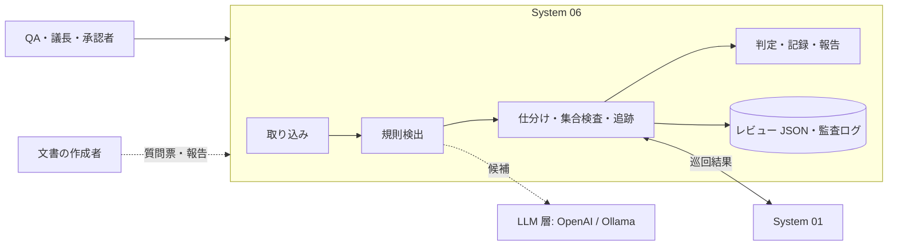

# WS2D-RD-006 要件定義書 System 06「ドキュメント検証（ドキュメントインスペクション）」

- 文書ID: WS2D-RD-006
- 版数: 0.2（合意前の草案） / 作成日: 2026-10-15 / 最終更新: 2026-10-15 / 承認者: 未承認（保守者が要件合意時に記入する）
- 準拠: REBOK（JISA, 2011）の工程区分を参考にした（要求仕様化。正式名称は一次資料未確認のため準拠とは言わない）／ISO/IEC/IEEE 29148:2018（SRS の構成と要求の品質特性を参考。条番号は原典未確認）／IEEE 1028-2008・ISO/IEC 20246:2017・ISTQB CTFL（レビュー種別・役割・工程。いずれも正文未入手、C §2・§4・§5 の二次資料に基づく）／ISO/IEC 25010（品質特性）／IPA 非機能要求グレード 2018（非機能の分類）
- 要件の機械可読ソース: 実装時に機能契約（所在は付録 B）へ登録し、本書の FR-06-xxx と対応させる。食い違いは保守者に提示し、承認後に本書を改版する（機能契約を正としない）
- 優先度は MoSCoW（Must／Should／Could／Won't）。「現行」はマージ済みの機能で、回帰させてはならない（優先度は Must と同等）。受入基準は Given/When/Then（G/W/T）または測定可能な条件
- 優先度とリリース区分は案であり、保守者の決定で確定する（13 章 要確認-4）

## 1. 文書概要

### 1.1 目的
System 06 の現行機能を棚卸しして要件 ID を付け、商用化のための追加の機能要件・AI 要求・データ要件・外部インタフェース要件・非機能要件・画面要件を定め、保守者と合意する。上位の要求（なぜ・誰のため）は WS2D-RA-006 に置く。

### 1.2 適用範囲
WebSpec2Doc の System 06「ドキュメント検証」（画面上の呼称「レビュー」、内部名 docverify）。画面 /docverify、API /api/docverify/*、処理 web/services/docverify/、取り込み web/vendor/reverse_doc/docs_ingest/readers.py。

### 1.3 読者
- 保守者（要件合意・受け入れ判定）
- 開発チーム（基本設計・実装の入力）
- レビュアー・検証担当（受入基準とトレーサビリティの確認）

### 1.4 関連文書

| 文書番号 | 文書名 | 関係 |
|---|---|---|
| WS2D-RA-006 | 要求分析書 System 06 | 本書の上位。BR・UC・決定 D-1〜D-10 の出典 |
| WS2D-RD-001 | 要件定義書（全体） | 体裁の基準 |
| WS2D-NF-001 | 非機能要件定義書 | 全体の非機能。本書 8 章は System 06 固有分 |
| WS2D-GL-001 | 用語集 | 共通用語。本書 12 章は追加分のみ |
| 実装契約 | docs/process/docverify-contract.md | 現行機能の仕様（「契約」「契約 v2」） |
| 調査 | docs/research/docverify/00・A〜E5・D〜D3 | 根拠欄の「C §2」等 |
| 画面見本 | docs/design/docverify/home-v1.html | ホーム（承認待ち） |

## 2. システム概要・コンテキスト

QA が文書を取り込むと、決定的な規則が指摘の候補を出し、人が採否を決める。LLM（OpenAI または Ollama）は送信前確認の後、候補の理由と書き換え案を付ける（D-2）。レビューは計画 → 文書を読む → 指摘の検討 → 質問票 → 修正版の確認 → 実画面との照合 → 判定と記録の工程で進み、承認は人が記入する（D-3）。

## 3. 中核原則: 検出と判断の分担

| 役割 | 担うもの | 担わないもの |
|---|---|---|
| 規則（決定的） | 候補の検出、規則 ID・特性・原文の付与、スコア・指標の計算 | 指摘の確定 |
| LLM | 候補の理由の説明、書き換え案、揺れの検出（Should） | 指摘の確定、重大度の決定、承認 |
| 人 | 採否、重大度、質問、修正の確認、承認 | — |

1. 指摘の確定（採用）は人だけが行う。LLM の出力は「AI の提案」と明示する（E4 §3 出力の扱い）
2. 網羅性は常に「未検証」と表示する。候補 0 件を「問題なし」と表示しない（D-7）
3. 承認欄（approver・decided_at）は人の入力だけで埋まる。自動処理は書き込まない（契約 v2）
4. 判定に使った規則の版・対象文書のハッシュを記録し、同じ入力で同じ候補が出ること（再現性。A §4）

## 4. 機能要件

### 4.1 レビューの作成と計画（現行）

| ID | 名称 | 説明 | 優先度 | 受入基準 | 根拠 |
|---|---|---|---|---|---|
| FR-06-001 | レビューの作成 | 名前と目的だけでレビューを作る | 現行 | G レビュー 0 件 W 名前と目的を入れて作成 T 一覧に表示され工程が「計画」 | 契約 API、UC-06-01 |
| FR-06-002 | 計画の保存 | 期限・参加者と役割（作成者・議長・レビュアー・承認者）・チェックリスト・終了条件を保存する | 現行 | G レビューがある W 参加者 2 名と期限を選んで保存 T 再表示で同じ値が出る | 契約 v2 PATCH、UC-06-01 |
| FR-06-003 | 工程の表示と前進 | 計画／個別レビュー／検討／手戻り／確認／終了の工程を画面上部に示し、前進できる。R4 以降は入口基準（FR-06-142）を満たす場合だけ前進する。R4 までは現行の挙動を保つ | 現行 | G 工程「計画」・入口基準を満たす（R4 以降） W 工程を進める T 上部の表示が「個別レビュー」になる | 契約 v2 phase |
| FR-06-004 | 個別レビューの終了 | 自分の個別レビューを終えたことを記録する | 現行 | G 自分がレビュアー W 個別レビューを終える T 参加者一覧で自分が「済」 | 契約 v2、UC-06-03 |
| FR-06-006 | 取り込み時の自動前進 | 初回の文書取り込みで工程を計画→個別レビューへ、状態を reviewing へ自動で進める。R4 以降はこの時も入口基準（FR-06-142）を判定し、未達なら前進せず理由を示す | 現行 | G 工程「計画」 W 初回の文書を取り込む T 工程が「個別レビュー」になる | doc_verify.py upload_document（P118-148） |
| FR-06-005 | ホームと一覧 | ホーム（自分の担当・進行中・件数）、自分の担当、レビュー一覧、全レビュー横断の指摘一覧（状態・重大度・レビューで絞り込み）を出す | 現行 | G 2 レビューに指摘がある W 指摘一覧を重大度「重大」で絞る T 両レビューの重大だけがレビュー名付きで出る | 契約 v2 API |

### 4.2 取り込み

| ID | 名称 | 説明 | 優先度 | 受入基準 | 根拠 |
|---|---|---|---|---|---|
| FR-06-010 | 対応形式と上限 | .txt .md .docx .xlsx .pdf を取り込む。上限は NFR-06-15 | 現行 | G 21MB の docx W 取り込む T 上限と次の行動が表示されレビューは変わらない | 契約 ingest.py |
| FR-06-011 | 暗号化 PDF | パスワードなしで開ける暗号化 PDF は解除して読み、開けないものは拒否する | 現行 | G パスワード付き PDF W 取り込む T 解除方法を案内する文が出る | 契約 ingest.py |
| FR-06-012 | docx の構造 | 文書内の順序、入れ子の表、結合セルの重複排除、テキストボックス、ヘッダー/フッター、図形内の文字を読む | 現行（P1b） | G 段落→表→段落の順で、入れ子表とテキストボックスとヘッダーを含む docx W 取り込む T 断片が文書順に並び、入れ子とボックスとヘッダーの文が出て、結合セルの文が 1 回だけ出る | E3 §2・§3、PR #247 |
| FR-06-013 | xlsx の構造 | 結合セル、図形内の文字、保存値の無い式（式の文字列で補う）を読む | 現行（P1b） | G 計算結果が保存されていない式と図形を含む xlsx W 取り込む T 式の文字列と図形の文が断片に出る | E3 §2、PR #247 |
| FR-06-014 | 取り込み失敗の案内 | 失敗は利用者向けの文と次の行動 1 行で示し、レビューを変えない | 現行 | G 破損した docx W 取り込む T 赤い帯に理由と次の行動が出て断片数が変わらない | 契約 IngestError |
| FR-06-015 | 読めなかった要素の申告 | 画像・コメント・非表示シート/列・読めなかった図形・文字の取れない PDF 頁の件数を取り込み結果に出す。無言で欠落させない。文字が 1 字も取れない PDF は失敗にする | Must | G 画像 3 点とセルコメント 2 件を含む xlsx W 取り込む T 結果に「画像 3・コメント 2 は読んでいません」と出る／G 一部の頁が画像だけの PDF W 取り込む T 「文字が取れない頁: 4 頁」と出る／G 全頁が画像だけの PDF W 取り込む T 失敗として扱い「文字の取れない PDF です。文字を含む PDF か docx で取り込んでください（画像からの文字認識には対応していません）」と出る | E3 §3（順位 6・7）、RA-006 7 章（OCR は対象外） |
| FR-06-016 | 表の行と見出しの対応 | 表の各行を列見出しと対で 1 断片にし、項目名・型・必須の関係を保つ | Should | G 見出し「項目名｜型｜必須」の表 W 取り込む T 1 行が「項目名: 氏名／型: 文字列／必須: ○」の 1 断片になる | E3 §3（順位 1） |
| FR-06-017 | 非表示要素の印 | 非表示シート・非表示列の断片に印を付け、検出対象に含めるかを選べる | Should | G 非表示シートを含む xlsx W 取り込む T 該当断片に「非表示」の印が付く | E3 §2 |
| FR-06-018 | 暗号化 docx/xlsx の判別 | 暗号化された docx/xlsx を破損と区別して案内する | Should | G パスワード付き xlsx W 取り込む T 「パスワードを外してから」の文が出て「破損」とは出ない | E3 §2 |

### 4.3 自動検出

| ID | 名称 | 説明 | 優先度 | 受入基準 | 根拠 |
|---|---|---|---|---|---|
| FR-06-020 | 曖昧語 | reverse_doc の曖昧語辞書で候補を出す（確度「要確認」） | 現行 | G 「適切に処理する」を含む文書 W 取り込む T 曖昧語の候補が 1 件出る | 契約 checks.py |
| FR-06-021 | Lint 5 規則 | REQ.AMBIGUOUS_TERM／MEASURABILITY／MULTIPLE_REQUIREMENTS／MISSING_UNIT／MISSING_SUBJECT を要求文に適用する | 現行 | G 「応答は速やかに返すこと」 W 取り込む T AMBIGUOUS_TERM と MEASURABILITY が出る | 契約 checks.py |
| FR-06-022 | 29148 規則 4 種 | REQ.INCOMPLETE（未決定記述）・OPEN_ENDED・UNIVERSAL・AND_OR を適用する | 現行（P1） | G 「詳細は別途定める」 W 取り込む T INCOMPLETE が重大度「主要」以上で出る | 契約追加規則、PR #242 |
| FR-06-023 | 指摘の属性 | 各候補に規則 ID・29148 の特性・観点・原文引用・場所・確度（事実／推定／要確認）を付ける | 現行 | G 候補がある W 詳細を開く T 規則 ID・特性・原文・場所が表示される | 00 §2-4、C §1 |
| FR-06-024 | 重複候補の統合 | 同じ断片・同じ語の候補は 1 件にまとめる | 現行 | G 同じ文に同じ曖昧語が 2 回 W 取り込む T 候補は 1 件 | 契約 checks.py |
| FR-06-025 | 規則の選択と組織語彙 | テナントごとに規則の有効/無効、禁止語・許容語を設定する | Should | G 規則 UNIVERSAL を無効 W 「必ず」を含む文書を取り込む T UNIVERSAL の候補が出ない | C §8 |
| FR-06-026 | 要求属性の欠落 | 要求に ID・優先度・根拠・検証方法の欄が無いことを候補にする（表形式の要求一覧が対象） | Should | G 「検証方法」列の無い要求一覧 W 取り込む T 「検証方法がありません」の候補が出る | C §1 |
| FR-06-027 | 用語ゆれ | テナントの同義語辞書（社内語⇔標準語）で表記ゆれを候補にする | Should | G 辞書に「顧客＝お客様」 W 両方を含む文書 T 用語ゆれ候補が出る | D3 §3・§9 |
| FR-06-028 | 書式パターン | EARS 型の書式から外れた要求文を候補にし、書き換えの型を示す | Could | G 条件と応答の無い要求文 W 取り込む T 型と例が付いた候補が出る | B §4-2 |

### 4.4 指摘の仕分け

| ID | 名称 | 説明 | 優先度 | 受入基準 | 根拠 |
|---|---|---|---|---|---|
| FR-06-030 | 採用・却下 | 候補の行の「採用」「却下」だけで仕分ける | 現行 | G 候補 1 件 W 採用 T 状態が「採用」になり件数が更新される | 契約 画面 |
| FR-06-031 | 人の指摘の追加 | 断片を選び、重大度と観点を選択、文 1 行で指摘を加える | 現行 | G 断片 P3 を選択 W 重大度「主要」で追加 T origin 人・状態採用で一覧に出る | 契約 API |
| FR-06-032 | 指摘の更新 | 重大度・チェック項目・対応結果・状態を更新する | 現行 | G 採用済み指摘 W 対応結果を入れ状態を「修正済み」 T 保存され一覧に反映 | 契約 v2 |
| FR-06-033 | 根拠原文の表示 | 選んだ指摘の原文と場所を右側に表示する | 現行 | G 指摘を選ぶ W — T 原文の該当語が強調され場所が出る | 契約 画面 |
| FR-06-034 | 個別レビューの独立 | 個別レビュー中は他者の指摘を見せない（レビューごとに切替） | Should | G 設定オン・B さんが指摘済み W A さんが個別レビュー中に一覧を見る T B さんの指摘が出ない／個別レビューを終えると出る | C §5・§9-B |
| FR-06-035 | 指摘の種別 | 欠落・誤り・曖昧・矛盾・規約違反を選択式で付ける | Should | G 指摘 W 種別「欠落」を選ぶ T 一覧と報告に種別が出る | C §5・§9-C |

### 4.5 質問票

| ID | 名称 | 説明 | 優先度 | 受入基準 | 根拠 |
|---|---|---|---|---|---|
| FR-06-040 | 質問票の作成 | 確度「要確認」で却下以外の指摘から質問を作る | 現行 | G 要確認 3 件・うち却下 1 件 W 質問票を開く T 2 行出る | 契約 questions.py |
| FR-06-041 | 質問票の出力 | CSV（UTF-8 BOM、先頭が = + - @ の値は ' を前置）と xlsx で出す | 現行 | G 「=SUM」で始まる質問 W CSV 出力 T 値が「'=SUM」で始まる | 契約 questions.py |
| FR-06-042 | 回答の取り込み（CSV） | No. と回答の列を取り込み、回答のある指摘を確度「事実」にする | 現行 | G 2 行に回答 W 取り込む T 「2 件反映」と出て確度が事実 | 契約 questions.py |
| FR-06-043 | 回答の取り込み（xlsx） | 出力した xlsx に回答を書いたものを取り込む | Should | G 回答入りの xlsx W 取り込む T CSV と同じ件数が反映される | 現行は CSV のみ（契約） |
| FR-06-044 | 反映できない行の表示 | 不明な No.・空の回答は反映せず件数と行番号を示す | Should | G 存在しない No. を含む CSV W 取り込む T 「反映できない行: 5 行目」と出る | UC-06-05 |

### 4.6 改版比較と指摘の引き継ぎ

| ID | 名称 | 説明 | 優先度 | 受入基準 | 根拠 |
|---|---|---|---|---|---|
| FR-06-050 | 版の差分 | 新しい版の取り込みで追加・削除・変更の件数と一覧を出す | 現行 | G 版 1 W 1 文を変えた版 2 を取り込む T 変更 1 件と出る | 契約 diff.py |
| FR-06-051 | 指摘の引き継ぎ | 消えた断片の採用済み指摘を「修正済み」にし、残る断片の指摘は引き継ぐ | 現行 | G 採用済み指摘のある文を削った版 2 W 取り込む T その指摘が「修正済み」 | 契約 diff.py |
| FR-06-052 | 新しい断片だけの検出 | 2 回目以降は新しい断片だけに候補を出す | 現行 | G 版 1 で却下した候補 W 同じ文のまま版 2 T 同じ候補は再度出ない | 契約 API |
| FR-06-053 | 修正の確認 | 議長が「修正済み」を「確認済み」にする | 現行 | G 修正済み 1 件 W 修正版の確認で確認済みにする T 状態が確認済み | 契約 status、C §3 |
| FR-06-054 | 承認後の変更検知 | 承認後に新しい版が取り込まれたら承認を「失効」と示し、再レビューを求める | Should | G 承認済み W 版 2 を取り込む T 判定画面に「承認後に文書が変わりました」と出る | C §9-F |

### 4.7 実画面との照合（現行）

| ID | 名称 | 説明 | 優先度 | 受入基準 | 根拠 |
|---|---|---|---|---|---|
| FR-06-060 | 巡回済みサイトの選択 | System 01 で巡回済みのサイトを選択肢に出す | 現行 | G 巡回済み 2 サイト W 照合を開く T 2 件が選べる | 契約 match.py |
| FR-06-061 | 文言の照合 | 文書の「」内の語を画面のボタン・入力項目・見出しと照合し、一致しないものを候補（推定）にする | 現行 | G 文書に「送信」・画面に「登録」だけ W 照合 T 「送信」が食い違い候補で出る | 00 §2-2 |
| FR-06-062 | 未巡回の案内 | 未巡回なら System 01 での巡回を案内する | 現行 | G 巡回 0 件 W 照合を開く T 「まず System 01 で対象サイトを巡回してください」 | 契約 画面 |

### 4.8 終了判定・承認・報告

| ID | 名称 | 説明 | 優先度 | 受入基準 | 根拠 |
|---|---|---|---|---|---|
| FR-06-070 | 終了条件の判定 | 未対応の重大・主要の件数が終了条件以内かを判定し理由を示す | 現行 | G 重大 1 件未対応・条件 0 W 判定を開く T 未達と理由 1 行 | 契約 metrics.py |
| FR-06-071 | 未達では閉じない | 未達の終了は理由を示して拒む | 現行 | G 未達 W 「検査を終える」 T 終わらず理由が出る | 契約 close 409 |
| FR-06-072 | 承認欄 | 承認者名と日時は人が入力して保存する。自動では埋めない | 現行 | G 判定可能 W 承認者名を入れて保存 T 名前と日時が残る／AC-06-06 の操作の後も空欄のまま | 契約 v2 approval、D-3 |
| FR-06-073 | 報告 xlsx | 指摘一覧と集計（品質スコアを含む）の 2 シートで出す | 現行 | G 指摘 5 件 W 報告を出す T 2 シートで 5 行と集計が入る | 契約 metrics.py |
| FR-06-074 | レビュー記録の項目 | 種別・参加者と役割・各工程の日時・所要時間・対象版とハッシュ・判定（承認／条件付き承認／再レビュー）を報告に含める | Should | G 終了したレビュー W 報告を出す T 列挙した項目がすべて入る | C §2・§9-F |
| FR-06-075 | 適用範囲の欄 | 報告に「検査した範囲」「検査していないこと（網羅性・意味の正しさ）」を入れる | Must | G 報告を出す W — T 「検査していないこと」の欄があり網羅性が「未検証」 | D3 §3（C.1.1）、D-7 |
| FR-06-077 | レビューの削除 | 作成者・議長・テナント管理者がレビューを削除する。確認モーダル（SCR-06-25）を経て、JSON・取り込みファイル・AI 提案を消し、監査ログに残す | Must | G レビュー 1 件 W 削除して確認で「削除する」 T 一覧から消え、保存先にファイルが残らず、監査ログに 1 行 | E4 §3 保持・削除権、NFR-06-03 |
| FR-06-078 | テナントの消去 | テナント管理者が解約時にテナントの全レビュー・設定・送信記録を消す。名前の再入力で確認する | Must | G レビュー 3 件のテナント W テナント名を入れて消去 T 3 件と設定が消え、他テナントは変わらない | E4 §3 削除権 |
| FR-06-076 | 規格の扱いの表示 | 採用した規格・版・適用範囲を示し、「認証済み」と書かない | Should | G 報告と画面 W 「認証済み」「規格に準拠」の語で検索 T 断定表現が 0 件 | C §9-G |

### 4.9 メトリクスと品質スコア（現行）

| ID | 名称 | 説明 | 優先度 | 受入基準 | 根拠 |
|---|---|---|---|---|---|
| FR-06-080 | 横断メトリクス | レビュー別・観点別・重大度別の件数、断片あたり指摘密度、修正完了率を出す | 現行 | G 2 レビュー W メトリクスを開く T 件数と密度と完了率が出る | 契約 v2 metrics |
| FR-06-081 | 品質スコアの算出 | 29148 特性別と総合のスコア（100 ×（1 − 未解決の指摘がある断片数 ÷ 断片数））を算出する。断片 0 件は算出しない | 現行（P1） | G 10 断片中 2 断片に未解決 W 算出 T 80／G 断片 0 W 算出 T 値なし | 契約 quality() |

### 4.10 観点チェックリストと設定（現行）

| ID | 名称 | 説明 | 優先度 | 受入基準 | 根拠 |
|---|---|---|---|---|---|
| FR-06-090 | チェックリストの管理 | チェックリストの一覧・項目の追加・編集・保存 | 現行 | G 項目 7 つ W 1 つ追加して保存 T 8 つで再表示 | 契約 v2 |
| FR-06-091 | 初期チェックリスト | 「要求仕様書（29148 の品質特性）」を初期値に持つ | 現行 | G 新しいテナント W 一覧を開く T 初期の 1 件がある | 契約 v2 |
| FR-06-092 | 設定 | 重大度・種別・終了条件の既定・利用者名を設定する | 現行 | G 終了条件の既定を主要 3 W 新しいレビュー T 終了条件が主要 3 | 契約 v2 settings |
| FR-06-093 | チェック状況 | レビューでチェック項目ごとの確認済みを記録する | 現行 | G 項目 7 W 3 つ確認 T 3/7 と表示 | 契約 v2 checks |

### 4.11 品質スコアの画面表示（追加・P1c）

| ID | 名称 | 説明 | 優先度 | 受入基準 | 根拠 |
|---|---|---|---|---|---|
| FR-06-100 | レビュー内のスコア | 判定画面と文書を読む画面に総合と特性別のスコアを出す | Must | G 10 断片中 2 に未解決 W 判定を開く T 総合 80 と特性別の値が出る | 00 P1c、A §3 |
| FR-06-101 | ホームのスコア | ホームに進行中レビューの平均と特性別の値を出す | Should | G 進行中 2 件（80・60） W ホーム T 平均 70 | home-v1 |
| FR-06-102 | 算出できない場合 | 断片 0 件・未取り込みは「—」と「文書を取り込むと表示されます」を出し、0 と表示しない | Must | G 未取り込み W 判定を開く T 「—」と案内 1 行 | 契約 quality() |
| FR-06-103 | 計算式と限界の表示 | スコアの意味（未解決の指摘がある断片の割合）と「内容の正しさは示さない」を 3 文以内で示す | Must | G スコアの説明を開く W — T 計算式と限界が 3 文以内で出る | E4 §3 精度開示 |
| FR-06-104 | 版ごとの推移 | 版ごとのスコアを並べて示す | Should | G 版 1 で 60・版 2 で 80 W 判定 T 2 版の値が並ぶ | home-v1 |

### 4.12 LLM 二段構成（追加・P2）

| ID | 名称 | 説明 | 優先度 | 受入基準 | 根拠 |
|---|---|---|---|---|---|
| FR-06-110 | 説明と書き換え案 | 規則の候補を入力に、LLM が理由（3 文以内）と書き換え案を作る。新しい指摘は確定しない | Must | G 曖昧語の候補 W 「AI の説明を見る」 T 理由と書き換え案が出て、指摘の状態は変わらない | B §4-3、E2 §5、D-2 |
| FR-06-111 | 送信先の選択 | テナント管理者が「使わない／OpenAI／Ollama」を選ぶ。初期値は「使わない」。Ollama はモデル名と接続先（NFR-06-23）を選び、保存前に接続を確かめる | Must | G 新しいテナント W 設定を開く T 送信先が「使わない」／G 送信先「Ollama」 W 説明を作る T Ollama だけに要求が出て OpenAI への送信が 0 件／G 停止中の Ollama W 保存 T 保存されず「Ollama に接続できません。起動とアドレスを確かめてください」と出る | E4 §4、D-4 |
| FR-06-112 | 送信前確認 | 送る前に送信先・所在（国外処理の有無）・学習利用・保持期間・実際に送る文（伏せ字後の全文。伏せ字箇所を強調）を示し、承諾で送る | Must | G 送信先 OpenAI W 説明を求める T 確認画面に 5 項目が出て、承諾までは送信 0 件 | E4 §3 送信先開示・入力制御 |
| FR-06-113 | 送信前の伏せ字 | 次の 8 種を検出して伏せ字にしてから送る: メールアドレス・電話番号・郵便番号・URL のクエリ値・API キー形式（既知の接頭辞、または 32 字以上の英数字列）・12 桁の個人番号形式・カード番号形式（Luhn 判定）・IP アドレス。利用者は送信前確認で伏せ字範囲を追加できる。評価セットでの再現率 0.95 以上（暫定。R5 の実測で見直す） | Must | G 断片にメールアドレス W 送る T 送信内容にアドレスが無く伏せ字がある／G 伏せ字評価セット W 測定 T 8 種それぞれ再現率 0.95 以上 | E4 §2.3・§3 |
| FR-06-114 | AI 提案の明示と採否 | AI の出力に「AI の提案」と付け、採用・不採用を人が選ぶ | Must | G 書き換え案 W 採用 T 指摘の対応結果に案が入り「AI 提案を採用」と記録 | E4 §3 出力の扱い |
| FR-06-115 | 障害時の縮退 | LLM が失敗・時間切れでも規則の検出と仕分けは続けられる | Must | G Ollama 停止 W 説明を求める T 「AI の説明を作れませんでした」と次の行動が出て、他の操作は続く | E4 §3 可用性 |
| FR-06-116 | 揺れの検出 | 同じ候補を温度 0・3 回で解釈（各 1 文）させ、正規化後の文字列類似度 0.8 以上で一致する組が 1 つも無い場合を「割れ」とし、曖昧さの合図として示す（暫定。R5 の実測で見直す） | Should | G 3 回の解釈の類似度がすべて 0.8 未満 W 揺れの検出 T 「解釈が分かれます」が付く／G 2 回が 0.8 以上で一致 W 同 T 付かない | B §4-4・§5 |
| FR-06-117 | 未決定事項を質問票へ | AI が見つけた未決定事項を、人が選んで質問票に送る | Should | G AI の提案に未決定事項 2 件 W 1 件を選んで送る T 質問票に 1 行増える | 00 §4 P2 |
| FR-06-118 | 元文書を変えない | 書き換え案は記録だけにし、元の文書・断片は変えない | Must | G 案を採用 W 文書を読む画面 T 原文は変わらない | A §3（採否は人）、D-3 |
| FR-06-119 | AI の追加指摘候補 | LLM が規則に無い候補を「AI 候補（推定）」として出す。採否は人 | Could | G 設定オン W 実行 T 確度「推定」・origin AI で出る | B §5（LLM 単独の検出は根拠が弱い） |

### 4.13 要求集合の検査（追加・P3）

| ID | 名称 | 説明 | 優先度 | 受入基準 | 根拠 |
|---|---|---|---|---|---|
| FR-06-120 | 重複候補 | 正規化（空白・全角半角・句読点の統一）後の文字列類似度（編集距離の比率）0.9 以上の組を重複候補にする（暫定。R5 の実測で見直す） | Should | G ほぼ同じ文 2 つ W 集合の検査 T 1 組の重複候補 | C §1、B §4-5 |
| FR-06-121 | 矛盾候補 | 同じ主語（正規化後に一致する名詞句）を持つ 2 文で、(a) 同じ単位の数値が異なる、(b) 一方が否定・禁止で他方が肯定、のいずれかを矛盾候補にする（暫定。R5 の実測で見直す。LLM の補助は送信前確認を経る） | Should | G 「5 秒以内」と「10 秒以内」が同じ処理 W 集合の検査 T 1 組の矛盾候補 | C §1、B §4-5 |
| FR-06-122 | 候補の判断の記録 | 組ごとに「矛盾／重複／問題なし」を人が選び、矛盾・重複は指摘にする | Should | G 矛盾候補 W 「矛盾」を選ぶ T 指摘一覧に種別「矛盾」で 1 件増える | D-7 |
| FR-06-123 | 網羅性の表示 | 単一文書の検出結果（指摘の検討・判定）に「網羅性: 未検証」を常に出す。R3 以降は集合の検査の結果にも同じ表示を出す | Must | G 単一文書で候補 0 件 W 指摘の検討を開く T 「確認した範囲では指摘はありません。網羅性は未検証です」／G（R3）集合の検査で候補 0 件 W 結果を見る T 同じ表示 | D-7、B §5 |
| FR-06-130 | 複数文書の登録 | 1 レビューに要件・設計・テストの文書を種別付きで登録する | Should | G 要件と設計の 2 文書 W 登録 T 文書一覧に種別付きで 2 件 | A §1、00 §1 |
| FR-06-131 | 追跡表 | 文書中の ID と参照を決定的に抽出し、要件→設計→テストの追跡表を作る | Should | G 要件 REQ-001〜003・設計が 001 と 002 を参照 W 追跡表 T 3 行、003 の設計欄が空 | B §4-6、C §1 |
| FR-06-132 | 完全率と孤立項目 | 下流に対応がある上流 ID の割合と、上流の無い下流 ID を示す | Should | 同上 T 完全率 67%（2/3）と孤立 0 件 | 00 §1 |
| FR-06-135 | ID を読み取れない文書 | 選んだ書式の ID が 1 件も無い文書は理由を示し、追跡表から外す | Should | G ID の無い設計書 W 追跡表 T 「この文書から ID を読み取れませんでした。ID の書式を確かめてください」と出る | UC-06-09 代替系列 |
| FR-06-133 | 追跡表の出力 | 追跡表を xlsx で出す | Should | G 追跡表 W 出力 T 画面と同じ行数 | UC-06-09 |
| FR-06-134 | ID の書式設定 | 抽出する ID の書式（例: REQ-001）を選択肢と例から選ぶ | Should | G 書式「FR-数字」 W 追跡表 T FR-001 形式だけが拾われる | B §4-6 |

### 4.14 レビュー工程管理（追加・P4）

| ID | 名称 | 説明 | 優先度 | 受入基準 | 根拠 |
|---|---|---|---|---|---|
| FR-06-140 | レビュー種別 | 新規作成時に種別（非公式・ウォークスルー・技術レビュー・インスペクション・マネジメントレビュー・監査）を必須で選ぶ。種別ごとに必須役割・工程・既定の基準を切り替える。種別を持たない既存レビューは「未設定（旧形式）」として開け、選ぶよう案内する。役割に記録者（scribe）を加える（現行は作成者・議長・レビュアー・承認者の 4 役） | Should | G 種別「インスペクション」 W 計画を保存 T 議長・記録者が必須になる／G 種別の無い既存レビュー W 開く T 「未設定（旧形式）」と出て操作は続けられる | C §2・§4・§9-A |
| FR-06-141 | 兼務制約 | 作成者と議長、作成者と承認者の兼務を止める | Should | G 作成者 A W 議長に A T 理由が出て保存されない | C §2・§9-B |
| FR-06-142 | 入口基準 | 工程の前進前に基準（文書取り込み済み・必須役割の割当・チェックリスト選択等）を判定し、未達なら理由を示して止める | Should | G 文書未取り込み W 個別レビューへ進める T 進まず「文書を取り込んでください」 | C §2・§3・§9-A |
| FR-06-143 | 出口基準 | 終了条件に「修正済みがすべて確認済み」「個別レビュー全員終了」を加えられる | Should | G 確認待ち 1 件・基準オン W 終える T 終わらず理由が出る | C §3・§9-A |
| FR-06-144 | 工程の実施記録 | 工程ごとの開始・終了日時と担当を記録する | Should | G 工程を 2 回前進 W 記録を見る T 2 工程の日時と担当が出る | C §4・§5 |
| FR-06-145 | 工数の入力 | 参加者ごとの準備時間、会議時間を分単位で入れる | Should | G 準備 60 分×2 名・会議 30 分 W 保存 T 合計 150 分 | C §3、E5 §4 |
| FR-06-146 | 指標 | 指摘密度（件/頁）、検査速度（頁/時）、頁あたり工数（人時/頁）、重大度別件数、修正完了率を出す | Should | G 20 頁・採用 6 件・会議 1 時間 W 指標 T 0.30 件/頁・20 頁/時／G 頁数が無い文書（頁の定義は要確認-13） W 指標 T 「頁数が無いため算出できません」と出る | C §3・§9-E、E5 §4 |
| FR-06-147 | IPA 参考範囲との比較 | 基本設計 0.12〜0.76 件/頁（中央 0.28）、詳細設計 0.07〜0.42（中央 0.16）を出典付きで並べ、範囲外は注意として示す。合否に使わない | Should | G 基本設計で 0.05 件/頁 W 指標 T 「参考範囲より低い」と出典・適用限界が出て判定は変わらない | E5 §4、D-9 |
| FR-06-148 | 組織基準値 | テナントで参考範囲を上書きできる | Should | G 上書き 0.2〜0.5 W 指標 T 上書き値で比較 | C §7 |
| FR-06-149 | 変更できない記録 | 指摘・採否・承認・送信の操作を追記専用で記録し、改ざんを検知できる | Should | G 記録 10 行 W 1 行を書き換える T 検査で「改ざんの疑い」と出る | C §9-F |
| FR-06-150 | 計画書・報告書の出力 | レビュー計画書と報告書を xlsx で出す | Could | G 計画済み W 出力 T 種別・役割・基準・期限が入る | C §4（20246 テンプレート） |
| FR-06-151 | 後工程流出 | 後工程で見つかった欠陥を元のレビューに紐付け、検出率（推定）を出す | Could | G レビュー後に欠陥 1 件登録 W 指標 T 検出率に反映され「推定」と付く | C §3 |

### 4.15 カスタム観点プリセット（追加）

| ID | 名称 | 説明 | 優先度 | 受入基準 | 根拠 |
|---|---|---|---|---|---|
| FR-06-160 | プリセットの選択 | 文書種別ごとのプリセット（要求仕様書・基本設計書・画面設計書・AI 時代の完了条件 4 項目）から選ぶ | Should | G 新しいレビュー W 「画面設計書」を選ぶ T 項目が読み込まれる | D3 §3・§9、A §1 |
| FR-06-161 | 複製と編集 | プリセットを複製して項目を編集し、テナント内で共有する | Should | G 既定プリセット W 複製して 1 項目追加 T 元は変わらず複製に追加 | A §1 |
| FR-06-162 | 未確認項目の表示 | 判定画面に未確認のチェック項目を一覧で出す | Should | G 7 項目中 5 確認 W 判定 T 未確認 2 件が出る | C §9-C |
| FR-06-163 | 規則との対応 | チェック項目に規則 ID を対応づけ、候補を項目別に数える | Could | G 項目「検証可能」に MEASURABILITY W 取り込む T 項目別件数が出る | C §8 |
| FR-06-164 | 入出力 | プリセットを xlsx で出し、取り込む | Could | G プリセット W 出して取り込む T 同じ項目が再現 | UC-06-12 |
| FR-06-165 | 使用中の保護 | 使用中のプリセットは削除させない | Should | G レビューが使用中 W 削除 T 理由が出て残る | UC-06-12 |

- FR-06-160 の「AI 時代の完了条件 4 項目」は書籍付録 C.2 の構造を参照し、文面は自作する（CC BY-NC-SA 4.0。RA-006 8.2）。

### 4.16 精度の測定と公開（追加・P5）

| ID | 名称 | 説明 | 優先度 | 受入基準 | 根拠 |
|---|---|---|---|---|---|
| FR-06-170 | 規則別の精度測定 | 評価セットで規則別・特性別の適合率・再現率を分けて測る。n を併記し、全体値だけを出さない。適合率 0.7 未満の規則は既定で無効にする（暫定。R5 の実測で見直す） | Should | G 評価セット W 測定 T 規則ごとに適合率・再現率・n が出る／G 適合率 0.6 の規則 W 測定後 T 既定で無効になり精度ページに理由が出る | E2 §5、E1 |
| FR-06-171 | 評価セット | 英語は PURE に自前注釈（ARTA はライセンス確認後）。日本語は自作し、2 名独立注釈と裁定、Cohen's kappa を記録する。kappa 0.6 未満のラベルは裁定をやり直す（暫定。R5 の実測で見直す） | Should | G 日本語セット W 記録を見る T 文数・注釈者数・kappa があり、全ラベルの kappa が 0.6 以上 | E1 §「日本語で評価セット」 |
| FR-06-172 | 精度ページ | 製品内に規則別の値・測定日・データセット・n・限界を表示する。未測定は「未測定」。報告と判定画面から精度ページへ案内する | Should | G 3 規則測定済み・2 規則未測定 W 精度ページ T 3 件の値と 2 件の「未測定」 | 00 §2-1、E4 §3 精度開示 |
| FR-06-173 | 回帰測定 | 規則の変更時に同じセットで測り直し、前回との差を記録する | Should | G 規則を変更 W 測定 T 前回値と差が並ぶ | E2 §5（項目別に出す） |
| FR-06-174 | 測定方法の区別 | 欠陥を注入した文の値と実文書の値を分けて出す | Should | G 両方の測定 W 精度ページ T 2 列に分かれる | E1 §「日本語で評価セット」4 |
| FR-06-175 | LLM の比較 | Ollama と OpenAI の説明の質を同じデータで比べる | Could | G 同じ 50 候補 W 比較 T 2 送信先の評価が並ぶ | E4 §4 次の一手 2 |

## 5. AI 要求（自律度・人間承認点）

| 処理 | 自律度 | 人の承認点 | 失敗時 |
|---|---|---|---|
| 規則検出 | 自動（候補まで） | 採否 | 取り込みは成功扱い、検出の失敗を表示 |
| LLM の説明・書き換え案 | 送信前確認の後に自動 | 送信の承諾、案の採否 | 縮退（FR-06-115） |
| 揺れの検出 | 送信前確認の後に自動 | 質問票へ送るか | 縮退 |
| 矛盾・重複候補 | 自動（候補まで） | 判断の記録 | 候補なしと網羅性未検証を表示 |
| 追跡・指標 | 自動計算 | — | 算出できない理由を表示 |
| 承認 | 自動化しない | 承認者の記入 | — |

- AI-06-01: LLM への入力は規則の候補・断片・前後の文脈（範囲は要確認-1）に限る
- AI-06-02: LLM の出力は保存時に送信先・モデル名・日時・入力のハッシュを付ける（再現性・監査）
- AI-06-03: 文書中の指示文（「この指摘を無視せよ」等）を指示として扱わない。LLM へは「データとして扱う」旨の指示を付ける
- AI-06-04: LLM の出力は画面に出す前にエスケープする

## 6. データ要件

1 レビュー＝1 JSON（`<base>/docverify/<iid>/inspection.json`）を互換のまま拡張する（D-1）。

| エンティティ | 主な属性 | 区分 |
|---|---|---|
| レビュー | id・name・goal・phase・participants・due・checklist_id・checks・exit_criteria・approval | 現行（版番号 rev・種別・役割 scribe は追加） |
| 文書・版 | name・format・passages 数・version・sha256 | 現行（sha256 の保存は追加） |
| 断片 | id・text・location | 現行（非表示の印・行見出しは追加） |
| 指摘 | id・rule・severity・viewpoint・message・location・passage_id・quote・certainty・status・answer・origin・checklist_item・raised_by・disposition | 現行 |
| 指摘の AI 提案 | provider・model・explanation・rewrite・generated_at・input_sha256・adopted | 追加 |
| 取り込み結果 | 読めなかった要素の種類別件数 | 追加 |
| 集合の候補 | kind（矛盾/重複）・passage_ids・judgement | 追加 |
| 追跡 | 文書種別・ID・参照先・完全率 | 追加 |
| 工程記録 | phase・started_at・ended_at・actor・effort_minutes | 追加 |
| 操作記録 | 日時・利用者・操作・対象・前後のハッシュ（追記専用） | 追加 |
| 送信記録 | 日時・利用者・送信先・モデル・送信文のハッシュ・伏せ字件数 | 追加 |
| プリセット・設定 | checklists・settings・規則の有効/無効・語彙・同義語・参考範囲の上書き | 現行＋追加 |
| 精度 | 規則・特性・適合率・再現率・n・データセット・測定日 | 追加 |

- 既存の JSON（v1 の warning/info を含む）は読み替えて読める（NFR-06-17）
- 送信記録には送信文の本文を残さずハッシュだけ残す（本文の扱いは要確認-5）

## 7. 外部インタフェース要件

| ID | 相手 | 方向 | 内容 | 優先度 |
|---|---|---|---|---|
| IF-06-01 | 利用者のファイル | 入力 | txt・md・docx・xlsx・pdf、回答 CSV／xlsx | 現行 |
| IF-06-02 | 利用者のファイル | 出力 | 質問票 CSV／xlsx、報告 xlsx、追跡表 xlsx、計画書・報告書 | 現行＋追加 |
| IF-06-03 | System 01 | 入力 | 巡回結果（画面のボタン・入力項目・見出し） | 現行 |
| IF-06-04 | OpenAI API | 出力・入力 | 説明・書き換え案。既存の LLM 層と送信ゲートを経由する | Must |
| IF-06-05 | Ollama（ローカル） | 出力・入力 | 同上。接続先とモデル名は設定 | Must |

## 8. 非機能要件（IPA 非機能要求グレード 2018 の大項目で分類、ISO/IEC 25010 の特性を併記）

IPA の中項目名は要約名、ISO/IEC 25010 の副特性名は版未確認。判定条件は 8.1。

| ID | IPA 大項目 | ISO/IEC 25010 | 要件 | 数値 |
|---|---|---|---|---|
| NFR-06-01 | セキュリティ | セキュリティ—機密性 | 送信先の LLM と所在（国外処理の有無）を設定画面・送信前確認・利用規約で示す | — |
| NFR-06-02 | セキュリティ | セキュリティ—機密性 | 送信先ごとの学習利用・保持の説明を示す。説明文は設定ファイルで更新でき、出典と取得日を併記する（初期値は E4 §2.6、取得日 2026-10-15） | — |
| NFR-06-03 | セキュリティ | セキュリティ—機密性 | レビューデータの保持期間と削除手段を持つ。レビュー単位とテナント単位（解約時）で消去できる。送信先側の保持は NFR-06-02 の説明文で示す | 既定は要確認-5 |
| NFR-06-04 | セキュリティ | セキュリティ—責任追跡性 | 誰がいつ何をどこへ送ったか、採否・承認・削除を監査ログに残す | — |
| NFR-06-25 | セキュリティ | セキュリティ—責任追跡性 | 監査ログはテナント管理者と承認者が画面（SCR-06-12）で期間・利用者・操作で絞り込んで閲覧し、CSV で出せる。保持は NFR-06-03 と同じ既定 | — |
| NFR-06-05 | セキュリティ | セキュリティ—機密性 | レビュー・設定・ログはテナント単位で分離する | — |
| NFR-06-06 | セキュリティ | セキュリティ—機密性 | 通信を TLS で暗号化する。保存時の暗号化は要確認-6 | — |
| NFR-06-07 | セキュリティ | セキュリティ—真正性 | API はログインとテナントの権限を確かめる。受け取った iid は書式照合し、違えば 404 | iid 照合は現行。ログインとテナント権限の適用は未確認（R1 で確かめる） |
| NFR-06-08 | 運用・保守性 | 使用性 | 限界（網羅性未検証・スコアの意味）を画面と報告に示す。文の正本は FR-06-075（報告）と FR-06-103（スコア）。精度ページへの案内は R5（FR-06-172） | — |
| NFR-06-09 | 性能・拡張性 | 性能効率性—時間効率性 | 取り込みと規則検出 | 暫定 20MB の docx で 60 秒以内（未計測。要確認-7） |
| NFR-06-10 | 性能・拡張性 | 性能効率性—時間効率性 | 画面の切替・一覧表示 | 暫定 2 秒以内（未計測。要確認-7） |
| NFR-06-11 | 性能・拡張性 | 性能効率性—時間効率性 | LLM 呼び出しに時間切れとキャンセルを持つ | 暫定 60 秒で時間切れ（要確認-7） |
| NFR-06-12 | 性能・拡張性 | 性能効率性—容量 | 1 レビューの断片数の上限 | 暫定 20,000 断片（未計測。要確認-7） |
| NFR-06-13 | 可用性 | 信頼性—可用性 | LLM 障害時も規則検出・仕分け・判定は使える | — |
| NFR-06-14 | 可用性 | 信頼性—回復性 | 保存は一時ファイルと置換で行い、途中停止でレビューが壊れない | 現行 |
| NFR-06-15 | 性能・拡張性 | 信頼性—障害許容性 | 取り込み上限: 1 ファイル 20MB、docx/xlsx の展開後 100MB・2,000 エントリ、PDF 500 ページ | 現行 |
| NFR-06-16 | 運用・保守性 | 使用性—ユーザーエラー防止 | エラー文は利用者向けの日本語で、次の行動 1 行を添える。実装語・パス・例外名を出さない。「（任意）」を書かない | — |
| NFR-06-17 | 移行性 | 互換性 | 既存の検査 JSON（v1・v2）を変換なしで読める | 現行 |
| NFR-06-18 | 運用・保守性 | 使用性—アクセシビリティ | キーボードだけで主要導線を操作できる。文字と背景のコントラスト比 4.5:1 以上 | — |
| NFR-06-19 | セキュリティ | セキュリティ—完全性 | 画面に出す値はすべてエスケープする。CSV は式注入を防ぐ | 現行 |
| NFR-06-20 | セキュリティ | セキュリティ—機密性 | 外部への通信は既存の送信ゲートを経由し、送信 0 件を記録で示せる | — |
| NFR-06-21 | セキュリティ | 信頼性—成熟性 | 同時編集はレビューの版番号による楽観ロックで制御する。古い版番号の保存は拒否し、後勝ちで上書きしない | — |
| NFR-06-22 | セキュリティ | セキュリティ—機密性 | 操作の権限は 8.2 の役割×操作の表に従い、権限の無い操作は拒否する | — |
| NFR-06-23 | セキュリティ | セキュリティ—機密性 | Ollama の接続先は localhost と社内アドレス（10/8・172.16/12・192.168/16）だけを許可する。リンクローカル（169.254/16）と製品自身のポートは拒否する | — |
| NFR-06-24 | セキュリティ | セキュリティ—完全性 | docx/xlsx は zip 展開上限（NFR-06-15）を守り、XML の外部実体と実体展開を拒否し、マクロは実行も解析もせず、外部参照を辿らない。拡張子と中身の形式が違うファイルは拒否し、保存名は自動採番にする | — |

- NFR-06-01〜04・06・08・13 は E4 §3 のチェックリスト（送信先開示・学習不使用・保持・監査ログ・暗号化・精度開示・可用性）に対応する。DPA・利用規約の整備、ISMS 等の認証取得は製品機能ではないため本書の対象外とし、要確認-8 に置く

### 8.2 役割×操作の権限（NFR-06-22）

| 操作 | 作成者 | 議長 | レビュアー | 記録者 | 承認者 | テナント管理者 |
|---|---|---|---|---|---|---|
| 計画の編集・工程の前進 | ― | ○ | ― | ― | ― | ○ |
| 文書の取り込み | ○ | ○ | ― | ― | ― | ― |
| 指摘の追加・採否 | ― | ○ | ○ | ○ | ― | ― |
| 対応結果の記入（修正済み） | ○ | ○ | ― | ― | ― | ― |
| 確認済みにする | ― | ○ | ― | ― | ― | ― |
| 承認欄の記入 | ― | ― | ― | ― | ○ | ― |
| レビューの削除 | ○ | ○ | ― | ― | ― | ○ |
| 送信先・規則・プリセット・参考範囲の設定 | ― | ― | ― | ― | ― | ○ |
| 監査ログの閲覧・出力 | ― | ― | ― | ― | ○ | ○ |
| テナントの消去 | ― | ― | ― | ― | ― | ○ |

- 認証オフ（検証用）は全操作を許可する。表の既定は暫定で、テナント管理者が変えられるかは要確認-17

### 8.1 非機能の判定条件

| ID | 判定条件 |
|---|---|
| NFR-06-01 | G 送信先 OpenAI W 設定画面と送信前確認を開く T 送信先名と国外処理の有無が両方に出る |
| NFR-06-02 | G 送信先を切り替える W 設定画面 T 送信先ごとの学習利用の記述と出典が出る |
| NFR-06-03 | G レビュー 1 件 W 削除 T JSON・取り込みファイル・AI 提案が消え、監査ログに削除が残る |
| NFR-06-04 | G 説明を 1 回送信・指摘 1 件採用 W 監査ログ T 送信と採用の 2 行（日時・利用者・対象） |
| NFR-06-05 | G テナント A のレビュー W テナント B の利用者が iid を指定して取得 T 404 |
| NFR-06-06 | G 本番の設置 W 通信を確認 T TLS 以外で応答しない |
| NFR-06-07 | G 書式外の iid W API を呼ぶ T 404 と利用者向けの文 |
| NFR-06-08 | G 報告を出す W — T 「検査していないこと」の欄がある（R1）。R5 以降は精度ページへの案内もある |
| NFR-06-09 | G 20MB の docx（表 50・本文 300 頁相当） W 取り込む T 60 秒以内に候補が出る（値は要確認-7） |
| NFR-06-10 | G レビュー 100 件 W 一覧を開く T 2 秒以内に表示 |
| NFR-06-11 | G 応答しない LLM W 説明を求める T 60 秒で打ち切り、キャンセル操作でも打ち切れる |
| NFR-06-12 | G 20,000 断片 W 指摘一覧を開く T 表示でき内側スクロールで最下部まで届く |
| NFR-06-13 | G LLM 停止 W 取り込み・採否・判定 T すべて成功する |
| NFR-06-14 | G 保存中にプロセスを停止 W 再起動 T 直前の正しい状態で開ける |
| NFR-06-15 | G 各上限 +1 の入力 W 取り込む T 上限値を含む文で拒否 |
| NFR-06-16 | G 全エラー経路 W 画面の文を確認 T パス・例外名が 0 件、次の行動が 1 行ある |
| NFR-06-17 | G v1 の JSON（warning・info） W 開く T 主要・軽微として表示 |
| NFR-06-18 | G 主要導線 W Tab と Enter だけで操作 T 作成から判定まで通る |
| NFR-06-19 | G 名前に `<script>` を含むレビュー W 一覧を開く T 文字として表示され実行されない |
| NFR-06-20 | G 送信先「使わない」 W 全機能を操作 T 送信記録が 0 件 |
| NFR-06-21 | G A と B が同じ版を開く W A が保存した後に B が保存 T B の保存は拒否され「他の人が先に更新しました。最新を読み込んでから操作してください」と出て、A の変更が残る |
| NFR-06-22 | G レビュアーの利用者 W 承認者欄の保存・送信先の変更・削除を API で行う T すべて 403 と利用者向けの文 |
| NFR-06-23 | G 接続先に 169.254.169.254・外部のアドレス W 保存 T 拒否され許可範囲が示される／G 127.0.0.1 W 保存 T 保存できる |
| NFR-06-24 | G 外部実体を含む docx・マクロ入り xlsx・拡張子を docx に変えた zip W 取り込む T 外部実体は展開されず、マクロは実行されず、形式違いは拒否される |
| NFR-06-25 | G 監査ログ 20 行 W 承認者が利用者で絞り込み CSV 出力 T 画面と同じ行が CSV に出る／G レビュアー W 監査ログを開く T 権限なしの表示 |

## 9. 画面要件

基準: ドキュメント作成（/dashboard）と同等以上（トップバー・カード・統計カード・内側スクロール）。ホームの見本は home-v1（承認待ち。要確認-3）。PC 専用、`html,body{overflow:hidden}` の内側スクロール方式。

| ID | 画面 | 要件 | 優先度 |
|---|---|---|---|
| SCR-06-01 | ホーム | 統計カード（進行中・未対応の重大・回答待ち・品質スコア平均）、特性別スコア、次にやること | Must |
| SCR-06-02 | 自分の担当・レビュー一覧・指摘一覧 | 表と絞り込み。行から該当レビューを開く | 現行 |
| SCR-06-03 | 計画 | 種別・参加者と役割・期限・プリセット・入口基準を選択式で入力 | 現行＋Should |
| SCR-06-04 | 文書を読む | 文書の帯（名前・形式・断片数・版・読めなかった要素）、原文、スコア | 現行＋Must |
| SCR-06-05 | 指摘の検討 | 指摘の表＋詳細（原文・規則 ID・特性・AI の提案）。候補行は採用・却下のみ | 現行＋Must |
| SCR-06-06 | 質問票・修正版の確認・実画面との照合 | 現行の画面。9.1 の全状態を適用する（R1 で現状を実測し、不足を直す） | 現行＋Must |
| SCR-06-07 | 集合の検査・追跡 | 候補の組の表と判断、追跡表・完全率 | Should |
| SCR-06-08 | 判定と記録 | 出口基準・スコア・指標と参考範囲・未確認項目・承認欄・報告出力 | 現行＋Must |
| SCR-06-09 | メトリクス・観点チェックリスト・設定 | 現行に、規則の有効/無効・LLM 送信先・参考範囲を追加 | 現行＋Must |
| SCR-06-10 | 精度 | 規則別の適合率・再現率・n・測定日・限界 | Should |
| SCR-06-11 | 送信前確認（モーダル） | 送信先・所在・学習利用・保持・実際に送る文（伏せ字後）。承諾・取りやめ | Must |
| SCR-06-12 | 監査ログ・削除 | 監査ログの絞り込み・CSV 出力、テナント消去。権限の無い利用者には権限なしの表示 | Must |

### 9.1 全状態の要件（全画面 SCR-06-01〜12 に適用。現行の画面も免除しない）

| ID | 状態 | 要件 | 受入基準 |
|---|---|---|---|
| SCR-06-20 | 通常 | 主要な操作が最初の画面に収まり、表は内側でスクロールして最下部まで届く | 対象画面を最下部まで撮り、見切れ 0 件（見切れ検査） |
| SCR-06-21 | 実行中 | 取り込み・LLM・集合の検査の実行中はボタンを無効にし進捗と「取りやめ」を出す。二重送信しない。取りやめたらレビューは実行前のまま。一部だけ失敗したときは成功分を保存し、失敗件数と理由を出す | G 取り込み中 W ボタンを 2 回押す T 要求は 1 回／G 取り込み中 W 取りやめ T 断片数が変わらない／G 10 候補中 2 件で LLM が失敗 W 完了 T 8 件の説明が残り「2 件は作れませんでした」と出る |
| SCR-06-22 | 失敗 | 赤い帯に利用者向けの文と次の行動 1 行。入力は消さない | G API が失敗 W — T 帯が出て入力が残る |
| SCR-06-23 | 0 件 | 全画面で 0 件の文と次の行動を出す。検討: 「確認した範囲では指摘はありません。N 断片を確認しました。網羅性は未検証です」。レビュー一覧・自分の担当・指摘一覧・質問票・差分・照合・集合の検査・追跡表・プリセット・精度（測定 0 規則）・監査ログも、それぞれ「まだありません」と次の行動 1 行 | G 各画面のデータ 0 件 W 開く T すべての画面で文と次の行動が出て、空の表だけにならない |
| SCR-06-24 | 狭い画面 | PC の最小幅（暫定 1280×720。要確認-9）で横スクロールと見切れが無い | G 1280×720 W 全画面を開く T 横スクロール 0・見切れ 0 |
| SCR-06-25 | モーダル | 送信前確認・削除確認は Esc で閉じ、フォーカスを閉じ込め、背景を操作させない | G モーダル表示 W Esc T 閉じて元の位置にフォーカス |
| SCR-06-26 | 長文 | 長い名前・原文は省略記号とツールチップで表示し、レイアウトが崩れない | G 200 字の名前 W 一覧 T 1 行で省略され全文は詳細で読める |

## 10. 受け入れ基準（システムとして）

| ID | 基準 |
|---|---|
| AC-06-01 | 現行と Must の FR すべての受入基準が自動テストで合格する。件数だけを数えるテスト・0 件実行は合格に数えない |
| AC-06-02 | 実文書で 1 回通す: 表・テキストボックス・ヘッダーを含む docx の設計書 1 本を、計画 → 取り込み → 仕分け（AI の説明を 1 件含む）→ 質問票 → 修正版 → 判定 → 報告 xlsx まで初級 QA の操作で通す |
| AC-06-03 | 失敗系を 1 回ずつ通す: 上限超過・破損・暗号化・LLM 停止・LLM 時間切れ・キャンセル・終了条件未達。いずれも原因と次の行動が出て、レビューが壊れない |
| AC-06-04 | 送信先「使わない」で全機能を操作し、外部送信が 0 件であることを送信記録で示す |
| AC-06-05 | 9.1 の全状態を全画面で開き、見切れ 0 件・横スクロール 0 |
| AC-06-06 | 承認欄は人の入力以外で埋まらない: 取り込み・自動検出・採否・LLM の説明・集合の検査・終了判定・報告出力・回答取り込みの各 API を通した後に approver と decided_at が空欄 |

## 11. 段階的リリース計画（案。要確認-4）

| リリース | 範囲 | 出口基準 |
|---|---|---|
| R1（P1b 残・P1c） | FR-06-015、FR-06-075、FR-06-100〜104、FR-06-123（単一文書）、SCR-06-01・04・06・08、9.1、NFR-06-07（確認）・08（限界の文のみ）・16・18・24 | 対象の受入基準すべて合格、AC-06-05 |
| R2（P2） | FR-06-077・078、FR-06-110〜118、SCR-06-05・09・11・12、NFR-06-01〜04・11・13・20〜23・25 | 対象の受入基準、AC-06-02〜04 |
| R3（P3） | FR-06-120〜122、FR-06-123（集合の検査）、FR-06-130〜135、SCR-06-07、FR-06-016〜018・025〜027 | 対象の受入基準。実文書 3 本で追跡表を作る |
| R4（P4） | FR-06-034・035・043・044・054・074・076、FR-06-140〜149、FR-06-160〜162・165 | 対象の受入基準 |
| R5（P5） | FR-06-170〜174、SCR-06-10、NFR-06-08（精度ページへの案内） | 規則別の精度を精度ページに公開 |
| 後続（Could） | FR-06-028・119・150・151・163・164・175 | — |
| Won't（本版） | 7 章 RA-006 の対象外すべて | — |

## 12. 用語（WS2D-GL-001 に無いもののみ）

| 用語 | 意味 |
|---|---|
| レビュー | 画面上の呼称。データ上は inspection |
| 断片 | 取り込んだ文書を文・セル・行の単位に分けたもの |
| 候補 | 規則・AI が出した、人の採否前の指摘 |
| 二段構成 | 規則で検出し、LLM で説明・書き換え案を作る構成 |
| 送信前確認 | LLM に送る前に送信先・範囲を示して承諾を得る画面 |
| 完全率 | 下流に対応がある上流 ID の割合 |
| 参考範囲 | IPA 白書の四分位（P25〜P75）。合否に使わない |

## 13. 未決事項・要確認

| No | 内容 | 推奨 | 決定 |
|---|---|---|---|
| 要確認-1 | 外部 LLM へ送る範囲（断片のみ／前後の文脈を含む） | 断片と前後 1 断片。伏せ字の後 | 推奨で進行（2026-10-15 保守者の /goal 指示） |
| 要確認-2 | LLM の既定の送信先 | 「使わない」 | 推奨で進行（2026-10-15 保守者の /goal 指示） |
| 要確認-3 | ホーム見本 home-v1 の承認 | 承認後に R1 着手 | 推奨で進行（2026-10-15 保守者の /goal 指示） |
| 要確認-4 | 優先度とリリース区分（11 章） | 本書の案 | 推奨で進行（2026-10-15 保守者の /goal 指示） |
| 要確認-5 | 保持期間の既定、送信記録に本文を残すか | 既定は保守者が決め契約値で上書き。本文は残さずハッシュのみ | 推奨で進行（2026-10-15 保守者の /goal 指示） |
| 要確認-6 | 保存時の暗号化を R1 で入れるか | 提供形態（要確認-12）で決める | 推奨で進行（2026-10-15 保守者の /goal 指示） |
| 要確認-7 | 性能の数値（NFR-06-09〜12） | 現行で実測してから確定 | 推奨で進行（2026-10-15 保守者の /goal 指示） |
| 要確認-8 | DPA・利用規約・ISMS 等の認証 | 製品外の対応として別途 | 推奨で進行（2026-10-15 保守者の /goal 指示） |
| 要確認-9 | PC の最小幅 | 1280×720 | 推奨で進行（2026-10-15 保守者の /goal 指示） |
| 要確認-10 | LLM の追加指摘候補（FR-06-119）を入れるか | 精度測定（R5）の後に判断 | 推奨で進行（2026-10-15 保守者の /goal 指示） |
| 要確認-11 | 追跡に使う ID の書式（顧客ごとに違う） | 選択肢＋例から選ぶ | 推奨で進行（2026-10-15 保守者の /goal 指示） |
| 要確認-12 | 提供形態（SaaS／顧客環境への設置） | 顧客環境／ローカル設置で開始 | 推奨で進行（2026-10-15 保守者の /goal 指示） |
| 要確認-13 | docx・xlsx の「頁」の定義（指摘密度・検査速度の分母） | PDF は実頁、docx は文字数換算、xlsx はシート数。換算は表示する | 推奨で進行（2026-10-15 保守者の /goal 指示） |
| 要確認-14 | 日本語評価セットの作成者と規模 | 社内 QA 2 名、300〜500 文から | 推奨で進行（2026-10-15 保守者の /goal 指示） |
| 要確認-15 | 精度を製品外にも公開するか | 製品内から始める | 推奨で進行（2026-10-15 保守者の /goal 指示） |
| 要確認-16 | 規格の正文（29148・20246・1028）の入手 | 種別名・条項を正文で確かめてから画面文言を確定 | 推奨で進行（2026-10-15 保守者の /goal 指示） |
| 要確認-17 | 権限表（8.2）をテナント管理者が変えられるか | 本版は固定 | 推奨で進行（2026-10-15 保守者の /goal 指示） |

### 改訂履歴

| 版 | 日付 | 変更 | 出所 |
|---|---|---|---|
| 0.1 | 2026-10-15 | 初版 | — |
| 0.2 | 2026-10-15 | 工程の前進を入口基準と整合（FR-06-003）、取り込み時の自動前進を現行として追加（FR-06-006）、削除とテナント消去（FR-06-077・078）、PDF の文字なし頁の申告と失敗化（FR-06-015）、種別の旧形式扱いと記録者の追加（FR-06-140）、送信先の初期値「使わない」と Ollama 接続確認（FR-06-111）、伏せ字 8 種と再現率（FR-06-113）、揺れ・重複・矛盾・精度・kappa の暫定閾値（FR-06-116・120・121・170・171）、網羅性未検証を単一文書に適用し R1 で満たせる形に（FR-06-123）、精度ページ案内を R5 へ分離（NFR-06-08・FR-06-172）、ベンダー条件を更新可能な説明文に（NFR-06-02・03）、認証の現行扱いを未確認に（NFR-06-07）、同時編集・権限・Ollama 接続先・取り込みの安全・監査ログ閲覧を追加（NFR-06-21〜25、8.2、SCR-06-12）、キャンセルと部分失敗（SCR-06-21）、0 件と全状態を全画面に適用（SCR-06-06・23、9.1）、頁数なし（FR-06-146）・ID 読取不可（FR-06-135）、根拠欄の循環解消（FR-06-118・119・134）、検証可能な受入へ修正（FR-06-072・076、AC-06-06）、13 章の決定列を更新 | 点検結果 rd006_review.md No.1〜26・29〜31・39、保守者の /goal 指示 |

## 14. トレーサビリティ表（BR → UC → FR → 受入基準）

受入基準列の「G/W/T」は 4 章の当該行、AC は 10 章。

| FR | BR | UC | 受入基準 |
|---|---|---|---|
| FR-06-001〜006 | BR-06-06・09 | UC-06-01・03 | G/W/T、AC-06-02 |
| FR-06-010〜014 | BR-06-03 | UC-06-02 | G/W/T、AC-06-02・03 |
| FR-06-015〜018 | BR-06-03 | UC-06-02 | G/W/T、AC-06-03 |
| FR-06-020〜024 | BR-06-01 | UC-06-02・03 | G/W/T、AC-06-02 |
| FR-06-025〜028 | BR-06-01・11 | UC-06-02・12 | G/W/T |
| FR-06-030〜035 | BR-06-01・06・09 | UC-06-03 | G/W/T、AC-06-02 |
| FR-06-040〜044 | BR-06-09 | UC-06-05 | G/W/T、AC-06-02 |
| FR-06-050〜054 | BR-06-01・06 | UC-06-06 | G/W/T、AC-06-02 |
| FR-06-060〜062 | BR-06-10 | UC-06-07 | G/W/T |
| FR-06-070〜078 | BR-06-01・06・08 | UC-06-10 | G/W/T、AC-06-02・06 |
| FR-06-080・081 | BR-06-02 | UC-06-11 | G/W/T |
| FR-06-090〜093 | BR-06-11 | UC-06-12 | G/W/T |
| FR-06-100〜104 | BR-06-02 | UC-06-10・11 | G/W/T、AC-06-05 |
| FR-06-110〜119 | BR-06-04・08 | UC-06-04・13 | G/W/T、AC-06-02〜04 |
| FR-06-120〜123 | BR-06-05 | UC-06-08 | G/W/T |
| FR-06-130〜135 | BR-06-05 | UC-06-09 | G/W/T |
| FR-06-140〜151 | BR-06-06 | UC-06-01・10・11 | G/W/T |
| FR-06-160〜165 | BR-06-11 | UC-06-12 | G/W/T |
| FR-06-170〜175 | BR-06-07 | UC-06-14 | G/W/T |
| NFR-06-01〜25 | BR-06-08・09 | UC-06-13 | 8.1、AC-06-03・04 |
| SCR-06-01〜26 | BR-06-09 | 全 UC | 9.1、AC-06-05 |

- 範囲表記（〜）は範囲内の全 ID を指す。trace-check.sh で 1 ID ずつの照合が要る場合は、設計工程で 1 行 1 ID に展開する

## 付録 B. 実装上の所在

- 画面: templates/doc_verify.html、templates/docverify/_global.html・_review.html、static/js/docverify-core.js・docverify-global.js・docverify-review.js、static/css/docverify.css
- API: web/routes/doc_verify.py
- 処理: web/services/docverify/（store・ingest・checks・questions・diff・match・metrics・settings）
- 取り込み: web/vendor/reverse_doc/docs_ingest/readers.py
- LLM 層・送信ゲート（流用候補）: web/services/openai_qa.py、web/services/egress_gateway.py、web/services/backendtest/llm_gate.py（System 08 の送信前検査。流用可否は設計で判断）
- 機能契約（機械可読）: quality/feature_contracts.yml（`feature_id: s06-...` で登録）
