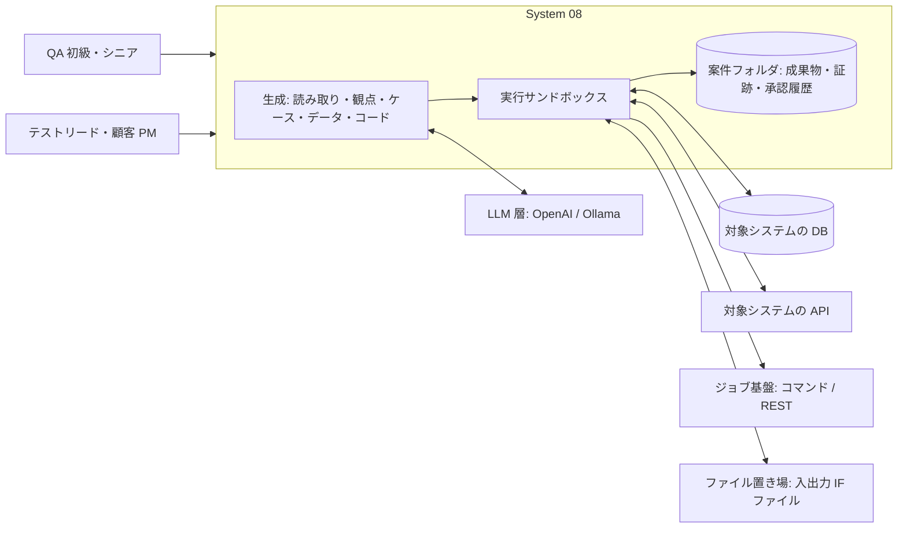
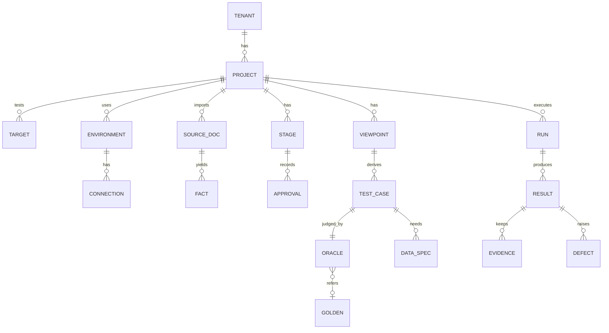

# WS2D-RD-008 要件定義書 System 08「バッチ・バックエンドのテスト」

- 文書ID: WS2D-RD-008
- 版数: 0.2（合意前の草案） / 作成日: 2026-10-15 / 最終更新: 2026-10-15 / 承認者: 未承認（保守者が要件合意時に記入する）
- 準拠: REBOK（JISA, 2011）の工程区分を参考にした（要求仕様化。工程名・知識領域の正式名称は一次資料未確認のため準拠とは言わない）／ISO/IEC/IEEE 29148:2018（SRS の構成を参考。条番号は原典未確認）／ISO/IEC/IEEE 29119-4:2021（テスト技法名）／ISTQB CTFL 4.0・CTAL-TA・CT-TAE（テストレベル・用語。CTFL・CTAL-TA は原典未確認）／ISO/IEC 25010（品質特性）／IPA 非機能要求グレード 2018（非機能の分類）
- 要件の機械可読ソース: 実装時に機能契約（機械可読。所在は付録 B）へ登録し、本書の FR-08-xxx と 1 対 1 または 1 対多で対応させる。両者が食い違った場合は差異を保守者に提示し、承認後に本書を改版する（機能契約を正としない）
- 優先度は MoSCoW（Must／Should／Could／Won't）。受入基準は Given/When/Then

## 1. 文書概要

- 改訂（0.2・2026-10-15）: 検証指摘（High 4・Medium・Low）反映、保守者決定の書き戻し

### 1.1 目的
System 08 の機能要件・AI エージェント要求・データ要件・外部インタフェース要件・非機能要件を定め、保守者と合意する。上位の要求（なぜ・誰のため）は WS2D-RA-008 に置く。

### 1.2 適用範囲
WebSpec2Doc に追加する System 08「バッチ・バックエンドのテスト」。既存の System 07 は存続し、本書の範囲では 07 の機能を変えない（FR-08-123）。

### 1.3 読者
- 保守者（要件合意・受け入れ判定）
- 開発チーム（基本設計・実装の入力）
- レビュアー・検証担当（受入基準とトレーサビリティの確認）

### 1.4 関連文書

| 文書番号 | 文書名 | 関係 |
|---|---|---|
| WS2D-RA-008 | 要求分析書 System 08 | 本書の上位。BR・UC・決定事項 D-1〜D-9 の出典 |
| WS2D-RD-001 | 要件定義書（全体） | 既存機能の要件。体裁の基準 |
| WS2D-NF-001 | 非機能要件定義書 | 全体の非機能。本書 8 章は System 08 固有分 |
| WS2D-GL-001 | 用語集 | 共通用語。本書 12 章は追加分のみ |
| 機能契約 | 機能契約（機械可読） | 実装時に s08 を登録。所在は付録 B |
| 調査 1〜4（2026-10-15） | 商用／OSS／論文・標準／QA 実務 | 根拠欄の「調査1」〜「調査4」 |

## 2. システム概要・コンテキスト

System 08 は、QA が選んだ対象（バッチジョブ・API・ジョブネット・スクリプト）とテストレベルに対して、AI エージェントが 8 段階（目的・範囲 → 対象の読み取り → 観点表 → ケース表 → テストデータ仕様 → テストコード → 実行 → 判定・報告）の成果物を下書きし、人が段階ごとに承認する。実行は製品内のサンドボックスから検証環境へ接続して行い、前後スナップショット・差分・ログを証跡として案件に残す。アーキテクチャは ISTQB CT-TAE の gTAA（テスト生成層・定義層・実行層・適合層）に沿って分け、ジョブ基盤・DB・API の差は適合層（アダプタ）で吸収する（調査3 C-4）。

## 3. 中核原則: テストオラクル（期待値）の方針

**期待値（テストオラクル）は機械判定できるもの（冪等性・再実行・DB 前後比較・スキーマ・件数）だけ自動確定し、業務判断を含む期待値は人が確定する。LLM が対象コードの振る舞いから期待値を学ばない。**
根拠: 調査3 要約 3・A-4（LLM がバグ入りコードから期待値を学習してしまう問題をサーベイ・議論論文が指摘。本文未確認、abstract のみ）、調査3 B（変換ロジックの期待値は仕様からしか決まらず、コードから導くと同義反復になりうる）、調査2 6 章（根拠なき期待値は PASS に数えない）。

| 区分 | 自動確定してよい期待値 | 人が確定する期待値 |
|---|---|---|
| 再実行・冪等性 | 正常終了後の再実行で DB 前後状態が 1 回目と同一／同一パラメータの再投入が拒否される（仕様で拒否と定義済みの場合） | 再実行方式（全件やり直し／処理済みスキップ）の選択そのもの |
| 途中失敗からの回復 | 最終状態が「失敗なしで 1 回流した結果」と一致 | 部分コミットを許容するかの判断 |
| DB 前後比較 | 対象外テーブル・除外列以外が不変／件数が承認済みの式（入力 − 除外 = 出力 等）を満たす | 変化した行の値の正しさ（別経路またはゴールデンで確定） |
| スキーマ | DDL・OpenAPI への型・桁・NULL 可否・必須項目の適合 | 仕様と DDL が食い違うときどちらを正とするか |
| 件数 | 0 件・1 件・最大件数での件数関係 | 最大件数の値（仕様にない場合） |
| 業務値 | — | 計算結果・端数処理・業務日付の帰属・エラー時の業務扱い |

運用規則:
1. 期待値の根拠に使えるのは、仕様書・業務ルール・承認済みゴールデンデータ・人が承認した別経路 SQL だけ。ソースコードは事実抽出（どの表を更新するか等）と、別経路 SQL がソースの式の写しでないかの照合（FR-08-064）にだけ使い、期待値の根拠欄に出さない
2. 期待値が未確定のケースは実行しても「未判定」と表示し、合格に数えない
3. 自動確定した期待値も、その判定規則（何を比べたか）を証跡に残す
4. 生成コードを通すために期待値・assert を弱めない（比較の削除・許容差の拡大・判定の反転を含む）。変更が要るときは段階 6 の承認を経る（FR-08-144）

## 4. 機能要件（段階別）

各表の列: ID／名称／説明／優先度／受入基準（G/W/T）／根拠。優先度のうち観点に関するものは調査4 要約 1〜8 の実装優先順を写した（1〜4 → Must、5〜6 → Should、7〜8 → Could）。

### 4.1 案件・対象の登録（段階 1: 目的・範囲）

| ID | 名称 | 説明 | 優先度 | 受入基準 | 根拠 |
|---|---|---|---|---|---|
| FR-08-001 | 案件の作成 | 名称・目的・範囲・対象種別・テストレベルを選択式で入力して案件を作る | Must | G 未登録のテナントで W 名称と種別・レベルを選んで作成 T 案件一覧に表示され段階 1 が「下書き」になる | BR-08-06・09、UC-08-01 |
| FR-08-002 | 対象の登録 | 対象（バッチジョブ／API／ジョブネット／スクリプト）と起動方法（コマンド／REST）を登録する | Must | G 案件がある W バッチジョブとコマンド起動を選んで登録 T 対象一覧に種別・起動方法が表示される | D-1、UC-08-01 |
| FR-08-003 | 環境と接続先の登録・切替 | 環境（例: 結合環境・システム環境）ごとに DB 種別・接続先・API ベース URL・ファイル置き場を持ち、案件の環境を切り替えられる | Must | G 環境が 2 つ登録済み W 実行前に環境を切り替える T 実行記録に使用した環境名が残り、接続先が切り替わる | BR-08-03、UC-08-01（調査1 4 章では他製品の環境切替を確認できなかったが、不在の証明ではないため差別化の根拠にしない） |
| FR-08-004 | 接続先の秘匿 | パスワード・トークン等の秘密情報は保存せず、実行のたびに入力を求める（13 章 要判断-7 決定）。画面・ログ・証跡・生成コードに平文で出さず、外部 LLM へも送らない | Must | G 秘密情報を入力済み W 画面・ログ・証跡・生成コードを検索し、LLM 呼び出し記録の送信前検査結果を見る T 平文がどこにも無く、全呼び出しで秘密情報の検出件数が 0／G 前回の実行で秘密情報を入力済み W 再ログイン後に実行 T 秘密情報の再入力を求められる | BR-08-07、UC-08-11 |
| FR-08-005 | 接続確認 | 登録した接続先に疎通し、到達性・認証・権限（読み取りのみか書き込み可か）を判定して表示する。失敗時は原因と次の行動を 1 行で示す | Must | G 誤ったポートの接続先 W 接続確認 T 「接続できません」と原因候補・次の行動が出て登録は下書きで残る／G 正しい接続先 W 接続確認 T 権限区分が表示される | UC-08-01、調査4 3 章 疎通確認 [S7] |
| FR-08-006 | 資料の取り込み | 仕様書・DDL・ジョブ定義・OpenAPI・ソース・IF 仕様書・既存テスト資産を取り込む。上限は NFR-08-04 | Must | G 案件がある W 対応形式の資料を取り込む T 資料一覧に種類別に並ぶ／G 上限（暫定: 1 ファイル 20MB・1 案件 30 ファイル。NFR-08-04）を超える資料 W 取り込む T 拒否理由と上限が表示される | UC-08-02 |
| FR-08-007 | テナント分離 | 案件・資料・証跡・接続先はテナント単位で分離し、他テナントから参照できない。MVP（顧客環境／ローカル設置。13 章 要判断-7 決定）では 1 設置内で複数テナントを運用する場合に適用する | Must | G テナント A の案件 W テナント B の利用者が案件 ID を指定して参照 T 拒否される | BR-08-07、既存のテナント分離（WS2D-RD-001） |
| FR-08-008 | 書き込み保護と本番の読み取り専用 | 環境ごとに「書き込み可否」を持つ。書き込み不可の環境ではデータ投入・ジョブ起動を行わない。本番と判定した接続先（名称・設定・接続確認の結果から判定し、登録時に表示）は読み取り専用を強制し、書き込み系 SQL（INSERT・UPDATE・DELETE・DDL 等）・データ投入・ジョブ起動・巻き戻しを拒否する | Must | G 書き込み不可の環境 W 実行を開始 T データ投入とジョブ起動が行われず理由が表示される／G 本番と判定した接続先 W 書き込み系 SQL またはジョブ起動を含む実行を開始 T 拒否され「本番と判定した接続先は読み取りのみです」と次の行動が表示され、DB に変更が無い | BR-08-07、RA-008 7 章（本番での書き込みは対象外）・8.3 リスク |
| FR-08-009 | 書き込み前の確認 | 書き込みを伴う実行（データ投入・ジョブ起動・巻き戻し）の前に、対象環境名と影響テーブル（投入・更新・削除が見込まれる表）を示して利用者の確認を取る。確認が無ければ開始しない | Must | G 書き込み可の環境とデータ投入を含むケース W 実行を開始 T 環境名と影響テーブルの一覧が示され、確認するまで投入もジョブ起動も行われない／G 確認画面 W 取り消す T 実行されず当該ケースは「未実行」になる | BR-08-07、RA-008 8.3 リスク（書き込み前の確認） |

### 4.2 対象の読み取り（段階 2）

| ID | 名称 | 説明 | 優先度 | 受入基準 | 根拠 |
|---|---|---|---|---|---|
| FR-08-011 | DDL の読み取り | テーブル・列・型・桁・NULL 可否・主キー・一意・外部キー・制約を抽出する | Must | G PostgreSQL の DDL W 読み取る T 全テーブル・列が事実一覧に出て各事実に根拠行が付く／G 基準資料と正解表（4.2 末尾） W 読み取る T 再現率が下限以上 | BR-08-01、UC-08-02 |
| FR-08-012 | ジョブ定義の読み取り | 起動コマンド・引数・入出力ファイル・リターンコード・コミット単位・再実行方式を抽出する | Must | G ジョブ定義とバッチ仕様書 W 読み取る T 起動方法・入出力・リターンコードが根拠行付きで出る／G 基準資料と正解表（4.2 末尾） W 読み取る T 再現率が下限以上 | BR-08-08、UC-08-02、調査4 1.1・1.2 |
| FR-08-013 | 仕様書からの事実抽出 | 日本語の仕様書から業務ルール・計算式・境界値・日付規則・エラー時の扱いを抽出する | Must | G 計算式を含む仕様書 W 読み取る T 計算式が事実一覧に出て資料名と行が示される／G 基準資料と正解表（4.2 末尾） W 読み取る T 再現率が下限以上 | BR-08-01、調査3 A-3 |
| FR-08-014 | OpenAPI の読み取り | 操作・パラメータ・スキーマ・応答コード・認証方式を抽出する | Should | G OpenAPI 文書 W 読み取る T 全操作が事実一覧に出る | UC-08-02、調査1 2-3 |
| FR-08-015 | ジョブネットの読み取り | 先行後続・リカバリジョブ・判定ジョブを抽出し依存の一覧を作る | Should | G 先行後続のあるジョブ定義 W 読み取る T 依存一覧に先行・後続が出る | BR-08-08、調査4 1.3 [S3] |
| FR-08-016 | ソースからの事実抽出 | 更新するテーブル・発行 SQL・日付の取得箇所を抽出する。期待値の根拠には使わない（3 章） | Should | G ソースを取り込み済み W 読み取る T 事実に「出典: ソース」が付き期待値の根拠欄に選べない | 3 章、調査3 A-4 |
| FR-08-017 | 根拠と読み取れなかった箇所の明示 | すべての事実に資料名と行を付ける。読み取れなかった箇所・資料間の矛盾は「未確認」として質問一覧に出す（不在は証明しない） | Must | G 解析できない資料が混在 W 読み取る T 該当資料が「読み取れなかった」と表示され質問一覧に 1 件以上出る | BR-08-04、UC-08-02 |
| FR-08-018 | 取り込み資料の秘密検出と伏せ字 | 取り込み時に資料（ジョブ定義・ソース・DDL・接続設定・仕様書のサンプル値を含む）から秘密情報（パスワード・トークン・接続文字列）と個人情報らしき値を検出し、伏せ字にした版を作る。外部 LLM へは伏せ字後の版だけを送る。利用者は検出結果を確認し、伏せる箇所を追加できる。検出の再現率は未検証 | Must | G パスワードを含む接続設定ファイルと氏名のサンプル値を含む仕様書 W 取り込んで観点生成を実行 T 伏せ字の版が作られ、LLM 呼び出し記録の送信前検査で秘密情報・データ値の検出件数が 0 | BR-08-07、UC-08-02、FR-08-146 |

読み取りの品質基準（FR-08-011〜013）: MVP 対象のバッチ 1 本の DDL・ジョブ定義・仕様書を基準資料とし、人が事実の正解表を作って抽出の再現率・適合率を測る。下限値は MVP の実測で決めて本書を改版する（現時点は未設定。調査3 A-3: 要件文書→テストの再現率は資料の質で大きく変わることが示唆される）。

### 4.3 観点生成（段階 3）

観点カテゴリは付録 A の観点カタログ（調査4 の表の全カテゴリ）を網羅基準とする。

| ID | 名称 | 説明 | 優先度 | 受入基準 | 根拠 |
|---|---|---|---|---|---|
| FR-08-021 | 観点カタログ | 付録 A の 10 カテゴリ・61 観点を観点生成の網羅基準として持ち、各観点を「出す／対象外（理由）」のどちらかにする | Must | G 観点表を生成 W カタログと突き合わせる T 全観点が「出す」か「対象外＋理由」のどちらかになり、黙って落ちた観点が 0 | BR-08-01、調査4 全体 |
| FR-08-022 | 再実行・冪等性・リスタートの観点 | 付録 A-1 の 8 観点を扱う。正常終了後の再実行、途中失敗からの再実行、再実行方式の別、入力ファイルの破壊、同一パラメータの拒否、リスタート状態の保持の 6 観点を出す。ジョブ管理製品の再実行起点は「対象外（ジョブ管理製品の直接連携は対象外）」、前段完了確認はジョブネット対象（FR-08-015）以外では「対象外（ジョブネットでない）」として出す | Must | G コマンド起動のバッチジョブ 1 本の案件 W 観点表を生成 T 6 観点が出て、再実行起点と前段完了確認は「対象外＋理由」になる | 調査4 要約 1・1.1 [S1][S2][S3][S4]、7 章（ジョブ管理製品の連携は対象外） |
| FR-08-023 | DB 前後比較・結果検証の観点 | 付録 A-7 の 5 観点（行数、集計突合、行単位ハッシュ、現新比較、開始・完了時点スナップショット） | Must | G DB を更新するジョブ W 観点表を生成 T A-7 の 5 観点が出る | 調査4 要約 2・1.7 [S6][S9][S10] |
| FR-08-024 | 日付・時間の観点 | 付録 A-4 の 5 観点（月末・うるう年、存在しない日付、業務日付とシステム日付の分離、年度末・営業日、日付またぎ・タイムゾーン）。出典の無い観点は「根拠: 実務通説（未検証）」と表示 | Must | G 日付項目を持つ対象 W 観点表を生成 T A-4 の 5 観点が出て、業務日付・年度末・日付またぎに「実務通説（未検証）」が付く | 調査4 要約 3・1.4 [S17][S18]・[一般] |
| FR-08-025 | データ（件数・値・文字）の観点 | 付録 A-5 の 4 観点（件数境界、項目値境界、文字コード・サロゲートペア、NULL と空文字） | Must | G 入力テーブルまたはファイルがある W 観点表を生成 T A-5 の 4 観点が出る | 調査4 要約 4・1.5 [S7][S20]・[一般] |
| FR-08-026 | 外部 IF ファイルの規約確認の観点 | 付録 A-6 のうち規約確認（形式・項目・桁・文字コード・改行・ヘッダ／トレーラ件数）と固定長のバイト長 | Must | G 出力 IF ファイルがある W 観点表を生成 T 規約確認と固定長の観点が出る | 調査4 要約 4・1.6 [S7][S8] |
| FR-08-027 | 外部 IF ファイルの連携設定の観点 | 付録 A-6 のうち項目マッピング（多数ならサンプリング）、暗号化・パス | Should | G 外部連携ファイルがある W 観点表を生成 T 項目マッピングと暗号化・パスの観点が出る | 調査4 1.6 [S7][S8] |
| FR-08-028 | トランザクション・途中異常の観点 | 付録 A-2 のうちコミット単位、エラーレコードのスキップ・リトライ、外部呼び出しとの整合 | Should | G コミット単位が仕様にある W 観点表を生成 T 3 観点が出て N 件目の異常注入ケースの候補が付く | 調査4 要約 5・1.2 [S1][S2][S4] |
| FR-08-029 | ジョブネット依存の観点 | 付録 A-3 のうち先行ジョブ失敗時の後続、再実行中の状態遷移競合 | Should | G 先行後続がある W 観点表を生成 T 2 観点が出る | 調査4 要約 5・1.3 [S3] |
| FR-08-030 | API の観点 | 付録 A-9 の 12 観点（冪等キー 5 種、タイムアウト後の再送、ページング、レート制限、認証・認可、スキーマ互換、スタブ、エラー応答） | Should | G API 対象 W 観点表を生成 T A-9 の 12 観点が出る | 調査4 要約 6・2 章 [S5][S12][S13] |
| FR-08-031 | 外部結合の観点と手順書 | 付録 A-10 の 9 観点を出し、規約確認 → 疎通確認 → 業務通しの手順書とチェックリストを生成する | Could | G システム統合レベルを選択 W 観点表を生成 T A-10 の 9 観点と 3 段階の手順書が出る | 調査4 要約 7・3 章 [S7][S8][S16]、UC-08-13 |
| FR-08-032 | 性能・排他・環境差異の観点 | 付録 A-2 長時間トランザクション、A-3 多重起動防止・バッチとオンラインの排他・並列直列、A-8 タイムアウト・性能・メモリ。観点は出すが期待値は人が決める | Could | G バッチジョブの案件 W 観点表を生成 T 該当観点が出て期待値方式が「人が確定」に固定される | 調査4 要約 8・1.2・1.3・1.8 [S1][S15] |
| FR-08-033 | ログ・通知・監査の観点 | 付録 A-8 のうちログの記録内容、リターンコード・完了通知、ドライラン、監査証跡 | Should | G バッチジョブの案件 W 観点表を生成 T 4 観点が出る | 調査4 1.8 [S1]・[一般]（優先順位に無いため 13 章 要判断-3） |
| FR-08-034 | 技法名の付与 | 各観点・ケースに ISO/IEC/IEEE 29119-4 の技法名を付ける: 同値分割（5.2.1）、境界値分析（5.2.3）、組合せテスト設計（5.2.5）、デシジョンテーブル（5.2.6）、状態遷移（5.2.8）、シナリオテスト（5.2.9。ユースケースに基づくテストを含む）、エラー推測（5.4.1）。当てはまる技法が無い観点（冪等性・ドライラン・疎通確認等）は「技法なし（経験ベース）」とする | Must | G 観点表 W 表示 T 全観点に技法名か「技法なし（経験ベース）」が付き、付与の妥当性は FR-08-036 で人が採否する | 調査3 C-3、調査3 A-3（境界値は LLM が単純条件で検出、算術条件は弱い） |
| FR-08-035 | テストレベル別の観点セット | 選んだテストレベルで既定の観点カテゴリと期待値方式を切り替える（4.3.1 表） | Must | G 同じ対象 W レベルをシステムから受け入れに変える T 観点セット（提供済みのカテゴリのみ）と既定の期待値方式が表のとおり変わる | D-2、BR-08-09 |
| FR-08-036 | 観点の採用／修正／破棄・追加 | AI が出した観点を 1 件ずつ採用／修正／破棄でき、シニア QA は観点を追加できる | Must | G 生成済み観点表 W 1 件を破棄し 1 件を追加 T 破棄理由と追加者が記録される | BR-08-06、調査1 1-4（RightData の採用／修正／破棄） |
| FR-08-037 | 実務通説の未検証表示 | 出典の無い観点（付録 A の [一般]）には「根拠: 実務通説（未検証）」を表示する | Must | G [一般] の観点を含む観点表 W 表示 T 該当観点に未検証の表示がある | 調査4 凡例、A-5 |

#### 4.3.1 テストレベル別の既定（本書の設計判断。外部基準ではない）

| テストレベル（ISTQB） | 既定の観点カテゴリ | 既定の期待値方式 |
|---|---|---|
| コンポーネント統合 | A-1、A-2、A-5、A-7 | DB 前後比較・別経路計算 |
| システム統合（外部結合） | A-6、A-9、A-10 | ゴールデン（相手先と合意した IF 仕様）・スキーマ |
| システム | A-1〜A-9 | 3 方式すべて |
| 受け入れ | A-4（月次・年度末）、A-10（業務通し）、A-7（現新比較） | ゴールデン（業務担当者が承認） |

表のカテゴリのうち、対応する FR が Should／Could のもの（A-2・A-3・A-6 の連携設定・A-8・A-9・A-10）は、その FR の提供リリース（11 章）まで観点表に「R2 以降で提供」と表示する。

### 4.4 ケース生成（段階 4）

| ID | 名称 | 説明 | 優先度 | 受入基準 | 根拠 |
|---|---|---|---|---|---|
| FR-08-041 | ケース表の生成 | 承認済み観点からケースを作る。各ケースは前提データ・手順・期待値・期待値方式・根拠観点・技法・テストレベルを持つ | Must | G 観点表承認済み W ケース表を生成 T 全ケースに 7 項目があり、空欄は「未確定」と表示される | BR-08-01、UC-08-04 |
| FR-08-042 | レベル別ケース | テストレベルに応じて手順の粒度を変える（統合: ジョブ 1 本、システム: ジョブネット通し、受け入れ: 日次・月次サイクル） | Must | G 受け入れレベル W ケース表を生成 T 月次サイクルの通しケースが含まれる | D-2、調査4 3 章 日次・月次サイクル（[一般]） |
| FR-08-043 | 比較ケースの 3 族 | DB 比較ケースを集計（件数・合計・最小・最大）・集合（A⊂B、B⊂A、A=B）・値（行・列）の 3 族で網羅する | Must | G DB 更新ジョブ W ケース表を生成 T 3 族それぞれに 1 件以上のケースがある | 調査1 1-7（DVO の比較の型） |
| FR-08-044 | ケースの編集と保護 | ケースの追加・編集・削除ができ、変更履歴を残す。承認済みケースは再生成で上書きしない | Must | G 承認済みケース表 W 観点表を再生成 T 承認済みケースは変わらず差分だけが「提案」として出る | D-4、UC-08-04 |
| FR-08-045 | 要件 ID との紐付け | ケースに顧客の要件 ID（仕様書の章・項番）を紐付け、要件ごとのケース数・結果を集計する | Must | G 要件 ID を含む仕様書 W ケース表を生成 T 各ケースに要件 ID が付き、ケースの無い要件が一覧に出る | BR-08-05、調査1 1-6（Tosca DI の要件追跡） |
| FR-08-046 | プレスクリーニングのケース | 取り込み前の入力ファイルの検査（形式・件数・必須項目）を独立したケースとして作る | Should | G 入力ファイルを持つジョブ W ケース表を生成 T プレスクリーニングのケースが本処理のケースより前に並ぶ | 調査1 1-6（Tosca DI） |

### 4.5 テストデータ仕様・生成（段階 5）

| ID | 名称 | 説明 | 優先度 | 受入基準 | 根拠 |
|---|---|---|---|---|---|
| FR-08-051 | テストデータ仕様の生成 | ケースから必要なデータ条件（0 件・1 件・最大件数・項目値境界・文字コード・NULL と空文字・日付境界）を仕様として作る | Must | G ケース表承認済み W データ仕様を生成 T 各ケースに必要なデータ条件が対応付き、境界値には境界の根拠（DDL・仕様の行）が付く | BR-08-02、調査4 1.5・4 章 |
| FR-08-052 | テストデータの生成 | データ仕様の承認後に、仕様から投入データ（テーブル行・入力ファイル）を作る。外部キー等の参照整合性を保つ | Must | G 外部キーのある 2 テーブル W データを生成 T 投入時に参照整合性違反が 0 件 | BR-08-02、調査1 3-1（参照整合性を保つ合成） |
| FR-08-053 | マスキング | 本番由来データを使う場合、指定した列（氏名・住所・電話等）を形式を保って置換してから案件に保存する | Must | G マスキング対象列を指定 W 本番由来データを取り込む T 保存されたデータに元の値が残らず、桁と形式は保たれる | BR-08-07、調査4 3 章 [S16]、調査1 3-1 |
| FR-08-054 | 大量データの生成 | 件数を指定して大量データを作る。上限は要計測（NFR-08-04） | Should | G 件数を指定 W 生成 T 指定件数のデータができ所要時間が記録される | 調査4 1.5 最大件数 [S7] |
| FR-08-055 | データの投入と巻き戻し | テスト前にデータを投入し、テスト後に投入前の状態へ戻せる。巻き戻しの前に、投入前スナップショットとの差分（投入後に他者が更新した行を含む）を示して FR-08-009 の確認を取る。共有の検証 DB では投入先を案件専用のスキーマに限る設定を持つ。戻せない環境ではその旨を表示する | Must | G 投入前スナップショットあり W 巻き戻しを実行 T 対象テーブルが投入前と一致する／G 投入後に他者が対象テーブルを更新 W 巻き戻しを指示 T 他者の更新行が示され、確認するまで巻き戻さない | 調査1 3-2（巻き戻しは再実行試験の前提）、調査4 1.1、RA-008 8.3 リスク |
| FR-08-056 | 外部 IF ファイルの生成 | 固定長・CSV・JSON の入力ファイルを文字コード・改行コードを指定して作る | Should | G Shift_JIS 固定長の IF 仕様 W ファイルを生成 T 全行がバイト長どおりで、変換不能文字はデータ仕様で指定した扱いになる | 調査4 1.5・1.6 [S7][S20] |

### 4.6 期待値 3 方式（段階 4〜5 で確定）

| ID | 名称 | 説明 | 優先度 | 受入基準 | 根拠 |
|---|---|---|---|---|---|
| FR-08-061 | 期待値方式と状態 | 各ケースに期待値方式（DB 前後比較／別経路計算／ゴールデン／スキーマ）と状態（未確定・自動確定・人が確定）を持つ | Must | G ケース表 W 表示 T 全ケースに方式と状態があり、未確定の件数が集計される | D-3、3 章 |
| FR-08-062 | DB 前後比較の設定 | 対象テーブル・突合キー・許容差（数値の丸め）・除外列（更新日時等）・非決定値のマスク（採番・時刻）を設定する。確定は FR-08-107 の権限に従う | Must | G 突合キーと除外列を設定 W 実行 T 除外列の差分は不合格にならず、突合キーで行が対応付く | D-3、調査4 1.7 [S6]、調査2 6 章（自前実装） |
| FR-08-063 | 前後比較の自動確定 | 次だけを自動確定する: 対象外テーブル・除外列以外の不変、承認済み件数式、再実行での差分なし（冪等性。再実行方式が人により確定済みのケースに限る）、途中失敗後の再実行結果と正常 1 回結果の一致 | Must | G 再実行方式が「全件やり直し」で確定済みの冪等性ケース W 同じ入力で 2 回実行 T 2 回目の差分が空なら合格、空でなければ不合格として差分行が示される／G 再実行方式が未確定の冪等性ケース W 2 回実行 T 自動確定せず「未判定」になる | 3 章、調査4 1.1 [S2][S4] |
| FR-08-064 | 別経路計算 | AI が仕様から期待値を求める SQL（再計算）を下書きし、シニア QA が承認する（FR-08-107）。ソースが取り込まれている場合は、対象のソースと同じ式の写しになっていないかを照合して警告する（3 章 規則 1 の例外。照合結果は期待値の根拠にしない）。ソースが無い場合は「照合未実施（未検証）」と表示する | Must | G 計算式を含む仕様 W 別経路 SQL を生成 T 状態は「未確定」で、シニア QA の承認後に「人が確定」になる／G ソースと同一の式 W 照合 T 警告が出る／G ソース未取り込み W 生成 T 「照合未実施（未検証）」と表示される | D-3、調査4 4 章 [S19b]（実装と同じ式の複写） |
| FR-08-065 | ゴールデンデータ | 承認済みの入出力の組を登録し、版・承認者・承認日時を持つ。差し替えは新しい版として承認する。承認は FR-08-107 の権限に従う | Must | G ゴールデン v1 W 値を変更 T v2 として承認待ちになり v1 は保持される | D-3（ゴールデンの定義・運用は調査4 で出典なし＝本書で定義） |
| FR-08-066 | 現新比較 | 旧システムの出力をゴールデンとして登録し、新システムの出力と比較する。旧出力のバグも期待値になることを登録時に表示する | Should | G 旧出力を登録 W 登録確認 T 「旧システムの不具合も期待値になります」と表示され承認を求められる | 調査4 1.7・4 章 [S10]、調査1 1-8 |
| FR-08-067 | スキーマ判定 | 結果データ・出力ファイルを DDL・IF 仕様と照合して自動判定する（R1）。API 応答と OpenAPI の照合は FR-08-014 の提供（R2）以降 | Must | G 桁超過の出力 W 判定 T 不合格になり列と値が示される | 3 章、調査1 4 章（スキーマ／契約検証） |

### 4.7 テストコード生成（段階 6）

| ID | 名称 | 説明 | 優先度 | 受入基準 | 根拠 |
|---|---|---|---|---|---|
| FR-08-071 | pytest コードの生成 | 接続・データ投入・ジョブ起動・前後スナップショット・検証・証跡出力を含む pytest のテストコードを生成する | Must | G データ仕様承認済み W コードを生成 T 生成コードが構文検査を通り、全承認ケースに対応するテストがある | D-5、調査2 6 章 |
| FR-08-072 | 接続情報の実行時注入 | 生成コードに接続情報を書かず、実行時に注入する | Must | G 生成コード W 秘密情報・接続先の文字列を検索 T 該当が 0 件 | BR-08-07、FR-08-004 |
| FR-08-073 | ケースとコードの対応 | テスト名・コメントにケース ID を入れ、ケースからコード、コードからケースへ辿れる | Must | G 生成コード W ケース ID で検索 T 全ケース ID が 1 回以上現れる | BR-08-05 |
| FR-08-074 | 生成の採否関門 | 構文検査・試行実行（データ投入なしの起動確認）・期待値方式の欠落検出を通ったコードだけを承認対象にする | Must | G 期待値方式が未設定のケース W コード生成 T 当該テストは「承認不可（期待値未設定）」になる | 調査3 A-2（TestGen-LLM の関門連鎖）、調査2 要約 7 |
| FR-08-075 | 検出力の確認 | ミューテーションで生成テストが欠陥を検出できるかを確認する。Python 製の対象に限る（mutmut は Python 向け）。他言語の対象は未検証 | Could | G 生成テスト W 検出力確認を実行 T 検出できなかった変異の一覧が出る | 調査2 5 章（mutmut・ACH 系） |
| FR-08-076 | 直接編集と保護 | シニア QA がコードを直接編集でき、再生成で編集を上書きしない（差分を提案として出す） | Must | G 編集済みコード W 再生成 T 編集箇所は保たれ、新しい生成内容は差分として出る | D-8、D-4 |
| FR-08-077 | API テストコードの生成 | OpenAPI からのプロパティベース検査と業務シナリオの API テストを生成する | Should | G OpenAPI と API 観点 W コード生成 T スキーマ検査とシナリオの 2 種のテストが出る | 調査2 4 章（Schemathesis・Tavern） |

### 4.8 実行（段階 7）

| ID | 名称 | 説明 | 優先度 | 受入基準 | 根拠 |
|---|---|---|---|---|---|
| FR-08-081 | サンドボックス実行 | 製品内の隔離された実行環境で、資源上限（時間・メモリ・出力量）を守って実行する。上限の既定値は NFR-08-03 の実測で決め、案件設定で変えられる。隔離方式は 13 章 要判断-9 | Must | G 案件の作業ディレクトリ外へ書き込むテストコード W 実行 T 書き込みが拒否され「案件外への書き込み」が記録される／G 出力量の上限を検査用に 1MB に設定 W 1MB を超えて出力するテストを実行 T 停止して「出力量の上限超過」が記録される | D-6 |
| FR-08-082 | タイムアウト | ケース単位と実行全体のタイムアウトを持つ。既定値は要計測 | Must | G 応答しないジョブ W 実行 T タイムアウトで停止し当該ケースが「実行不能（タイムアウト）」になる | 調査4 1.8（タイムアウト [一般]） |
| FR-08-083 | キャンセル | 実行中に利用者が停止できる。停止時点までの結果と証跡を残す | Must | G 実行中 W キャンセル T 実行が止まり、完了済みケースの結果が残り未実行は「未実行」になる | functional-integrity（キャンセル） |
| FR-08-084 | 部分結果と再実行 | 失敗・停止後に、未実行・失敗のケースだけを再実行できる | Must | G 10 件中 3 件が未実行 W 未実行分を再実行 T 3 件だけが実行され、前回結果と合わせて集計される | UC-08-08 |
| FR-08-085 | 進捗表示 | 実行中のケース・完了件数・経過時間を表示する | Must | G 実行中 W 画面を見る T 現在のケースと完了件数が 5 秒以内の間隔で更新される（暫定値。実測後に見直す） | UC-08-08 |
| FR-08-086 | 前後スナップショットと差分 | 実行前後に対象テーブルのスナップショットを取り、差分（追加・削除・更新行と列）をテーブル形式で保存する | Must | G DB 前後比較のケース W 実行 T 前・後・差分の 3 つが案件に保存され画面で見られる | D-6、調査4 1.7 [S9] |
| FR-08-087 | 業務日付の注入 | 業務日付（基準日）をパラメータで与えて実行する。OS 時刻は変更しない。時刻固定の環境は本版で提供しないため、業務日付を引数で受け取れないジョブ（システム日付を直接参照するもの）の業務日付ケースは「実行不能（業務日付を注入できない）」とし、観点表・ケース表にもその旨を表示する | Must | G 業務日付 2028-02-29 を指定 W 実行 T ジョブに基準日が渡り、OS 時刻の変更が行われない／G 業務日付の引数を持たないジョブ W 業務日付ケースを実行 T 当該ケースが「実行不能（業務日付を注入できない）」になり理由が表示される | 調査2 3 章（JP1 マニュアルの時刻変更注意）、調査4 1.4 |
| FR-08-088 | コマンドによるジョブ起動 | コマンドでジョブを起動し、リターンコード・標準出力・標準エラーを取得する | Must | G コマンド起動のジョブ W 実行 T リターンコードと出力が証跡に残る | 調査2 要約 8（アダプタで抽象化） |
| FR-08-089 | REST 起動とジョブネット順序実行 | REST でジョブを起動し完了を待つ。ジョブネットは先行後続の順に実行し、先行失敗時は後続を止める | Should | G 先行が異常終了するジョブネット W 実行 T 後続は実行されず「未実行（先行失敗）」になる | 調査4 1.3 [S3]、調査2 3 章 |
| FR-08-090 | 失敗の原因分類 | 失敗を「環境起因（接続・権限）／テスト起因（コード・データ）／対象起因（不具合候補）」の候補に分けて示す | Should | G 接続断による失敗 W 結果を見る T 「環境起因」の候補として表示される | 調査1 2-5（mabl の失敗原因分析） |

### 4.9 判定・報告（段階 8）

| ID | 名称 | 説明 | 優先度 | 受入基準 | 根拠 |
|---|---|---|---|---|---|
| FR-08-091 | 事実と判断の分離 | 観測事実（差分・出力）、自動判定（規則と結果）、人の判断（判定者・理由）を別欄で示す | Must | G 実行完了 W 結果を見る T 3 欄が分かれ、人の判断欄の判定者と日時が記録される | BR-08-04、System 03 の思想 |
| FR-08-092 | 判定状態 | 合格・不合格・未判定（期待値未確定）・未実行・実行不能を区別し、合格に数えるのは合格だけ | Must | G 期待値未確定のケースを実行 W 集計 T 「未判定」に数えられ合格数に含まれない | D-3、3 章 |
| FR-08-093 | 不具合記録 | 不合格から不具合を記録し、Severity（影響の度合い）と Priority（修正の重要度）を独立に付け、再現情報（入力・手順・差分）を添える。等級の名称と段階数は設定可能（既定値は System 03 と同じ等級。13 章 要判断-4 決定） | Must | G 不合格ケース W 不具合を記録 T Severity と Priority が別項目で、差分と入力データが添付される | 調査4 4 章 [S14]（ISTQB 用語集の定義。二次資料経由） |
| FR-08-094 | Excel 出力 | 観点表・テスト仕様書（ケース表）・テストデータ仕様・結果一覧・不具合一覧・エビデンス（前後差分）を Excel で出力する。Excel を既定形式とするのは想定（未検証）で、顧客の様式は FR-08-097 で差し替える | Must | G 実行完了 W Excel 出力 T 6 種のシートを含むファイルができ、未判定・未実行がその状態のまま載る | BR-08-05、調査1 要約 6 |
| FR-08-095 | Markdown 出力 | 結果の要約・未検証の一覧を Markdown で出力する | Should | G 実行完了 W Markdown 出力 T 判定状態別の件数と未検証の一覧が出る | BR-08-05 |
| FR-08-096 | トレース出力 | 要件 ID ↔ 観点 ↔ ケース ↔ 結果の対応表を出力する | Must | G 要件 ID 付きのケース W トレース出力 T ケースの無い要件・結果の無いケースが一覧に出る | BR-08-05、調査1 5 章 3 |
| FR-08-097 | 顧客様式への差替 | 出力の様式（列名・並び・表紙）を顧客の様式に差し替えられる | Could | G 顧客様式を登録 W Excel 出力 T 顧客様式の列名・並びで出力される | BR-08-05 |

### 4.10 人の介入点

| ID | 名称 | 説明 | 優先度 | 受入基準 | 根拠 |
|---|---|---|---|---|---|
| FR-08-101 | 段階承認 | 8 段階それぞれに承認を持ち、前段が未承認なら次段の生成を開始しない | Must | G 観点表が未承認 W ケース表の生成を指示 T 開始されず「観点表の承認が必要です」と表示される | D-4、UC-08-03 |
| FR-08-102 | 差し戻しとコメント | 各段階を差し戻せ、項目単位にコメントを付けられる | Must | G 承認待ちのケース表 W 差し戻し理由を書いて差し戻す T 段階が「差し戻し」になり理由が履歴に残る | D-4 |
| FR-08-103 | 承認済み段階の保護 | 承認済みの段階は後段や再生成で変更しない。変更するには差し戻しを経る | Must | G 承認済みの観点表 W 読み取りを再実行 T 観点表は変わらず影響候補だけが通知される | D-4 |
| FR-08-104 | 後段への影響表示 | 前段を変更したとき、影響を受ける後段の成果物（ケース・データ・コード）を示す | Should | G 観点を 1 件破棄 W 影響表示 T その観点から作ったケースが一覧で出る | D-4 |
| FR-08-105 | 承認権限 | 段階ごとに承認できるロールを設定する。期待値の確定は FR-08-107 でシニア QA に固定する | Must | G 承認ロールをシニア QA に設定した段階 W 初級 QA が承認を試みる T 権限が無い旨が表示される | D-8 |
| FR-08-106 | SQL・コードの日本語要約 | 段階 4 の別経路 SQL と段階 6 のテストコードについて、ケースごとに「何を準備し・何を実行し・何と比べて合否を決めるか」を日本語 3 文以内で要約し、ケース ID を付けて表示する。初級 QA は要約を確認して段階 6 を承認できる（UC-08-07 代替系列） | Must | G 生成済みのテストコード W 初級 QA が段階 6 を開く T 全テストにケース ID 付きの日本語要約があり、コードを開かずに承認操作ができる／G 要約の無いテスト W 承認を指示 T 「要約がありません」と表示され承認できない | D-8、BR-08-06、RA-008 UC-08-07 |
| FR-08-107 | 期待値確定の権限 | 期待値の確定（FR-08-062 の突合キー・許容差・除外列、FR-08-064 の別経路 SQL、FR-08-065 のゴールデン、FR-08-143 の業務値）はシニア QA ロールに限る。初級 QA は下書きの確認と差し戻しまで | Must | G 初級 QA W 別経路 SQL・ゴールデン・突合キー設定のいずれかを承認 T 拒否され「期待値の確定はシニア QA の承認が必要です」と表示され、状態は「未確定」のまま／G シニア QA W 同じ操作 T 「人が確定」になり確定者と日時が記録される | D-8、3 章、RA-008 UC-08-06 |

### 4.11 監査・証跡

| ID | 名称 | 説明 | 優先度 | 受入基準 | 根拠 |
|---|---|---|---|---|---|
| FR-08-111 | 承認履歴 | 誰が・いつ・どの段階のどの版を承認・差し戻したかを記録し、閲覧できる | Must | G 承認と差し戻しが各 1 回 W 履歴を見る T 2 件が利用者・日時・版付きで出る | UC-08-10 |
| FR-08-112 | 実行証跡の保存 | 実行ログ・前後スナップショット・差分・実行したコードの版・環境名・業務日付を実行ごとに案件へ保存する | Must | G 実行完了 W 証跡を見る T 6 項目が実行単位で揃っている | D-6、BR-08-03 |
| FR-08-113 | LLM 呼び出しの記録 | LLM 呼び出しごとに日時・利用した LLM・段階・送信した資料の種類・送信内容のハッシュ・送信前検査の結果（秘密情報・データ値の検出件数）を記録する。送信本文は保存しない（13 章 要判断-5 決定）。外部 LLM への送信は検出件数が 0 のときだけ行う | Must | G 観点生成を実行 W 記録を見る T 呼び出しごとに段階名・LLM・ハッシュ・検出件数 0 が出て、送信本文は保存されていない／G 秘密情報を伏せていない資料 W 外部 LLM へ送る段階を実行 T 送信されず、検出件数と箇所（資料名と行）が示される | BR-08-07、AC-08-05 |
| FR-08-114 | 証跡の改ざん検出 | 保存した証跡にハッシュを付け、改変を検出する | Could | G 保存済み証跡 W 内容を変更 T 検証で「改変あり」と出る | BR-08-05 |

### 4.12 System 07 との統合方針

| ID | 名称 | 説明 | 優先度 | 受入基準 | 根拠 |
|---|---|---|---|---|---|
| FR-08-121 | 07 案件の取り込み | 07 の案件（スクリプト・抽出事実・ケース）を、対象種別「スクリプト」の 08 案件として取り込む。取り込めない項目は一覧で示す | Could | G 07 案件 W 08 へ取り込む T スクリプトとケースが 08 案件に入り、取り込めない項目が一覧に出る | D-1、UC-08-12 |
| FR-08-122 | 07 の生成形式の扱い | 07 の pytest 以外の形式を 08 の生成ターゲットに加えることは本版では行わない（RA-008 7 章で生成コードは Python＋pytest に限定。07 がその形式を生成するかは未確認） | Won't | G スクリプト対象の 08 案件 W コード生成 T 生成ターゲットとして pytest だけが選べる | D-1、RA-008 7 章 |
| FR-08-123 | 07 の非影響 | 08 の追加で 07 の画面・機能・保存データを変えない | Must | G 08 追加後 W 07 の既存案件を開いて生成・出力 T 追加前と同じ手順で同じ形式の出力が得られる | D-1 |

### 4.13 外部結合の補助

| ID | 名称 | 説明 | 優先度 | 受入基準 | 根拠 |
|---|---|---|---|---|---|
| FR-08-131 | スタブと実接続への切替 | 相手先 API・相手先ファイルをスタブで代替して実行し、実接続へ切り替えて同じケースを再実行し差分を示す | Could | G スタブで合格したケース W 実接続の環境で再実行 T スタブ時と実接続時の結果差分が出る | 調査1 2-1（サービス仮想化）、調査4 3 章 |

## 5. AI エージェント要求（自律度・人間承認点・オラクル方針）

調査3 C-6 の推奨（AI エージェント固有要求を独立章にする）に従う。

### 5.1 段階別の自律度と人間承認点

| 段階 | AI が行うこと | 人が行うこと | 自動で次へ進むか |
|---|---|---|---|
| 1 目的・範囲 | 対象種別・レベルから既定の観点セット・期待値方式を提案 | 選択と承認 | 進まない（承認必須） |
| 2 読み取り | 事実抽出・根拠行・質問一覧 | 事実の確認・質問への回答・承認 | 進まない |
| 3 観点表 | 観点カタログに沿った生成・技法名付与 | 採用／修正／破棄・承認 | 進まない |
| 4 ケース表 | ケース・期待値方式・別経路 SQL の下書き | 業務の期待値の確定（シニア QA。FR-08-107）・承認 | 進まない |
| 5 データ仕様 | 境界データ仕様・マスキング規則の下書き（データ生成は承認後） | 本番由来データの扱いの確認・承認 | 進まない |
| 6 コード | pytest 生成・採否関門・日本語要約 | コード確認（初級は日本語要約 FR-08-106 で確認）・承認 | 進まない |
| 7 実行 | 実行・証跡取得・原因分類 | 開始・キャンセル | 承認済みなら利用者の開始指示で進む |
| 8 判定・報告 | 機械判定（3 章の範囲のみ）・報告書下書き | 業務判断を含む差分の判定・不具合の Severity 確定 | 人の判定が残っていれば「判定待ち」 |

### 5.2 AI エージェント要求

| ID | 名称 | 説明 | 優先度 | 受入基準 | 根拠 |
|---|---|---|---|---|---|
| FR-08-141 | 自律度の固定 | 5.1 表の承認点を飛ばす設定を持たない。承認点の間で AI が自動で行う処理（段階 6 内の再生成 FR-08-144、段階 8 の機械判定）は次の承認点を越えない | Must | G 任意の段階 W 承認せずに次段を指示 T 開始されない | D-4、調査3 A（人間承認点） |
| FR-08-142 | 根拠付き出力 | AI の生成物（事実・観点・ケース・期待値・SQL）すべてに根拠（資料と行・観点・技法）を付け、根拠の無い出力には「根拠なし」と表示する | Must | G 生成済みの観点表とケース表 W 根拠欄を確認 T 空欄が 0 で、根拠の無いものは「根拠なし」と表示される | 調査3 A-3（26 件サーベイ: トレーサビリティ欠如が課題） |
| FR-08-143 | オラクル方針の強制 | 3 章の規則を機械的に適用する: ソースを根拠にした期待値は確定できない、業務値は人の承認なしに確定しない。業務値の承認は FR-08-107 の権限に従う | Must | G 根拠がソースだけの期待値 W 確定を指示 T 拒否され「仕様または承認が必要です」と表示される | 3 章、調査3 A-4 |
| FR-08-144 | 生成→実行→修復の反復 | 採否関門で落ちたコードは失敗内容を添えて再生成する。再生成で変えてよいのは接続・構文・データ投入のコードだけ。期待値・assert・期待値方式・ゴールデンに差分が出たら自動反復を止め、段階 6 を承認待ちに戻して差分を示す（3 章 規則 4）。反復の上限回数（暫定 3 回。実測後に見直す）に達したら人に渡す | Should | G 関門で失敗したテスト W 自動修復 T 上限回数内で再生成され、上限到達時は「手動確認が必要」になる／G 再生成結果が assert の比較値または期待値方式を変えている W 自動修復 T 反復が止まり段階 6 が「承認待ち」になり、変わった assert・期待値の差分が示される | 調査3 要約 1、調査2 要約 7（CoverUp 型）、3 章 |
| FR-08-145 | 生成の取消 | AI の生成結果を直前の版へ戻せる | Must | G 再生成した観点表 W 取消 T 直前の版に戻る | 調査3 C-6（誤り時の取消） |
| FR-08-146 | LLM の選択と送信範囲 | テナントごとに LLM（OpenAI／Ollama）を選べる。外部 LLM（OpenAI）へ送るのはスキーマ・仕様（FR-08-018 の伏せ字後）だけで、データ値を扱う処理は Ollama に限る（13 章 要判断-1 決定） | Must | G 外部 LLM を選んだテナント W 観点生成とデータ仕様生成を実行 T LLM 呼び出し記録の送信前検査でデータ値の検出件数が 0 で、データ値を扱う処理は Ollama で行われた記録が残る | D-7、BR-08-07、RA-008 UC-08-14 |

## 6. データ要件

### 6.1 概念モデル

### 6.2 主要エンティティ

| エンティティ | 主な属性 | 備考 |
|---|---|---|
| 案件 | 名称・目的・範囲・対象種別・テストレベル・段階状態 | テナントに属する |
| 環境／接続先 | 環境名・DB 種別・接続先・書き込み可否 | 秘密情報は FR-08-004 に従う |
| 資料／事実 | 種類・取り込み日時／内容・根拠（資料と行）・出典区分（仕様・DDL・ソース等） | 出典区分がソースの事実は期待値の根拠にできない |
| 観点 | カテゴリ（付録 A）・技法・採否・根拠・未検証表示 | |
| ケース | 前提データ・手順・期待値・期待値方式・状態・要件 ID・テストレベル | |
| 期待値 | 方式・突合キー・許容差・除外列・別経路 SQL・ゴールデン版・確定者 | |
| データ仕様 | 条件・件数・文字コード・マスキング規則 | |
| 実行／結果／証跡 | 環境・業務日付・コード版／判定状態／ログ・前後スナップショット・差分 | |
| 承認 | 段階・版・操作（承認・差し戻し）・利用者・日時・コメント | |
| 不具合 | Severity・Priority・再現情報・関連ケース | |

## 7. 外部インタフェース要件

| 区分 | 要件 | 対象外・制約 |
|---|---|---|
| DB | PostgreSQL に最初に対応し、MySQL・Oracle・SQL Server・SQLite を順次追加する。ドライバの選定は基本設計で行う | NoSQL。DB 内ロジックの単体テスト（pgTAP 等）は将来の生成ターゲット候補 |
| HTTP | REST API への要求・応答取得（認証ヘッダの注入を含む） | gRPC は将来 |
| ジョブ起動 | コマンド起動（Must）と REST 起動（Should）をアダプタで抽象化する | JP1/AJS3・A-AUTO・Control-M 等のジョブ管理製品との直接連携は対象外（調査2 3 章: 公開事例未発見） |
| LLM | 既存の LLM 層（OpenAI／Ollama）を使う | 開発工程で使うモデルは要件外（D-7） |
| ファイル | 入出力 IF ファイル（固定長・CSV・JSON）の読み書き。置き場はローカルまたは共有フォルダ | ファイル転送プロトコル（SFTP 等）への対応は R2 以降（13 章 要判断-6 決定） |
| 取り込み資料 | 仕様書（Excel・Word・Markdown・PDF）・DDL・ジョブ定義・OpenAPI・ソース | 対応形式の詳細は基本設計 |

### 7.1 OSS の採用区分（調査2 6 章の推奨を採用）

| 区分 | OSS（ライセンス） | 用途 |
|---|---|---|
| 組み込む（製品が使う） | Faker（MIT）、Hypothesis（MPL-2.0）、Schemathesis（MIT）、mutmut（BSD-3-Clause） | テストデータ生成、境界値の生成、OpenAPI からの検査、検出力確認（FR-08-075。Python 製の対象に限る） |
| 生成コードから使う | pytest（ライセンスは調査で未確認）、pytest-postgresql（LGPL-3.0-or-later。生成コード側の依存に限り製品に同梱しない。LGPL の法務確認は未確認。13 章 要判断-7 決定）、Pandera（MIT）、Tavern（MIT）、Hurl（Apache-2.0。将来のターゲット） | 実行器、PostgreSQL の一時 DB、スキーマ・値域検証、API シナリオ |
| 参考にする | Great Expectations（Apache-2.0）、Soda Core v4（Elastic License 2.0。同梱しない）、CoverUp（Apache-2.0）、TestGen-LLM（非公開）、reladiff（MIT）、DBUnit（ライセンス未確認）、Spring Batch Test・Airflow（Apache-2.0）、EvoMaster（LGPL-3.0）、Keploy（Apache-2.0） | 検証結果の文書化、データコントラクト、生成ループ、前後比較の考え方、バッチ基盤のテスト機構 |
| 採らない | Testcontainers（Apache-2.0/MIT。コンテナ実行環境が必須で方針と衝突）、Qodo Cover（AGPL-3.0・保守終了）、SDV（BUSL-1.1）、Dredd・TestPilot・data-diff（アーカイブ）、Step CI（活動停止） | — |

DB 前後比較・期待値テーブルを担う汎用の Python OSS は見つからなかったため自前で実装する（調査2 要約 2）。

## 8. 非機能要件（IPA 非機能要求グレード 2018 の大項目で分類、ISO/IEC 25010 の特性を併記）

IPA の中項目名は要約名（調査3 C-5）、ISO/IEC 25010 の副特性名は版未確認。判定条件は 8.1。

| ID | IPA 大項目（中項目） | ISO/IEC 25010 | 要件 | 数値 |
|---|---|---|---|---|
| NFR-08-01 | 可用性（A.4 回復性） | 信頼性—回復性 | 実行中の中断（タイムアウト・キャンセル・製品停止）後も、完了済みケースの結果と証跡が失われない | — |
| NFR-08-02 | 可用性（A.2 耐障害性） | 信頼性—障害許容性 | 検証環境の接続断で製品全体が止まらず、当該実行だけが「実行不能」になる | — |
| NFR-08-03 | 性能・拡張性（B.2 性能目標値） | 性能効率性—時間効率性 | ケース単位・実行全体のタイムアウト既定値、スナップショット取得時間 | 要計測（MVP の実データで測る） |
| NFR-08-04 | 性能・拡張性（B.1 業務処理量） | 性能効率性—容量 | 1 案件の資料の上限、スナップショット対象の行数上限、生成データの件数上限 | 資料は暫定 1 ファイル 20MB・1 案件 30 ファイル（System 07 と同じとした値は出典未確認＝未検証）。実測後に見直す。行数・件数の上限は要計測 |
| NFR-08-05 | 性能・拡張性（B.1 業務処理量） | 性能効率性—資源効率性 | テナントあたり・製品全体の同時実行数 | テナントあたり 1 本（13 章 要判断-2 決定）。製品全体は要計測 |
| NFR-08-06 | 運用・保守性（C.1 通常運用） | 保守性—解析性 | 実行ログ・証跡・LLM 呼び出し記録から、失敗の原因と実行条件を後から追える | — |
| NFR-08-07 | 運用・保守性（C.1 通常運用） | 保守性—モジュール性 | DB 種別・ジョブ起動方式・生成ターゲットを、他の層を変えずに追加できる（CT-TAE gTAA の置換・拡張の原則） | — |
| NFR-08-08 | 運用・保守性（C.2 保守運用） | 保守性—試験性 | 本システム自身の受入基準（本書の G/W/T）が自動テストで検証できる | — |
| NFR-08-09 | 運用・保守性（C.1 通常運用） | セキュリティ—責任追跡性 | ログ・証跡・承認履歴の保存期間を設定でき、期間経過後に削除できる | 既定 90 日。案件ごとに契約値で上書き可（RA-008 Q-5 決定） |
| NFR-08-10 | 移行性（D.3 移行対象） | 互換性—共存性 | System 07 と共存し、07 の案件を取り込める（FR-08-121） | — |
| NFR-08-11 | セキュリティ（E.5 アクセス・利用制限） | セキュリティ—機密性 | テナント分離と段階承認の権限 | — |
| NFR-08-12 | セキュリティ（E.6 データの秘匿） | セキュリティ—機密性 | 接続先の秘密情報の非保存（決定）、取り込み資料の伏せ字、顧客データのマスキング、外部 LLM への送信範囲の制限 | — |
| NFR-08-13 | セキュリティ（E.7 不正追跡・監視） | セキュリティ—真正性・責任追跡性 | 承認・実行・LLM 呼び出しの記録 | — |
| NFR-08-14 | セキュリティ（E.4 リスク管理） | 安全性（25010:2023 で追加された特性。版は要確認） | 書き込み不可環境の保護・本番と判定した接続先の読み取り専用強制・書き込み前の確認 | — |
| NFR-08-15 | システム環境・エコロジー（F.1 システム制約） | 移植性—適応性 | PC ブラウザのみ。コンテナ実行環境を前提にしない | — |
| NFR-08-16 | 運用・保守性（C.5 サポート体制） | 使用性—習得性・運用操作性 | 初級 QA の操作で段階 1〜8 を通せる。ただし期待値の確定はシニア QA の承認 1 回を含む。エラー文には次の行動を 1 行添える | 達成率は要計測 |

### 8.1 非機能の判定条件

| ID | 判定条件 |
|---|---|
| NFR-08-01 | G 10 ケース中 5 件完了 W 製品プロセスを停止して再起動 T 完了 5 件の結果と証跡が残る |
| NFR-08-02 | G 2 案件が実行中 W 一方の検証 DB への接続を断つ T 断たれた実行だけが「実行不能」になり、他方は完了し画面操作も続けられる |
| NFR-08-03 | MVP の実データでタイムアウト既定値とスナップショット取得時間を測り、本書に記録する（記録が無ければ不合格） |
| NFR-08-04 | 暫定上限で FR-08-006 の G/W/T が成立する。行数・件数の上限は実測値を本書に記録する |
| NFR-08-05 | G テナントで実行が 1 本走っている W 2 本目の実行を開始 T 開始されず理由と次の行動が表示される |
| NFR-08-06 | 失敗した実行 1 件について、証跡と記録だけから環境名・業務日付・コード版・失敗ケース・エラー内容を特定できる |
| NFR-08-07 | DB 種別のアダプタを 1 つ追加したとき、生成層・定義層のコード変更が 0 ファイル（検証手順は基本設計で定める） |
| NFR-08-08 | AC-08-01 が成立する |
| NFR-08-09 | G 保存期間 90 日の案件 W 91 日経過後に削除処理を実行 T 期限を過ぎたログ・証跡・承認履歴が削除され、契約値で上書きした案件はその値に従う |
| NFR-08-10 | AC-08-08 が成立する |
| NFR-08-11 | FR-08-007・FR-08-105・FR-08-107 の G/W/T が成立する |
| NFR-08-12 | FR-08-004・FR-08-018・FR-08-053・FR-08-113・FR-08-146 の G/W/T が成立する |
| NFR-08-13 | FR-08-111・FR-08-112・FR-08-113 の G/W/T が成立する |
| NFR-08-14 | FR-08-008・FR-08-009 の G/W/T が成立する |
| NFR-08-15 | コンテナ実行環境の無い PC で AC-08-02 が成立する |
| NFR-08-16 | AC-08-02 を初級 QA が実施し、シニア QA の承認 1 回以外に SQL・コードの入力が 0 回。達成率は MVP で測って記録する |

## 9. 受け入れ基準（システムとして）

| ID | 基準 |
|---|---|
| AC-08-01 | Must の FR すべての受入基準（G/W/T）が自動テストで合格する。件数だけを数えるテスト・0 件実行は合格に数えない |
| AC-08-02 | 実データで 1 回通す: PostgreSQL を更新するバッチ 1 本（コマンド起動）について、段階 1〜8 を初級 QA の操作で通す。ただし期待値の確定はシニア QA の承認 1 回を含む。前後スナップショット・差分・判定・Excel 出力が案件に残り、期待値未確定のケースは「未判定」で残る |
| AC-08-03 | 失敗系を 1 回ずつ通す: 接続不可・タイムアウト・キャンセル・書き込み不可環境・本番と判定した接続先への書き込み・期待値未設定。いずれも利用者に原因と次の行動が表示され、部分結果が残る |
| AC-08-04 | 冪等性ケースで、二重計上のある版のバッチを不合格、修正版を合格と判定できる（差分行が示される） |
| AC-08-05 | 秘密情報の平文が、画面・ログ・証跡・生成コードのどこにも無い。LLM 呼び出しはすべて送信前検査の結果（秘密情報・データ値の検出件数 0）とハッシュが記録され、検出のあった送信は行われていない |
| AC-08-06 | 付録 A の観点カタログ 61 観点のすべてが観点表で「出す」か「対象外＋理由」になる |
| AC-08-07 | RA-008 の UC の主系列・代替系列がすべて 10 章のいずれかの FR に現れ、10 章で孤立 FR が 0 |
| AC-08-08 | System 07 の既存案件が 08 追加前と同じ手順で生成・出力できる |
| AC-08-09 | 8.1 の非機能の判定条件がすべて成立する（要計測の項目は MVP の実測値を本書に記録したことで成立とする） |

## 10. トレーサビリティ表（BR → UC → FR → 受入基準）

受入基準列の「G/W/T」は 4 章各表の当該行、AC はシステム受け入れ基準（9 章）。

| FR | BR | UC | 受入基準 |
|---|---|---|---|
| FR-08-001 | BR-08-06・09 | UC-08-01 | G/W/T、AC-08-02 |
| FR-08-002 | BR-08-08 | UC-08-01 | G/W/T、AC-08-02 |
| FR-08-003 | BR-08-03 | UC-08-01 | G/W/T |
| FR-08-004 | BR-08-07 | UC-08-11 | G/W/T、AC-08-05 |
| FR-08-005 | BR-08-07 | UC-08-01 | G/W/T、AC-08-03 |
| FR-08-006 | BR-08-01 | UC-08-02 | G/W/T |
| FR-08-007 | BR-08-07 | UC-08-11 | G/W/T |
| FR-08-008 | BR-08-07 | UC-08-01 | G/W/T、AC-08-03 |
| FR-08-009 | BR-08-07 | UC-08-08 | G/W/T、AC-08-03 |
| FR-08-011 | BR-08-01 | UC-08-02 | G/W/T |
| FR-08-012 | BR-08-01・08 | UC-08-02 | G/W/T |
| FR-08-013 | BR-08-01 | UC-08-02 | G/W/T |
| FR-08-014 | BR-08-01 | UC-08-02 | G/W/T |
| FR-08-015 | BR-08-08 | UC-08-02 | G/W/T |
| FR-08-016 | BR-08-04 | UC-08-02 | G/W/T |
| FR-08-017 | BR-08-04 | UC-08-02 | G/W/T |
| FR-08-018 | BR-08-07 | UC-08-02 | G/W/T、AC-08-05 |
| FR-08-021 | BR-08-01 | UC-08-03 | G/W/T、AC-08-06 |
| FR-08-022 | BR-08-08 | UC-08-03 | G/W/T、AC-08-06 |
| FR-08-023 | BR-08-08 | UC-08-03 | G/W/T、AC-08-06 |
| FR-08-024 | BR-08-08 | UC-08-03 | G/W/T、AC-08-06 |
| FR-08-025 | BR-08-01 | UC-08-03 | G/W/T、AC-08-06 |
| FR-08-026 | BR-08-01 | UC-08-03 | G/W/T、AC-08-06 |
| FR-08-027 | BR-08-01 | UC-08-03 | G/W/T、AC-08-06 |
| FR-08-028 | BR-08-08 | UC-08-03 | G/W/T、AC-08-06 |
| FR-08-029 | BR-08-08 | UC-08-03 | G/W/T、AC-08-06 |
| FR-08-030 | BR-08-01 | UC-08-03 | G/W/T、AC-08-06 |
| FR-08-031 | BR-08-01 | UC-08-13 | G/W/T、AC-08-06 |
| FR-08-032 | BR-08-08 | UC-08-03 | G/W/T、AC-08-06 |
| FR-08-033 | BR-08-08 | UC-08-03 | G/W/T、AC-08-06 |
| FR-08-034 | BR-08-01 | UC-08-03 | G/W/T |
| FR-08-035 | BR-08-09 | UC-08-03 | G/W/T |
| FR-08-036 | BR-08-06 | UC-08-03 | G/W/T |
| FR-08-037 | BR-08-04 | UC-08-03 | G/W/T |
| FR-08-041 | BR-08-01 | UC-08-04 | G/W/T |
| FR-08-042 | BR-08-09 | UC-08-04 | G/W/T |
| FR-08-043 | BR-08-01 | UC-08-04 | G/W/T |
| FR-08-044 | BR-08-06 | UC-08-04 | G/W/T |
| FR-08-045 | BR-08-05 | UC-08-04 | G/W/T |
| FR-08-046 | BR-08-01 | UC-08-04 | G/W/T |
| FR-08-051 | BR-08-02 | UC-08-05 | G/W/T |
| FR-08-052 | BR-08-02 | UC-08-05 | G/W/T |
| FR-08-053 | BR-08-07 | UC-08-05 | G/W/T |
| FR-08-054 | BR-08-02 | UC-08-05 | G/W/T |
| FR-08-055 | BR-08-02・08 | UC-08-05 | G/W/T |
| FR-08-056 | BR-08-02 | UC-08-05 | G/W/T |
| FR-08-061 | BR-08-04 | UC-08-04 | G/W/T、AC-08-02 |
| FR-08-062 | BR-08-04 | UC-08-06 | G/W/T |
| FR-08-063 | BR-08-04 | UC-08-09 | G/W/T、AC-08-04 |
| FR-08-064 | BR-08-04 | UC-08-06 | G/W/T |
| FR-08-065 | BR-08-04 | UC-08-06 | G/W/T |
| FR-08-066 | BR-08-04 | UC-08-06 | G/W/T |
| FR-08-067 | BR-08-04 | UC-08-09 | G/W/T |
| FR-08-071 | BR-08-03 | UC-08-07 | G/W/T、AC-08-02 |
| FR-08-072 | BR-08-07 | UC-08-07 | G/W/T、AC-08-05 |
| FR-08-073 | BR-08-05 | UC-08-07 | G/W/T |
| FR-08-074 | BR-08-04 | UC-08-07 | G/W/T、AC-08-03 |
| FR-08-075 | BR-08-04 | UC-08-07 | G/W/T |
| FR-08-076 | BR-08-06 | UC-08-07 | G/W/T |
| FR-08-077 | BR-08-01 | UC-08-07 | G/W/T |
| FR-08-081 | BR-08-03 | UC-08-08 | G/W/T |
| FR-08-082 | BR-08-03 | UC-08-08 | G/W/T、AC-08-03 |
| FR-08-083 | BR-08-03 | UC-08-08 | G/W/T、AC-08-03 |
| FR-08-084 | BR-08-03 | UC-08-08 | G/W/T、AC-08-03 |
| FR-08-085 | BR-08-06 | UC-08-08 | G/W/T |
| FR-08-086 | BR-08-03 | UC-08-08 | G/W/T、AC-08-02 |
| FR-08-087 | BR-08-08 | UC-08-08 | G/W/T |
| FR-08-088 | BR-08-03 | UC-08-08 | G/W/T、AC-08-02 |
| FR-08-089 | BR-08-08 | UC-08-08 | G/W/T |
| FR-08-090 | BR-08-03 | UC-08-08 | G/W/T |
| FR-08-091 | BR-08-04 | UC-08-09 | G/W/T |
| FR-08-092 | BR-08-04 | UC-08-09 | G/W/T、AC-08-02 |
| FR-08-093 | BR-08-05 | UC-08-09 | G/W/T |
| FR-08-094 | BR-08-05 | UC-08-09 | G/W/T、AC-08-02 |
| FR-08-095 | BR-08-05 | UC-08-09 | G/W/T |
| FR-08-096 | BR-08-05 | UC-08-09 | G/W/T |
| FR-08-097 | BR-08-05 | UC-08-09 | G/W/T |
| FR-08-101 | BR-08-06 | UC-08-03 | G/W/T |
| FR-08-102 | BR-08-06 | UC-08-03 | G/W/T |
| FR-08-103 | BR-08-06 | UC-08-04 | G/W/T |
| FR-08-104 | BR-08-06 | UC-08-04 | G/W/T |
| FR-08-105 | BR-08-07 | UC-08-11 | G/W/T |
| FR-08-106 | BR-08-06 | UC-08-07 | G/W/T、AC-08-02 |
| FR-08-107 | BR-08-04・06 | UC-08-06 | G/W/T、AC-08-02 |
| FR-08-111 | BR-08-05 | UC-08-10 | G/W/T |
| FR-08-112 | BR-08-03 | UC-08-10 | G/W/T、AC-08-02 |
| FR-08-113 | BR-08-07 | UC-08-10 | G/W/T、AC-08-05 |
| FR-08-114 | BR-08-05 | UC-08-10 | G/W/T |
| FR-08-121 | BR-08-06 | UC-08-12 | G/W/T |
| FR-08-122 | BR-08-06 | UC-08-12 | G/W/T |
| FR-08-123 | BR-08-06 | UC-08-12 | G/W/T、AC-08-08 |
| FR-08-131 | BR-08-01 | UC-08-13 | G/W/T |
| FR-08-141 | BR-08-04 | UC-08-03 | G/W/T |
| FR-08-142 | BR-08-04 | UC-08-02 | G/W/T |
| FR-08-143 | BR-08-04 | UC-08-06 | G/W/T |
| FR-08-144 | BR-08-03 | UC-08-07 | G/W/T |
| FR-08-145 | BR-08-06 | UC-08-03 | G/W/T |
| FR-08-146 | BR-08-07 | UC-08-14 | G/W/T、AC-08-05 |

逆方向の確認: BR-08-01〜09 と UC-08-01〜14 はすべて 1 つ以上の FR に現れる。UC-08-07 の代替系列（初級 QA の要約確認）は FR-08-106 が受ける。

## 11. 段階的リリース計画

| リリース | 範囲 | 出口基準 |
|---|---|---|
| R1（MVP） | Must の FR すべて。PostgreSQL・コマンド起動のバッチ 1 本を、設計 → 生成 → 実行 → 判定まで通す。観点は A-1・A-4・A-5・A-6（規約確認）・A-7 | AC-08-01〜08 |
| R2 | Should の FR。API（OpenAPI 読み取り・API 観点・API テスト生成）、ジョブネット（読み取り・順序実行）、トランザクション・途中異常、ログ観点、現新比較、REST 起動、MySQL 対応 | R2 の FR の受入基準すべて合格。実データで API 1 本・ジョブネット 1 本を通す |
| R3 | Could の FR。外部結合の手順書とスタブ切替、性能・排他の観点、検出力確認、顧客様式、System 07 の取り込み、Oracle・SQL Server・SQLite 対応 | R3 の FR の受入基準すべて合格 |
| Won't（本版） | gRPC、ジョブ管理製品の直接連携、負荷試験の実行、GUI 画面・帳票の検証、07 の pytest 以外の生成形式（FR-08-122）、時刻固定の実行環境 | — |

## 12. 用語（WS2D-GL-001 に無いもののみ）

| 用語 | 定義 |
|---|---|
| 冪等性 | 同じ入力で 2 回以上実行しても結果（DB・出力）が 1 回実行と同じになる性質 |
| 別経路計算 | 対象の実装と独立に、仕様から期待値を計算する方式（SQL の再計算・表計算） |
| ゴールデンデータ | 人が承認した入力と期待出力の組。版を持ち、差し替えは再承認する。旧システムの出力を登録したものを現新比較と呼ぶ |
| DB 前後比較 | 実行前後のスナップショットの差分を、期待される更新と照合する方式 |
| 業務日付 | ジョブが処理の基準とする日付。OS のシステム日付とは別に与える |
| ジョブネット | 先行後続の関係で結ばれたジョブの集まり |
| テストレベル | ISTQB の区分（コンポーネント統合・システム統合・システム・受け入れ）。本書ではシステム統合を外部結合と同義に扱う |
| サンドボックス | 製品内で生成コードを隔離して実行する環境 |
| マスキング | 本番由来データの機微な値を、形式を保って別の値に置き換えること |
| テストオラクル | テスト結果の合否を決める期待値とその決め方 |

## 13. 未決事項・要判断（決定済みを含む）

| No | 内容 | 推奨 | 決定 |
|---|---|---|---|
| 要判断-1 | 外部 LLM に送る範囲（スキーマ・仕様のみか、サンプルデータ値を含むか） | データ値は送らない。値が要る処理は Ollama のみ | 外部 LLM へはスキーマ・仕様のみ。データ値は Ollama 限定（決定: 2026-10-15 保守者） |
| 要判断-2 | 同時実行数の上限 | MVP はテナントあたり 1 本で開始し実測後に見直す | テナントあたり 1 本で開始し実測後に見直す（決定: 2026-10-15 保守者） |
| 要判断-3 | 調査4 の優先順位に無い観点（A-6 の連携設定、A-8 ログ・通知・監査）の優先度。本書では A-6 規約確認を Must（要約 4 の「外部 IF ファイルの規約確認と直結」による）、A-6 連携設定と A-8 ログを Should、A-8 性能を Could とした | 本書のとおり | 未決（保守者の確認待ち） |
| 要判断-4 | Severity の等級名と段階数の既定値（ISTQB は定義だけで等級を定めない） | 既存 System 03 と同じ等級に揃える | System 03 と同じ等級（決定: 2026-10-15 保守者） |
| 要判断-5 | LLM 送信本文を記録として保存するか（監査性と顧客データ保持のトレードオフ） | 保存しない | 送信本文は保存しない。送信前検査の結果・送信内容のハッシュ・日時・LLM・段階を記録（FR-08-113）（決定: 2026-10-15 保守者） |
| 要判断-6 | ファイル転送プロトコル（SFTP 等）への対応 | R2 以降で顧客要望を見て判断 | R2 以降（決定: 2026-10-15 保守者） |
| 要判断-7 | 提供形態（SaaS／顧客環境設置）・秘密情報の保存方式・ローカル一時 DB の方式 | RA-008 Q-1・Q-2・Q-4 を参照 | 提供形態は顧客環境／ローカル設置（MVP）、SaaS は後続。秘密情報は保存せず実行のたびに入力。DB は顧客の検証 DB を使い、pytest-postgresql は生成コード側の依存に限る（製品に同梱しない。LGPL の法務確認は未確認）（決定: 2026-10-15 保守者） |
| 要判断-8 | 「現新比較」をゴールデンの一種として扱う定義（調査4 は前後比較の一種として扱っている） | 本書の定義（ゴールデンの一種）で進める | ゴールデンの一種として扱う（決定: 2026-10-15 保守者） |
| 要判断-9 | 実行サンドボックスの隔離方式（コンテナを使わない前提での実現手段。Docker 代替との整合は調査2 で未確認） | 専用の OS ユーザーで実行し、書き込みを案件の作業ディレクトリに限る | 未決（基本設計の前に決める） |

## 付録 A. 観点カタログ（調査4 の表を漏れなく取り込んだもの）

| No | カテゴリ（調査4 の節） | 観点 | 優先度（調査4 要約） | 反映 FR |
|---|---|---|---|---|
| A-1 | 再実行・冪等性・リスタート（1.1） | 正常終了後の再実行／途中失敗からの再実行／再実行方式の別／入力ファイルの破壊／ジョブ管理製品の再実行起点／同一パラメータの再実行拒否／リスタート状態の保持／前段バッチの完了確認（8） | Must（要約 1） | FR-08-022 |
| A-2 | トランザクション・途中異常（1.2） | コミット単位／長時間トランザクションとロック／エラーレコードのスキップ・リトライ／外部呼び出しとの整合（4） | Should（要約 5）。ロックは Could（要約 8） | FR-08-028、FR-08-032 |
| A-3 | ジョブネット依存・排他・同時実行（1.3） | 先行ジョブ失敗時の後続／再実行中の状態遷移競合／多重起動防止／バッチ・オンライン排他／並列・直列の指定（5） | Should（要約 5）。排他・多重起動・並列は Could（要約 8） | FR-08-029、FR-08-032 |
| A-4 | 日付・時間（1.4） | 月末・うるう年／月加算の存在しない日付／システム日付と業務日付の分離／年度末・期末・営業日／日付またぎ・タイムゾーン・夏時間・うるう秒（5） | Must（要約 3）。後半 3 つは実務通説（未検証） | FR-08-024 |
| A-5 | データ（件数・値・文字）（1.5） | 件数境界／項目値境界／文字コード・サロゲートペア／NULL・空文字（4） | Must（要約 4） | FR-08-025 |
| A-6 | 外部 IF ファイル検証（1.6） | 規約確認（出力側）／項目マッピング／固定長の桁・改行・文字コード／暗号化・パス（4） | Must（規約・固定長）、Should（マッピング・暗号化）。13 章 要判断-3 | FR-08-026、FR-08-027 |
| A-7 | DB 前後比較・結果検証（1.7） | スキーマ・行数／集計突合／行単位ハッシュ／現新比較／開始・完了時点スナップショット（5） | Must（要約 2） | FR-08-023 |
| A-8 | ログ・通知・監査・運用（1.8） | ログの記録内容／リターンコード・エラーコード・完了通知／ドライラン／監査証跡／タイムアウト・性能・メモリ・環境差異（5） | Should（性能は Could、要約 8）。13 章 要判断-3 | FR-08-033、FR-08-032 |
| A-9 | API 試験（2 章） | 冪等キー（同一キー再送／同一キー・異パラメータ／同時 2 件送信／保持期間・検証失敗／対象メソッド）／タイムアウト後の再送／ページング／レート制限／認証・認可／スキーマ互換／スタブ・モック／エラー応答の網羅（12） | Should（要約 6） | FR-08-030 |
| A-10 | 外部結合テストの手順（3 章） | 相手先との事前合意／テストデータ受け渡し／規約確認／疎通確認／スタブからの切替／業務通し・異常系／段階的拡大／日次・月次サイクルの通し／簡易版項目書の運用（9） | Could（要約 7） | FR-08-031、FR-08-131 |

調査4 4 章「成果物の型」8 件（観点表・テスト仕様書・テストデータ仕様・期待値 3 方式・件数規模の目安・不具合報告）は、FR-08-041・051・062〜066・093・094 に反映した。件数規模の目安（IPA データ集）は数値が二次記事経由のため引用しない。

**観点カテゴリ 10 件（観点 61 項目）を FR に反映。**

## 付録 B. 実装上の所在

- 機能契約（機械可読）: `quality/feature_contracts.yml`（`feature_id: s08-...` で登録）
