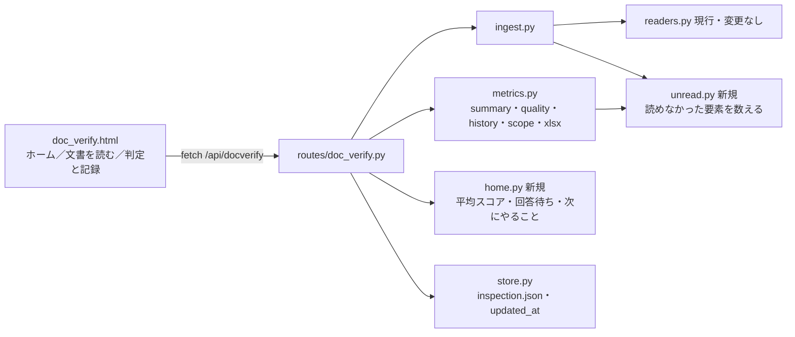
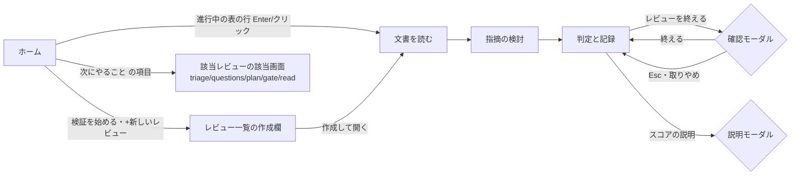

# WS2D-BD-006 基本設計書 System 06「ドキュメント検証」R1（方式設計）

- 文書ID: WS2D-BD-006 / 版数: 0.1（草案・未承認） / 作成日: 2026-10-15 / 作成者: 開発チーム / 承認者: 未承認（保守者が記入する）
- 準拠: IPA 共通フレーム（システム方式設計相当）。品質特性は ISO/IEC 25010、要求の品質特性は ISO/IEC/IEEE 29148（RD-006 と同じ扱い。条番号は原典未確認）
- 上位文書: WS2D-RD-006 要件定義書 System 06（v0.1 草案時点を参照）・WS2D-RA-006 要求分析書
- 下位文書: WS2D-DD-006 詳細設計書 System 06 R1（ファイル単位の契約・テスト観点）
- 画面見本: docs/design/docverify/home-v1.html（承認待ち。RD 要確認-3）
- 既存の型: 現行の docverify（`web/routes/doc_verify.py`・`web/services/docverify/`・`static/js/docverify-*.js`）。dashboard の部品（`dash-hero`・`stat-cards`/`stat-card`・`dashboard-table`・`sidebar-primary-action`・`app-topbar`）

## 0. 範囲

RD-006 11 章の R1 のうち次を対象にする。**FR-06-123（網羅性の表示・集合の検査）は R3 へ移すため含めない。**

| 区分 | ID |
|---|---|
| 機能 | FR-06-015・FR-06-075・FR-06-100〜104 |
| 画面 | SCR-06-01（ホーム）・SCR-06-04（文書を読む）・SCR-06-08（判定と記録） |
| 全状態 | SCR-06-20〜26（9.1。R1 で触る 3 画面と、共通部品を使う既存画面） |
| 非機能 | NFR-06-08・NFR-06-16・NFR-06-18 |
| 受入 | AC-06-05 |

対象外: LLM（SCR-06-11 送信前確認は R2）、精度ページ（SCR-06-10）、集合の検査（SCR-06-07・FR-06-123）。

## 1. 方式概要

現行の 1 レビュー＝1 JSON（`<base>/docverify/<iid>/inspection.json`）を互換のまま拡張する（RD 6 章・D-1）。新しい保存先・DB は作らない。スコアは保存せず毎回計算する（現行 `metrics.quality()`）。ただし**過去の版のスコアだけは、次の版を取り込む時点で確定値として版の記録に残す**（過去の断片・指摘は上書きされて再計算できないため）。

| 方針 | 内容 | 根拠 |
|---|---|---|
| 文言の真実源はサーバ | 読めなかった要素の文・スコアの説明・検査した範囲の文は Python で作り、画面と xlsx が同じ文を使う | FR-06-015・075・103 の文が画面と報告で食い違わないため |
| 読めない要素は数えるだけ | 中身は読まない。zip/XML・PDF 注釈から件数だけ取る。数えられなければ「数えられなかった」と出す | FR-06-015「無言で欠落させない」 |
| vendor は触らない | `web/vendor/reverse_doc/docs_ingest/readers.py` は変更しない。計数は新規 `unread.py` | vendor の更新取り込みを壊さない |
| 0 と未算出を分ける | 断片 0 件・未取り込みのスコアは `null`。画面は「—」と案内 1 行 | FR-06-102 |

## 2. 画面一覧と遷移

1 枚の HTML（`/docverify`）の中で `#<view>` を切り替える現行方式を維持する。

| 画面 | view | 区分 | R1 で変えること |
|---|---|---|---|
| SCR-06-01 ホーム | `home` | 変更 | home-v1 の骨格へ作り替え（ヒーロー・統計カード 4・特性別スコア・次にやること・進行中の表） |
| SCR-06-04 文書を読む | `read` | 変更 | 文書の帯（名前・形式・断片数・版・読めなかった要素）とスコアの帯を本文の上に追加 |
| SCR-06-08 判定と記録 | `gate` | 変更 | スコア区画・版ごとの推移・検査した範囲／検査していないこと・終了確認モーダル・報告のダウンロード |
| 共通（全画面） | — | 変更 | 失敗帯・実行中・0 件・長文・モーダル・キーボード操作の共通部品 |

## 3. 画面ごとの区画

### 3.1 SCR-06-01 ホーム

| 順 | 区画 | 部品 | 内容 | FR |
|---|---|---|---|---|
| 1 | ヒーロー | `dash-hero` | 見出し・説明 1 文・「検証を始める」・工程の手順（取り込み→自動検出→仕分け→質問票→判定） | SCR-06-01 |
| 2 | 見出し行 | `dashboard-section-head` | 「レビュー」・再読み込み・＋新しいレビュー | — |
| 3 | 統計カード | `stat-cards`/`stat-card` ×4 | 進行中のレビュー／未対応の重大な指摘／回答待ちの質問／品質スコア（平均） | SCR-06-01・FR-06-101・102 |
| 4 | 2 列 | `dv-grid2` | 左: 特性別の品質スコア（8 特性・低い順）／右: 次にやること（最大 5 件） | FR-06-101・SCR-06-01 |
| 5 | 進行中の表 | `dashboard-table` | 文書・工程・品質スコア・未対応・更新・操作（開く） | FR-06-101 |

サイドバー最上部に `sidebar-primary-action`「＋ 新しいレビュー」を置く（全画面共通）。

### 3.2 SCR-06-04 文書を読む

| 順 | 区画 | 内容 | FR |
|---|---|---|---|
| 1 | 段階表示・見出し（現行） | 工程の段・役割・自分の確認を終える | 現行 |
| 2 | 文書の帯 `dvr-docband` | 名前（省略記号＋title）・形式・断片数・版・読めなかった要素の文（0 件なら「読めなかった要素はありません」） | FR-06-015・SCR-06-04 |
| 3 | スコアの帯 `dv-scoreband` | 総合スコア・特性別（8 個の小さな棒）・「スコアの意味」ボタン | FR-06-100・102・103 |
| 4 | 本文と指摘（現行 2 列） | 行は Tab で選べ、Enter で指摘の追加欄を開く | NFR-06-18 |

### 3.3 SCR-06-08 判定と記録

| 順 | 区画 | 内容 | FR |
|---|---|---|---|
| 1 | KPI（現行） | 未対応の重大・主要・指摘密度・出口基準 | 現行 |
| 2 | 品質スコア `dvr-quality` | 総合・特性別の表（特性・スコア・未解決件数）・スコアの意味 | FR-06-100・102・103 |
| 3 | 版ごとの推移 `dvr-history` | 版・文書名・取り込み日・総合スコア・状態（確定／現在） | FR-06-104 |
| 4 | 判定の理由（現行） | 出口基準を満たさない理由 | 現行 |
| 5 | 検査した範囲 `dvr-scope` | 「検査した範囲」「検査していないこと」の 2 表。網羅性・意味の正しさは「未検証」 | FR-06-075・NFR-06-08 |
| 6 | 承認（現行） | 承認者名・承認日（人が記入） | 現行 |
| 7 | 操作 | 報告を Excel で出力（ダウンロード・実行中表示）／レビューを終える（確認モーダル） | FR-06-075・SCR-06-25 |

## 4. API の追加・変更

共通: JSON。エラーは `{"error": "何が起きたか。次にすること。"}`（NFR-06-16）。現行の `_respond()` が返す `summary` は全レビュー API に載るため、`summary` の追加は 1 か所で全画面に効く。

| メソッド | パス | 区分 | 変更 | FR |
|---|---|---|---|---|
| GET | `/api/docverify/home` | 変更 | `counts.awaiting_answers`・`quality`（平均と特性別）・`next_actions[]`・`active[]` に `quality_overall`・`open`・`open_critical`・`updated_at`・`versions` を追加。既存キーは残す | SCR-06-01・FR-06-101・102 |
| GET/POST/PATCH | `/api/docverify/inspections/<iid>…`（`summary` を返すもの全部） | 変更 | `summary.quality` に `note`・各特性の `label` を追加。`summary.history[]`・`summary.unread_lines[]`・`summary.scope` を追加 | FR-06-015・075・100・103・104 |
| POST | `/api/docverify/inspections/<iid>/document` | 変更 | 取り込み結果の `document.unread`（件数）を保存。直前の版の `versions[-1].quality` を確定し、新しい版の記録にも初期値を入れる | FR-06-015・104 |
| POST | `/api/docverify/inspections/<iid>/close` | 変更 | 終了時に現在の版の `quality` を確定して保存 | FR-06-104 |
| GET | `/api/docverify/inspections/<iid>/report.xlsx` | 変更 | シート「検査した範囲」を追加。集計シートに版ごとのスコアを追加。生成失敗は 500 と JSON の文 | FR-06-075・104・NFR-06-08 |

新しいエンドポイントは作らない（版ごとのスコアは `summary.history` で返す）。

## 5. データ追加（inspection.json）

| 場所 | キー | 型 | 既定（旧 JSON） | FR |
|---|---|---|---|---|
| `document` | `unread` | `{"images","comments","hidden_sheets","hidden_cols","shapes": int, "scanned": bool}` | キー無し＝「数えていない」 | FR-06-015 |
| `versions[]` | `quality` | `{"overall": int\|null, "items": {特性: int\|null}, "final": bool}` | キー無し＝「—」 | FR-06-104 |
| ルート | `updated_at` | ISO 8601 文字列 | キー無し＝`created_at` で代用 | SCR-06-01（更新列） |

- `hidden_sheets`・`hidden_cols` は**中身は読んでいる**（現行 readers は非表示シート・列のセルも読む）。画面では「読みました（非表示）」と区別して出す。`images`・`comments`・`shapes` は読んでいない要素
- 互換: 追加キーが無い JSON をそのまま読む（`store.upgrade()` は変えない。読み手側で `get()` の既定値を使う）

## 6. 回答待ち・次にやることの定義

| 名称 | 定義 |
|---|---|
| 回答待ちの質問 | 進行中（`phase != closed`）のレビューの指摘のうち `certainty == "要確認"` かつ `status != "rejected"` かつ `answer` が空のもの（`questions.build()` の対象から回答済みを除いたもの） |
| 品質スコア平均 | 進行中レビューのうち `quality.overall` が `null` でないものの算術平均（四捨五入の整数）。対象 0 件は `null` |
| 特性別の平均 | 特性ごとに、その特性のスコアが `null` でないレビューの平均 |
| 次にやること | 自分が参加者のレビュー（無ければ進行中すべて）から規則で作る。優先順: 重大な未対応 → 未検討の候補 → 回答待ち → 自分の確認が未完了 → 文書未取り込み → 出口基準を満たし未終了。最大 5 件 |

## 7. 全状態の扱い（SCR-06-20〜26）

| ID | 状態 | 方式 |
|---|---|---|
| SCR-06-20 | 通常 | `html,body{overflow:hidden}`（ta2.css）の内側で `.dv-content` だけ縦スクロール。表は `.dv-tscroll` の内側で横スクロールさせず省略。最下部の要素まで届く |
| SCR-06-21 | 実行中 | 共通 `DV.busy(btn, promise, label)` でボタンを `disabled`＋`aria-busy`＋文言差し替え。同じボタンの 2 回目は要求を出さない。取り込みは「文書を読み取り中…」、報告は「報告を作成中…」 |
| SCR-06-22 | 失敗 | 共通の赤い帯 `#dv-banner`（role=alert）か画面内の `.dvr-msg.err`。文はサーバの `error`。入力欄は再描画しない（失敗時に `form.reset()` を呼ばない） |
| SCR-06-23 | 0 件 | 共通文 `DV.emptyFindings(n)`「確認した範囲では指摘はありません。N 断片を確認しました。網羅性は未検証です。」。表の 0 件は表ごとの 1 文 |
| SCR-06-24 | 狭い画面 | 1280×720 で横スクロール 0。`stat-cards` は 4 列、`dv-grid2` は 2 列のまま。1280 未満は対象外（PC 専用） |
| SCR-06-25 | モーダル | 共通 `DV.modal()`（`<dialog>` の `showModal`）。Esc で閉じる・Tab をモーダル内に閉じ込める・閉じたら開いた要素へフォーカスを戻す。R1 の利用: 「レビューを終える」確認・「スコアの意味」 |
| SCR-06-26 | 長文 | 共通クラス `.dv-ellipsis`（1 行省略）＋`title` に全文。原文は詳細側で全文 |

## 8. エラー文言の方針（NFR-06-16）

| 規則 | 内容 |
|---|---|
| 形 | 「何が起きたか。次にすること。」の 2 文。次にすることは 1 行 |
| 禁止 | 実装語（関数名・キー名）・パス・例外名・HTTP コード・「（任意）」 |
| 置き場所 | サーバが返す `error` を画面はそのまま出す。画面側で作る文は `docverify-core.js` の定数に集める |
| 詳細 | 例外の詳細はサーバのログ（`log.exception`）にだけ残す |
| 数えられない | 読めなかった要素を数えられない・スコアを出せないことはエラーにせず、案内文で示す（取り込み自体は成功させる） |

R1 で追加する文の一覧は DD 9 章。

## 9. 品質特性（ISO/IEC 25010）への配慮

| 特性 | 対応 |
|---|---|
| 機能適合性 | スコアは現行 `quality()` の式を変えない。版の確定値は取り込み時に保存 |
| 使用性 | 限界の明示（NFR-06-08）・全状態（9.1）・キーボード（NFR-06-18）・コントラスト 4.5:1（文字に `--color-medium` を使わない） |
| 信頼性 | 計数の失敗で取り込みを止めない（`scanned: false`） |
| 保守性 | 文言の真実源をサーバ 1 か所。新規ファイルは 400 行以内 |
| 互換性 | 旧 JSON をそのまま読む |

## 10. RD への対応表

| RD の ID | BD の節 | DD の節 |
|---|---|---|
| FR-06-015 | 3.2・4・5 | 2・3・5・8.5・9 |
| FR-06-075 | 3.3・4 | 5・10 |
| FR-06-100 | 3.2・3.3・4 | 5・8.3・8.5 |
| FR-06-101 | 3.1・6 | 6・8.4 |
| FR-06-102 | 1・3.1・3.2 | 5・6・8・9 |
| FR-06-103 | 3.2・3.3・4 | 5・8.5・9 |
| FR-06-104 | 3.3・4・5 | 5・7・8.5・10 |
| SCR-06-01 | 3.1 | 6・8.1・8.2・8.4 |
| SCR-06-04 | 3.2 | 8.5 |
| SCR-06-08 | 3.3 | 8.5・10 |
| SCR-06-20〜26 | 7 | 8・11 |
| NFR-06-08 | 3.3 | 5・10 |
| NFR-06-16 | 8 | 9 |
| NFR-06-18 | 3.2・7 | 8.3・8.6・11 |
| AC-06-05 | 7 | 12.3 |

## 11. 未決・リスク

| ID | 内容 | 扱い |
|---|---|---|
| BD6-Q1 | ホームの見本 home-v1 が未承認（RD 要確認-3） | 骨格は見本どおりで作る。承認で変わる場合は DD 7 章だけ差し替え |
| BD6-Q2 | home-v1 の「前週から +6」は履歴の保存が要る | R1 は出さない。カード下の文は「算出できた N 件の平均」 |
| BD6-Q3 | NFR-06-08「精度ページへの案内」。精度ページ（SCR-06-10）は R1 に無い | 報告と画面に「規則の精度は未測定です」と書く。精度ページができたら案内に差し替え |
| BD6-Q4 | 指摘の無い特性は 100 になり「検査していない特性」と区別できない（現行 `quality()` の仕様） | 式は変えず、スコアの説明と「検査していないこと」に明記 |
| BD6-Q5 | PDF の画像・注釈の数え方は pdfminer／pypdf の取得範囲に依存（未検証） | 実データで 1 回確かめてから実装（S-1）。差異は `scanned` で示す |
