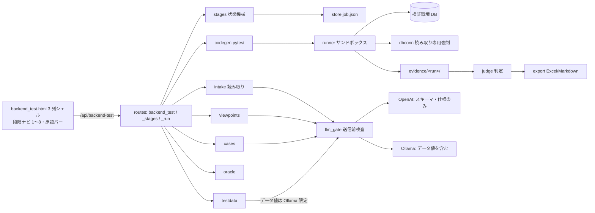

# WS2D-BD-008 基本設計書 System 08「バッチ・バックエンドのテスト」（方式設計）

- 文書ID: WS2D-BD-008 / 版数: 0.1（草案・未承認） / 作成日: 2026-10-15 / 作成者: 開発チーム / 承認者: 未承認（保守者が記入する）
- 準拠: IPA 共通フレーム（システム方式設計相当）
- 上位文書: WS2D-RD-008 要件定義書 System 08（v0.2 草案時点を参照）・WS2D-RA-008 要求分析書
- 既存の型: System 07（`web/routes/batch_test.py`・`web/services/batchtest/`）の 3 列シェルと保存方式、AutoRun（`web/routes/autorun_stages.py`）の段階承認
- 本書の数値のうち「要計測」は MVP の実データで決める。未確認の事項は 11 章に置く

## 1. 方式概要

System 07 の 3 列シェル（サイドバー／案件一覧／本体）と保存方式（1 案件 = 1 フォルダ・job.json・テナント分離）をそのまま使い、本体の中を AutoRun 型の 8 段階承認にする。各段階は「生成（AI・規則）→ 人が採否 → 承認」で閉じ、前段が承認済みでなければ次段を生成しない。実行（段階 7）だけがサブプロセスで非同期に動く。期待値は oracle が方式ごとに扱い、機械判定できるものだけを自動確定する（RD 3 章）。LLM への送信はすべて llm_gate を通す。



## 2. モジュール構成（並列実装の契約）

配置: `web/services/backendtest/`。各ファイル 400 行以内、関数 50 行未満。入力の dict を変更せず新しい dict を返す。利用者に見せてよい失敗は `store.StoreError`（ValueError 派生）に日本語の「理由。次の行動。」を入れて投げる。型名の略記: `Job`=job.json の dict（3 章）、`Fact`/`Viewpoint`/`Case` 等は 3.2 の要素。

| ファイル | 責務 | 公開関数（引数 → 戻り値） |
|---|---|---|
| `store.py` | 案件の保存・読み出し・ファイル取り込み・監査・保存期間の掃除 | `new(name, target_kind, level, purpose="", scope="") -> Job`／`load(jid) -> Job`（無ければ KeyError）／`save(job) -> Job`（原子的書き込み・updated_at 更新）／`list_all() -> list[dict]`（summary。呼び出し時に `purge_expired()` を先に実行）／`job_dir(jid) -> Path`／`add_file(job, filename, data: bytes) -> Job`／`remove_file(job, name) -> Job`／`file_path(job, name) -> Path`／`audit(job, action, stage: int|None, detail, actor) -> Job`／`purge_expired(today=None) -> list[str]`（削除した jid）／`save_version(job, stage) -> None`・`load_version(jid, stage, version) -> dict` |
| `stages.py` | 段階 1〜8 の状態機械（4 章） | `STAGES: tuple[dict]`（no, key, name, approver_role）／`can_generate(job, n) -> tuple[bool, str]`／`put_generated(job, n, artifact, actor) -> Job`（承認済みなら proposals へ）／`decide_item(job, n, item_id, decision, value, reason, actor) -> Job`／`approve(job, n, version, role, actor) -> Job`／`reject(job, n, reason, comments: dict, actor) -> Job`／`revert(job, n, actor) -> Job`（直前の版へ）／`adopt_proposal(job, n, pid, actor) -> Job`／`downstream(n) -> list[int]` |
| `intake_ddl.py` | PostgreSQL DDL の構文読み取り（規則ベース・LLM 不使用） | `read_ddl(text, file) -> {"facts": list[Fact], "unread": list[{"file","line","reason"}]}` |
| `intake.py` | 段階 2 の取りまとめ。ジョブ定義・仕様書・ソースから事実、矛盾と未読を質問へ | `analyze(job) -> {"facts": list[Fact], "questions": list[Question], "unread": list[dict]}`／`read_jobdef(text, file) -> list[Fact]`／`read_spec(passages, job) -> list[Fact]`（llm_gate 経由）／`read_source(text, file) -> list[Fact]`（origin="source"） |
| `redact.py` | 秘密情報・個人情報らしき値の検出と伏せ字（純関数） | `scan(text, extra_values=()) -> list[{"kind","start","end","rule"}]`／`mask(text, hits) -> str`／`scrub(text, secrets: list[str]) -> str`（ログ・証跡用） |
| `llm_gate.py` | LLM 送信の唯一の出口。送信前検査・振り分け・記録 | `send(job, stage, purpose, payload: {"schema": str, "spec": str, "data": str}, actor) -> {"text": str, "record": LlmRecord}`／`inspect(body, secrets, data_values) -> {"secret_hits": int, "data_hits": int, "rules": list[str], "locations": list[{"file","line"}]}`／`route(job, payload) -> "openai"\|"ollama"`。検査で 1 件でも検出したら送らず `StoreError` |
| `catalog.py` | 観点カタログ（付録 A の 10 カテゴリ・61 観点）とテストレベル既定（RD 4.3.1）のデータ | `CATALOG: tuple[dict]`（id, cat, name, technique, fr, release, basis, unverified）／`LEVEL_DEFAULTS: dict[level, {"cats": tuple, "oracles": tuple}]` |
| `viewpoints.py` | 段階 3。カタログを事実に当てて「出す／対象外＋理由」を決める | `build(facts, level, target_kind) -> list[Viewpoint]`（61 件すべてを返す）／`coverage(viewpoints) -> {"total":61, "decided": int, "silent": list[id]}` |
| `cases.py` | 段階 4。承認済み観点からケース。3 族・レベル別粒度・要件 ID | `build(viewpoints, facts, level) -> list[Case]`／`merge(approved: list[Case], fresh: list[Case]) -> {"cases": list[Case], "proposals": list[dict]}`／`renumber(cases) -> list[Case]`／`trace(cases, facts) -> {"rows": list[dict], "uncovered_reqs": list[str]}` |
| `testdata.py` | 段階 5。データ仕様・投入データ生成（Faker）・マスキング | `spec(cases, facts) -> list[DataSpec]`／`generate(specs, facts, seed: int) -> {"tables": {table: list[row]}, "files": list[dict]}`／`mask(rows, columns, seed) -> list[row]`／`affected_tables(specs) -> list[{"table","ops"}]` |
| `diffing.py` | スナップショットの差分（純関数。7 章のアルゴリズム） | `diff(before: list[row], after: list[row], key: list[str], exclude=(), tolerance: dict={}, mask=()) -> {"added": list, "removed": list, "updated": list[{"key","cols":{c:[b,a]}}], "unchanged": int}`／`row_hash(row, exclude) -> str` |
| `oracle.py` | 期待値 3 方式＋スキーマ。確定規則（RD 3 章）・自動判定 | `default_method(case, level) -> str`／`can_confirm(case, role, facts) -> tuple[bool, str]`／`confirm(case, role, actor) -> Case`／`check_alt_sql(sql, source_facts) -> list[str]`（写しの警告）／`judge_auto(case, evidence) -> {"verdict": str, "rule": str, "detail": dict}`／`schema_check(rows, ddl_facts, table) -> list[dict]`／`golden_new_version(job, case_id, file, actor) -> Job` |
| `codegen.py` | 段階 6。テンプレートから pytest＋conftest を生成（LLM 不使用）・ケースごとの日本語要約（3 文以内、FR-08-106） | `generate(job) -> {"files": list[{"path","text"}], "map": {case_id: test_name}, "summaries": {case_id: str}}`／`summarize_sql(case) -> str`（別経路 SQL の要約。段階 4 で使う）／`merge_edits(prev_files, edited_files, fresh_files) -> {"files": list, "proposals": list}` |
| `codegen_gate.py` | 採否関門と修復反復の保護 | `gate(files, cases) -> list[{"case_id","status":"ok"\|"blocked","reason"}]`（構文検査・期待値方式欠落・接続文字列の混入・日本語要約の欠落）／`guard(prev_files, new_files) -> list[str]`（assert・期待値・方式・ゴールデン参照の差分。1 件でもあれば承認待ちへ戻す） |
| `dbconn.py` | 接続・接続確認・本番判定・読み取り専用強制・スナップショット | `classify(env, declared_production: bool) -> {"production": bool, "reasons": list[str]}`／`check(env, secret) -> {"reachable": bool, "auth": bool, "privilege": "read"\|"write"\|None, "message": str}`／`connect(env, secret, read_only: bool) -> psycopg.Connection`／`guard_sql(sql, read_only) -> None`（書き込み系なら StoreError）／`snapshot(conn, table, key, limit) -> {"rows": list, "truncated": bool}` |
| `runner.py` | 段階 7。実行の受付・確認トークン・サブプロセス管理・キャンセル | `preview(job, env_id, case_ids, business_date) -> {"env_name","production","writes": bool,"affected_tables": list,"confirm_token": str\|None}`／`start(job, env_id, case_ids, business_date, secret, confirm_token, actor) -> RunSummary`（テナントで実行中なら StoreError）／`status(jid, run_id) -> RunSummary`／`cancel(jid, run_id, actor) -> RunSummary` |
| `evidence.py` | 証跡フォルダの規約・結果の逐次読み取り・junit 解析・ハッシュ | `run_dir(jid, run_id) -> Path`／`read_results(run_dir) -> list[dict]`（results.jsonl）／`parse_junit(path) -> list[dict]`／`manifest(run_dir) -> {"files": list[{"path","sha256"}]}` |
| `judge.py` | 段階 8。自動判定＋人の判断・集計・不具合 | `judge(job, run) -> list[Result]`／`set_human(job, run_id, case_id, verdict, reason, actor) -> Job`／`summarize(results) -> {state: count}`／`add_defect(job, run_id, case_id, severity, priority, title, actor) -> Job` |
| `export.py` | 書き出し | `report_xlsx(job) -> bytes`（6 シート: 観点表・テスト仕様書・テストデータ仕様・結果一覧・不具合一覧・エビデンス）／`report_md(job) -> bytes`／`trace_csv(job) -> bytes`／`code_zip(job) -> bytes`／`evidence_zip(job, run_id) -> bytes` |

ルート（`web/routes/`）: `backend_test.py`（Blueprint `bp`・画面・案件・資料・対象・環境・接続確認。末尾で下 2 つを import して同じ bp にルートを足す）、`backend_test_stages.py`（段階・項目・提案・期待値・ゴールデン・コード編集）、`backend_test_run.py`（実行・巻き戻し・判定・不具合・書き出し・監査）。画面: `templates/backend_test.html`、`static/js/backend-test.js`（シェル・一覧・段階 1〜5）、`static/js/backend-test-run.js`（段階 6〜8・実行のポーリング）、`static/css/backend-test.css`。

## 3. データ設計

### 3.1 配置

`<DATA_DIR>/[tenants/<slug>/]backendtest/<jid>/`（`scoped_output_dir(config.DATA_DIR) / "backendtest"`。jid は 12 桁 16 進）

```text
<jid>/job.json            案件の全状態（秘密情報を含めない）
<jid>/files/              取り込んだ資料の原本
<jid>/redacted/           伏せ字版（LLM へ送るのはこちらだけ）
<jid>/versions/<n>-v<k>.json  段階 n の版 k の成果物（取消・監査用。各段階 直近 10 版）
<jid>/golden/<case>-v<k>.*    承認済みゴールデン
<jid>/code/               生成コード（tests/test_*.py・conftest.py・bt_runtime.py）
<jid>/evidence/<run_id>/  results.jsonl・junit.xml・stdout.log・stderr.log（scrub 済み）・<case>/before.json・after.json・diff.json・rc.txt・manifest.json
```

### 3.2 job.json

```json
{"id":"a1b2c3d4e5f6","name":"","purpose":"","scope":"","target_kind":"batch","level":"system",
 "created_at":"","updated_at":"","retention_days":90,"members":{"<user>":"senior_qa"},
 "approver_roles":{"1":"qa","2":"qa","3":"qa","4":"senior_qa","5":"qa","6":"qa","7":"qa","8":"senior_qa"},
 "llm":{"provider":"openai|ollama","external_scope":"schema_spec"},
 "files":[{"name":"","kind":"ddl|jobdef|spec|source|io|golden|other","size":0,"added_at":"","redactions":[{"rule":"","line":0}]}],
 "targets":[{"id":"t1","kind":"batch","launch":"command","command":"python bin/close.py --date {business_date}","inputs":[],"outputs":[]}],
 "envs":[{"id":"e1","name":"結合環境","db":{"kind":"postgresql","host":"","port":5432,"dbname":"","user":"","sslmode":"prefer"},
          "file_root":"","writable":true,"declared_production":false,"production":false,"production_reasons":[]}],
 "current_env":"e1",
 "stages":{"1":{"status":"draft|generated|approved|rejected","version":0,"stale":false,"approved_by_role":null,
                "approved_by":null,"approved_at":null,"reject_reason":null,"comments":{},"proposals":[]}},
 "facts":[{"id":"F001","kind":"table|column|constraint|jobarg|io|rc|commit|rule|formula|date_rule","subject":"","value":"",
           "origin":"ddl|jobdef|spec|source","source":{"file":"","line":0},"confirmed":false}],
 "questions":[{"id":"Q001","text":"","source":{"file":"","line":0},"answer":null}],
 "viewpoints":[{"id":"A-1-01","cat":"A-1","name":"","technique":"境界値分析（5.2.3）|技法なし（経験ベース）","decision":"emit|excluded|adopted|edited|discarded",
                "reason":"","basis":"","unverified":false,"release":"R1","added_by":null}],
 "cases":[{"id":"C001","viewpoint":"A-1-01","technique":"","level":"system","req_ids":[],"pre":"","steps":[],"expected":"",
           "oracle":{"method":"db_diff|alt_sql|golden|schema","state":"unconfirmed|auto|human","tables":[],"key":[],"exclude":[],
                     "tolerance":{},"mask":[],"count_formula":null,"alt_sql":null,"alt_sql_ja":"","golden":null,"confirmed_by":null,"warnings":[]},
           "basis":"","origin":"generated|manual","history":[]}],
 "data_specs":[{"id":"D001","case":"C001","table":"","conditions":[],"rows":0,"encoding":"utf-8","mask_cols":[],"basis":""}],
 "code":{"files":[{"path":"tests/test_c001.py","sha256":"","edited_by":null}],"map":{"C001":"test_C001_rerun"},"summaries":{"C001":""},"gate":[]},
 "runs":[{"id":"r20261015-01","env":"e1","env_name":"","business_date":"2026-10-15","code_version":3,"case_ids":[],
          "status":"queued|running|done|cancelled|timeout|error","started_at":"","ended_at":"","rc":null,"progress":{"done":0,"total":0,"current":null}}],
 "results":[{"run":"r..","case":"C001","fact":{"diff":"evidence/..","rc":0},"auto":{"verdict":"","rule":""},
             "human":{"verdict":null,"reason":"","by":null,"at":null},"state":"pass|fail|undetermined|not_run|error","cause":null}],
 "defects":[{"id":"BUG-001","run":"","case":"","title":"","severity":"","priority":"","repro":{"input":"","steps":"","diff":""}}],
 "llm_log":[{"at":"","stage":3,"purpose":"viewpoints","provider":"openai","llm":"","kinds":["schema","spec"],"sha256":"",
             "inspection":{"secret_hits":0,"data_hits":0,"rules":[],"locations":[]},"sent":true}],
 "audit":[{"at":"","actor":"","action":"generate|approve|reject|revert|confirm|run|cancel|rollback|judge|export","stage":3,"version":2,"detail":""}],
 "notices":[]}
```

規則: (1) 接続の秘密（パスワード・トークン）は job.json・ログ・証跡・生成コードのどこにも書かない（8 章）。(2) LLM の送信本文は保存せず、sha256 と検査結果だけ残す。(3) 事実の `origin="source"` は期待値の根拠欄（`oracle` と `basis`）に入れられない（oracle が拒否）。

### 3.3 保存期間の掃除

既定 90 日（`retention_days` で案件ごとに上書き。0 は無期限にしない＝最小 1）。起点は `updated_at`。`store.list_all()` と System 08 の画面表示時に `purge_expired()` を呼ぶ（**定時実行・常駐の掃除は作らない**）。削除は案件フォルダ単位。実行中の案件は削除しない。削除したことを `<root>/purge.log`（jid・日時のみ）に残す。

## 4. 段階の状態機械

段階: 1 目的・範囲 / 2 対象の読み取り / 3 観点表 / 4 ケース表（期待値方式・別経路 SQL） / 5 テストデータ仕様 / 6 テストコード / 7 実行 / 8 判定・報告。状態は `draft`（未生成・入力中）→ `generated`（承認待ち）→ `approved`、差し戻しで `rejected`。

| 操作 | 許す条件 | 結果 |
|---|---|---|
| 生成 | n=1 または段階 n−1 が approved かつ stale でない（FR-08-101・141） | status が draft/generated/rejected: 版 +1、旧版を versions/ に退避、status=generated。status が approved: **成果物を変えず** 差分を `proposals` に積み notices に影響候補を出す（FR-08-044・076・103） |
| 項目の採否 | status=generated | 段階 3 は採用／修正／破棄（理由必須）、追加はシニア QA。段階 4 は期待値の確定（`oracle.can_confirm`） |
| 承認 | status=generated、要求された版と一致、承認ロールを満たす、段階固有の条件（下） | approved、approved_by_role/at を記録、audit |
| 差し戻し | status が generated または approved | rejected、理由と項目コメントを記録。後段の approved は **変更せず** `stale=true`（実行の開始を止める） |
| 取消 | 版 ≥2 | 直前の版を復元し status=generated（FR-08-145） |
| 提案の採用 | approved の段階に proposals がある | 差し戻しを経たのと同じ扱い（status=generated・版 +1） |

段階固有の承認条件: 3 は `viewpoints.coverage().silent` が 0（FR-08-021）。4 は全ケースに方式があり、業務値の確定がシニア QA（FR-08-143）。未確定は承認を止めず件数を承認バーに出す（実行しても「未判定」）。6 は `codegen_gate.gate` で blocked のケースを除外した旨を表示し、全テストに日本語要約があること（初級 QA は要約だけで承認できる。FR-08-106）。7 は実行が終了（done/cancelled/timeout）していること。8 は人の判定待ちが残っていれば「判定待ち」と表示し承認できない。

承認ロール: `job.approver_roles` で段階ごとに設定できる（FR-08-105。既定は段階 4・8 が `senior_qa`、他は `qa` 以上）。期待値の確定（突合キー・許容差・除外列・別経路 SQL・ゴールデン・業務値）は設定に関わらず `senior_qa` に固定し、初級 QA は下書きの確認と差し戻しまで（FR-08-107）。ロールは `job.members`（案件の作成者は senior_qa）から引く。

再生成の許可範囲（修復反復・ブリーフ決定）: 段階 6 の再生成で変えてよいのは接続・構文・データ投入だけ。`codegen_gate.guard` が assert・期待値・期待値方式・ゴールデン参照の差分を検出したら、承認済みでも status=generated に戻して承認待ちにする。反復の上限は 3 回（FR-08-144 は Should。MVP は手動の再生成のみ）。

## 5. API 一覧

共通: JSON。エラーは `{"error": "理由。次の行動。"}`。400 入力不正／403 ロール不足／404 案件・項目なし／409 段階の前提未達・実行中・版の不一致／413 上限超過／500 読み書き失敗（ログに詳細）。接頭辞 `/api/backend-test/jobs/<jid>` を `…` と書く。秘密情報は要求本文の `secret` で受け、そのリクエスト（実行中はその実行）のプロセス内メモリにだけ持つ。

| メソッド | パス | 要求 | 応答 | 主なエラー |
|---|---|---|---|---|
| GET | `/backend-test` | — | 画面 | — |
| GET/POST | `/api/backend-test/jobs` | POST: name, target_kind, level, purpose, scope | jobs[] / job（201） | 400 |
| GET/PATCH/DELETE | `…` | PATCH: name・purpose・scope・level・retention_days・llm・approver_roles（シニア QA） | job / ok | 404・409（実行中の削除） |
| POST | `…/files` | multipart files | job | 400・413 |
| PATCH/DELETE | `…/files/<name>` | kind, redactions_add | job | 404 |
| PUT | `…/targets` | targets[] | job | 400 |
| PUT | `…/envs` | envs[], current_env（secret を含めたら 400） | job（production 判定付き） | 400 |
| POST | `…/envs/<eid>/check` | secret | reachable, auth, privilege, production, message | 400 |
| POST | `…/stages/<n>/generate` | — | job | 409（前段未承認） |
| PATCH | `…/stages/<n>/items/<iid>` | decision, value, reason | job | 400・409 |
| POST | `…/stages/<n>/items` | item | job | 403 |
| POST | `…/stages/<n>/approve` | version | job | 403・409 |
| POST | `…/stages/<n>/reject` | reason, comments | job | 400 |
| POST | `…/stages/<n>/revert` | — | job | 409 |
| POST | `…/stages/<n>/proposals/<pid>/adopt` | — | job | 404 |
| PATCH | `…/cases/<cid>/oracle` | method, config, confirm | job | 403・409（根拠がソースのみ） |
| POST | `…/golden` | case_id, file | job（新版は承認待ち） | 400 |
| PUT | `…/code` | path, text（シニア QA） | job（gate 再評価） | 403・400 |
| POST | `…/runs/preview` | env_id, case_ids, business_date | env_name, production, writes, affected_tables, confirm_token | 409 |
| POST | `…/runs` | env_id, case_ids \| "remaining", business_date, secret, confirm_token | run（202） | 409（実行中・未承認・本番に書き込み・トークン不一致） |
| GET | `…/runs/<rid>` | — | run（progress・部分結果） | 404 |
| POST | `…/runs/<rid>/cancel` | — | run | 409 |
| POST | `…/rollback` | env_id, run_id, secret, confirm_token | 結果（一致・不一致） | 409 |
| PATCH | `…/results/<rid>/<cid>` | verdict, reason | job | 403 |
| POST | `…/defects` | run_id, case_id, severity, priority, title | job | 400 |
| GET | `…/export/<kind>` | kind: report.xlsx・report.md・trace.csv・code.zip・evidence.zip?run= | ファイル | 400・404 |
| GET | `…/audit` | — | audit[] | — |

## 6. 実行方式

- 受付: `runner.preview` が書き込みの有無（データ投入・ジョブ起動・巻き戻しを含むか）と影響テーブルを示し、書き込みありなら確認トークン（jid・env・case_ids・コード版の HMAC、10 分有効、メモリ内）を返す。`start` はトークン一致を必須にする（FR-08-009）。本番判定の環境で書き込みを含むなら 409（FR-08-008）
- 同時実行: テナントあたり 1 本（メモリ内のレジストリ＋`<root>/.running` ファイル。製品再起動後に残っていたら当該実行を error・部分結果を確定）
- 起動: `[sys.executable, "-m", "pytest", "code/tests", "-p", "bt_runtime", "--junitxml=evidence/<rid>/junit.xml", "-k", <選択>]` をワーカースレッドから `subprocess.Popen(start_new_session=True)` で起動。作業ディレクトリは `<jid>/`
- 環境変数の洗浄: 親の環境を引き継がず、`PATH`・`LANG`・`TZ`・`HOME=<jid>/work`・`PYTHONPATH=<jid>/code` と `WS2D_BT_*`（DSN 部品・パスワード・業務日付・run_id・証跡先・本番フラグ）だけを渡す。OpenAI キー等は渡さない
- 資源上限: POSIX は `preexec_fn` で `RLIMIT_AS`・`RLIMIT_FSIZE`・`RLIMIT_CPU` を設定（値は要計測。暫定 2GB・200MB・ケース上限 ×件数）。標準出力・標準エラーは上限 10MB で打ち切り
- タイムアウト: ケース単位は `bt_runtime` の `SIGALRM`（既定は要計測。暫定 300 秒、超過は「実行不能（タイムアウト）」）、全体は runner の deadline（暫定 60 分）で `killpg(SIGTERM)` → 5 秒後 `SIGKILL`
- キャンセル: 同じ停止手順。完了済みケースは results.jsonl から確定、残りは「未実行」（FR-08-083）
- 部分結果と再実行: `bt_runtime` がケース終了ごとに results.jsonl へ 1 行追記（fsync）。`case_ids="remaining"` は前回の未実行・実行不能・不合格だけを選び、結果は run を跨いで最新を集計する（FR-08-084）
- 業務日付: `WS2D_BT_BUSINESS_DATE` と対象コマンドの `{business_date}` 置換で渡す。OS 時刻は変えない（FR-08-087）
- 進捗: `GET …/runs/<rid>` が results.jsonl の行数・実行中ケース・経過秒を返す。画面は 2 秒間隔で、実行中の間だけ取得する
- 証跡（ケースごと）: before.json・after.json（対象テーブルのスナップショット、行上限暫定 100,000、超過は truncated として前後比較を未判定）・diff.json（7 章）・rc.txt・ジョブの stdout/stderr。run 単位で junit.xml・stdout.log・stderr.log・manifest.json（各ファイルの sha256・環境名・業務日付・コード版）。ログは保存前に `redact.scrub` で入力された秘密を伏せる
- 生成コードの接続: `bt_runtime.connect()` が `WS2D_BT_*` から接続し、本番フラグ時は `SET SESSION CHARACTERISTICS AS TRANSACTION READ ONLY` を発行し `guard_sql` を通す

## 7. 期待値 3 方式の実現

| 方式 | 設定（case.oracle） | 実現 |
|---|---|---|
| DB 前後比較 | tables・key（突合キー）・exclude（除外列）・tolerance（列ごとの絶対差／相対差）・mask（採番・時刻: 値でなく有無で比較）・count_formula（承認済みの件数式） | `diffing.diff`: 突合キーで before/after を辞書化 → 片側だけのキーを added/removed → 両側のキーは `row_hash`（除外列・mask 列を除いた正規化 JSON の sha256）を比較し、違う行だけ列ごとに比較して tolerance 内は一致扱い。キー重複は「未判定（突合キーが一意でない）」 |
| 別経路計算 | alt_sql（読み取り SQL のみ）・alt_sql_ja（日本語要約） | AI が仕様の事実だけから下書き → `oracle.check_alt_sql` がソース事実の式・列の並びと正規化比較し写しを警告 → シニア QA が承認して state=human → 実行時に同じ接続で読み取り実行し、対象の出力と突合キー・tolerance で比較 |
| ゴールデン | golden（版・承認者・承認日時・ファイル） | 承認済みの版だけを参照。差し替えは新版として承認待ち、旧版は保持（FR-08-065）。比較は DB 前後比較と同じ `diffing.diff` |
| スキーマ | DDL の事実 | `oracle.schema_check`: 型・桁・NULL 可否・一意を行ごとに検査（FR-08-067） |

判定表（`oracle.judge_auto`。自動確定してよいものだけ）:

| ケースの種類 | 機械判定 | 合格条件 | 人が確定するもの |
|---|---|---|---|
| 冪等性（再実行） | 可 | 2 回目の diff が空 | 再実行方式の選択 |
| 途中失敗からの回復 | 可 | 回復後の after が正常 1 回の after と diff 空 | 部分コミットの許容 |
| 対象外テーブル・除外列以外の不変 | 可 | 対象外の diff が空 | 対象外の範囲 |
| 件数 | 可（式が承認済みのとき） | count_formula を満たす | 式そのもの |
| スキーマ | 可 | 違反 0 | 仕様と DDL の食い違いの正 |
| 変化した行の値 | 別経路 SQL またはゴールデンが承認済みのときだけ可 | 突合して差 0（tolerance 内） | SQL・ゴールデンの承認 |
| 業務値で方式未確定 | 不可 | — | 「未判定」として残し合格に数えない |

確定の拒否（`oracle.can_confirm`）: 根拠がソース事実だけ（FR-08-143）、別経路 SQL が写し警告付きで未解消、ロールが senior_qa 未満。

## 8. 接続・安全

- 本番判定（`dbconn.classify`）: 次のいずれかで production=true。環境名・DB 名・ホストに `prod|prd|production|本番|honban|live` を含む／ホストが社内の本番帯として登録された接尾辞に一致（設定値・既定なし）／利用者が「本番」と申告／接続確認で `pg_is_in_recovery()` が真（複製先）。理由を `production_reasons` に入れて登録時に表示し、利用者は false に下げられない
- 読み取り専用の強制: production=true または writable=false の環境では、(1) 接続直後に `SET SESSION CHARACTERISTICS AS TRANSACTION READ ONLY`、(2) `dbconn.guard_sql` が先頭語・`;` 区切りの全文で INSERT/UPDATE/DELETE/MERGE/TRUNCATE/CREATE/ALTER/DROP/GRANT/REVOKE/COPY … FROM/CALL/DO を拒否、(3) runner がデータ投入・ジョブ起動・巻き戻しを含む実行を 409 で拒否（FR-08-008）
- 書き込み前確認: 6 章の preview とトークン（FR-08-009）
- 秘密情報の非保存: `PUT …/envs` に secret を含めたら 400。secret はリクエストと実行のメモリ内のみ、実行終了時に参照を破棄。ログ・証跡は `redact.scrub`。生成コードは `codegen_gate.gate` で接続文字列・`password=` の混入を blocked にする（FR-08-004・072）
- 取り込み時の伏せ字: `redact.scan` の規則 = 接続文字列（`postgres(ql)?://user:pass@`）・`password|passwd|pwd|secret|token|api[_-]?key\s*[:=]`・AWS/OpenAI 形式の鍵・秘密鍵ブロック・メール・電話・郵便番号・カード番号（Luhn）・氏名らしき値（姓名辞書なし。サンプル値欄の日本語 2〜4 字＋空白＋2〜4 字）。伏せ字版を redacted/ に作り、利用者は追加の伏せ字を指定できる。再現率は未検証（FR-08-018）
- LLM 送信前検査（`llm_gate`）: 送信本文に対して (1) `redact.scan` の秘密情報規則、(2) 入力された secret の値の部分一致、(3) データ値の検出 = 取り込んだ io/golden ファイルとテストデータの列値（8 文字以上または数値・日付以外の値）を集合に持ち本文中の出現を数える。OpenAI 宛ては (1)〜(3) すべて 0 件でなければ送らない。データ値を含む用途（段階 5 の値生成等）は `route` が Ollama に固定し、(1)(2) が 0 件を条件にする。記録は 3.2 の llm_log（本文なし・sha256・検査結果。送らなかった呼び出しも sent=false で記録し、検出箇所＝資料名と行を利用者に示す。FR-08-113）。期待値・ケースの用途では origin=source の事実を payload に入れない（RD 3 章）

## 9. 画面構成（概要。詳細は HTML 案で別途承認）

- 3 列シェル: System 07 と同じ（サイドバー rail／案件一覧／本体）。レイアウト基準は `css/ta2.css`（html,body overflow:hidden・grid-template-rows・min-height:0・内側だけ overflow:auto）
- 本体の上段: 段階ナビ 1〜8（番号・名称・状態の色と文字。stale は「前段が変わりました」）
- 本体の中段: 段階ごとの本体。1 フォーム（選択式）／2 事実表（根拠の資料と行）・質問一覧・読めなかった資料／3 観点表（カテゴリ・技法・出す／対象外＋理由・未検証の印）／4 ケース表（期待値方式・状態・SQL は日本語要約を併記）／5 データ仕様／6 コード（初級には日本語要約、シニアには編集欄）・関門の結果／7 環境選択・業務日付・秘密入力・確認画面・進捗／8 3 欄（観測事実・自動判定・人の判断）・不具合・書き出し
- 本体の下段: 承認バー（版・状態・未確定件数・承認／差し戻し／取消。権限がない操作は理由付きで無効表示）
- 実行結果: 判定状態別の件数（合格に数えるのは合格だけ）と差分の表

## 10. RD の FR への対応表（Must）

| FR | 割り当て先モジュール |
|---|---|
| FR-08-001 FR-08-002 | store.new・PUT targets（backend_test.py） |
| FR-08-003 | store（envs・current_env）・runner（run.env_name） |
| FR-08-004 | 8 章: envs の secret 拒否・runner のメモリ保持・redact.scrub・llm_gate.inspect |
| FR-08-005 | dbconn.check |
| FR-08-006 FR-08-007 | store.add_file（20MB×30）・scoped_output_dir |
| FR-08-008 FR-08-009 | dbconn.classify・guard_sql・runner.preview/start |
| FR-08-011 | intake_ddl.read_ddl |
| FR-08-012 FR-08-013 FR-08-017 | intake.read_jobdef・read_spec・analyze（questions・unread） |
| FR-08-018 | redact.scan/mask・store（redacted/）・llm_gate |
| FR-08-021 FR-08-022 FR-08-023 FR-08-024 FR-08-025 FR-08-026 | catalog.CATALOG・viewpoints.build/coverage |
| FR-08-034 FR-08-035 FR-08-037 | catalog（technique・LEVEL_DEFAULTS・unverified）・viewpoints |
| FR-08-036 | stages.decide_item（段階 3） |
| FR-08-041 FR-08-042 FR-08-043 FR-08-045 | cases.build・trace |
| FR-08-044 | cases.merge・stages.put_generated（proposals） |
| FR-08-051 FR-08-052 FR-08-053 | testdata.spec・generate・mask |
| FR-08-055 | dbconn.snapshot・runner（rollback）・diffing（一致確認） |
| FR-08-061 FR-08-062 FR-08-063 | oracle.default_method・judge_auto・diffing.diff |
| FR-08-064 FR-08-065 FR-08-067 | oracle.check_alt_sql・golden_new_version・schema_check |
| FR-08-071 FR-08-072 FR-08-073 | codegen.generate（bt_runtime 経由の注入・ケース ID 入りテスト名） |
| FR-08-106 | codegen.generate（summaries）・summarize_sql・codegen_gate.gate（要約欠落で承認不可） |
| FR-08-074 | codegen_gate.gate |
| FR-08-076 | codegen.merge_edits・PUT code |
| FR-08-081 FR-08-082 FR-08-083 FR-08-084 FR-08-085 | runner.start/cancel/status・evidence.read_results |
| FR-08-086 FR-08-087 FR-08-088 | bt_runtime（codegen 生成物）・dbconn.snapshot・diffing・evidence |
| FR-08-091 FR-08-092 FR-08-093 | judge.judge・set_human・summarize・add_defect |
| FR-08-094 FR-08-096 | export.report_xlsx・trace_csv（cases.trace） |
| FR-08-101 FR-08-102 FR-08-103 FR-08-141 FR-08-145 | stages（can_generate・reject・put_generated・revert） |
| FR-08-105 FR-08-107 | stages.approve（approver_roles）・oracle.can_confirm/confirm（senior_qa 固定） |
| FR-08-111 FR-08-112 | store.audit・evidence.manifest |
| FR-08-113 | llm_gate.send/inspect（llm_log・sent=false の記録） |
| FR-08-123 | 別パッケージ・別 Blueprint・別データフォルダ（batchtest に触れない） |
| FR-08-142 | 全生成物の basis／source 欄（intake・viewpoints・cases・testdata・oracle）。空は「根拠なし」 |
| FR-08-143 | oracle.can_confirm |
| FR-08-146 | llm_gate.route・job.llm |

Should／Could は R2 以降。拡張点のみ用意する: OpenAPI・ジョブネット（intake に read_* を追加）、REST 起動（targets.launch）、修復反復（codegen_gate.guard）、影響表示（stages.downstream）。

## 11. 未決・リスク

| No | 内容 | 扱い |
|---|---|---|
| 未決-1 | ロールの出所。既存の認証にシニア QA 相当の属性があるか未確認 | MVP は job.members（作成者 = senior_qa）。認証側の属性があれば置換 |
| 未決-2 | Severity の等級（RD 要判断-4「System 03 に揃える」）。`web/services/defect_store.py` の等級を実装時に確認 | 確認した値を judge の定数に写す |
| 未決-3 | 状態 4 値に「前段変更」が無いため `stale` フラグで表した | 承認時に保守者が確認 |
| リスク-1 | サブプロセス＋rlimit は OS レベルの隔離ではなく、生成コードが案件外へ書く可能性を完全には防げない（FR-08-081） | 生成はテンプレートのみ（LLM 不使用）・シニア編集は gate で `open(` の絶対パス等を blocked。完全な隔離は未検証と明記 |
| リスク-2 | `SIGALRM`・`preexec_fn` は Windows で動かない | 顧客環境が Windows の場合は全体 deadline のみ（ケース単位は未対応と表示） |
| リスク-3 | 段階 2〜5 の生成を同期 API で行う。Ollama で 1 分を超える可能性 | 要計測。超えるなら段階生成も runner と同じ非同期にする |
| リスク-4 | スナップショット行上限・タイムアウト・資源上限の既定値は要計測 | 暫定値で実装し MVP の実データで改版 |
| リスク-5 | 氏名らしき値の検出は辞書なしの規則で再現率が低い | 利用者の追加伏せ字と送信前検査（列値の照合）で補う。再現率は未検証 |

Must 72 件中 72 件割り当て（10 章の表を `grep -oE "FR-08-[0-9]+"` で数え、RD の Must 一覧と突合）
